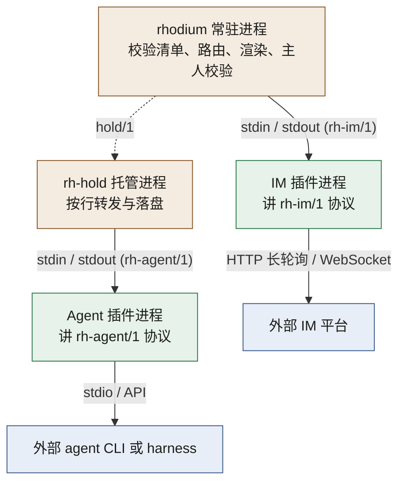

# 插件以独立进程运行，通过标准输入输出协议接入

这篇回答：Rhodium-OSS 的 agent 和 IM 插件是同进程加载 JS 还是独立进程走协议，核心从哪里找插件、信任哪些目录，如何应对权限、凭据、合规与故障隔离，以及和既有架构决定的关系。

前置阅读：[术语表](../../GLOSSARY.md)、[产品说明](../product.md)、[调研摘要](../research.md)、[ADR-0002](0002-one-daemon-plus-holders.md)、[ADR-0007](0007-satori-for-bot-apps.md)、[ADR-0008](0008-own-im-adapters.md)、[ADR-0009](0009-no-acp.md)、[ADR-0011](0011-codex-private-app-server.md)

状态：已采纳（2026-11-21）；2026-11-22 修订：改为扫描 `config.toml` 旁的 `plugins/` 目录，并加入一次性查询与建 Bot 向导两种短命插件进程

Rhodium-OSS 为扩展新的 agent 种类与新的 IM 平台提供[插件](../../GLOSSARY.md)机制。无论 agent 插件还是 IM 插件，都以独立操作系统进程运行，通过标准输入输出（stdio）上的按行 JSON [插件协议](../../GLOSSARY.md)与核心进程 `rhodium` 通信。

## 1. 决定

- **Agent 插件：独立进程，跑在现有的[托管进程](../../GLOSSARY.md) `rh-hold` 里，讲 `rh-agent/1`。**
  - 核心新增一个通用驱动 `PluginAgentDriver`，负责把内部操作和事件翻译成 `rh-agent/1` 的按行 JSON。
  - 现有的 Rust 托管进程 `rh-hold` 继续按字节转发和落盘，不解析插件协议，不需要为插件改动二进制。
  - 因此 agent 插件天然继承 `rhodium` 重启不断回合、输出重放、空闲回收、崩溃续跑、并发上限与跨平台托管。
- **IM 插件：独立进程，每个使用插件平台的 Bot 对应一个子进程，由 `rhodium` 直接拉起并看守，讲 `rh-im/1`。**
  - 核心新增一个通用适配器 `PluginImAdapter`，按能力表接进现有的发送队列、渲染降级和故障计数。
  - IM 插件只需要持有一个 Bot 的连接并翻译消息与能力，进程崩溃后由核心按指数退避自动拉起，连续失败触发熔断。
- **公开接口约定就是清单格式和两套 stdio 协议，与语言无关。**
  - 插件可以使用 TypeScript/Bun、Node.js、Python、Go、Rust 或任何能读写标准输入输出的语言编写，并各自独立管理依赖与打包。
  - 除了长驻的槽位进程和 Bot 进程，插件还可以以两种短命进程出现，同样独立进程、同样清洗环境：
    - agent 插件答一次性查询（列出本机对话、读出一段对话），答完就退出，不进 `rh-hold`；
    - IM 插件跑一次 `rh bot` 建 Bot 向导，报完步骤和要写的配置字段就退出。配置文件只由核心写，插件不碰。
  - 核心额外提供零内部依赖的 TypeScript 契约与运行时 SDK（`packages/plugin-sdk/`），暴露 `AgentPlugin` / `ImPlugin` 接口与 `runAgentPlugin` / `runImPlugin` 运行时辅助，统一封装按行 JSON 读写、握手、`ready`/`fatal`、重复 `answer` 去重、错误转报与退出清理，让 JS/TS 插件作者只需实现一个类即可接入独立进程架构。

## 2. 正面回应同进程插件的四项风险

如果改用主进程内动态 `import()` 加载外部 `.js`，开发启动快、几乎没有额外内存，但会直接踩中四个问题。本决定按如下方式正面应对：

- **故障隔离：一个插件卡死或崩掉，不能拖垮整个 `rhodium`。**
  - 同进程 JS 插件里的同步死循环、未捕获异常、栈溢出、内存耗尽或 `process.exit()` 会直接带走主事件循环，让所有内置 IM（QQ、Telegram、飞书）、网页看板和全部槽位一起停摆。
  - 这与 [ADR-0007](0007-satori-for-bot-apps.md) 拒绝把插件放进主进程、[ADR-0008](0008-own-im-adapters.md) 批评宿主与插件同进程被卡死的理由完全一致。
  - 改为独立进程后，一个 agent 插件崩掉或卡住，只触发这一个槽位的崩溃续跑或超时保护；一个 IM 插件崩掉，只影响使用该平台的这一个 Bot，内置通道和其余槽位照常工作。
- **内存与凭据隔离：插件不能接触其他 Bot 的令牌、数据库或运行时内部对象。**
  - 同进程插件与 `rhodium` 共享 JavaScript 堆和进程环境，能直接读到内存中所有 Bot 的配置和令牌、SQLite 数据库句柄以及路由内部状态。
  - 改为独立进程后，核心通过标准输入 `init` 消息把单个 IM Bot 的配置只发给该 Bot 对应的 IM 插件进程，绝不放进命令行参数（防同机 `ps` 窥探），也不把其他 Bot 凭据和配置路径交给任何插件。
  - Agent 插件进程收不到任何 IM Bot 凭据，只拿到和内置 agent 一样的普通槽位变量（`RHODIUM_SOCKET`、`RHODIUM_SLOT`、`RHODIUM_TOKEN`）；答一次性查询的进程连这些也没有。
  - 建 Bot 向导进程只拿到本插件的 `[plugins.<id>.config]`，拿不到任何已有 Bot 的配置。它报回的字段由核心检查（只收清单声明的键，不收 `owner`、`platform`、`target`），再由核心写进 `config.toml`；主人仍只经配对产生。
  - 插件图标由看板从插件目录读出，前端只用 `` 显示，从不内联 SVG，图标里的脚本不会在看板页面里跑。
- **信任边界、合规红线与防线范围。**
  - **信任模型：只信用户自己的两类目录**：
    - 核心扫描 `config.toml` 所在目录下的 `plugins/`，扫到的插件默认加载；`[plugins.<id>] enabled = false` 禁用一个；`[plugins.<id>].path` 从别处显式登记一个。
    - 这样做不扩大攻击面。Rhodium 是单用户、单机系统，`config.toml` 与它旁边的 `plugins/` 都在用户自己的目录里。能往这里写文件的人，本来就能以这个用户的身份跑代码：改用户的 shell 配置、systemd 用户单元，或者直接改 `config.toml` 登记插件。
    - 边界因此是：只扫 `plugins/` 这一层子目录，只信它和 `path` 显式指的目录；不扫家目录、`~/.config` 或系统全局目录，扫描时不跟随符号链接，免得一个链接把信任带到别处。
    - 扫描只读清单，不拉起进程；插件进程照旧到用到时才起。`rh doctor` 写明每个插件是扫描到的还是配置登记的，用户能看出加载了什么。
    - 放进 `plugins/` 或登记了的插件，都属于**用户信任的代码**。
  - **对插件同样生效的三条合规红线**（[产品说明](../product.md) §12）：
    1. **插件不得拉起 `claude` 或以任何形式包装 Claude Code**：包括通过改名插件（例如 `my-claude`）间接调用 `claude`、传递 `--bare` 或经由 ACP 适配层包装 Claude Code；内置 Claude 驱动继续运行用户自己的原版 `claude` 程序和登录，且实参不含 `--bare`；
    2. **插件与 `pi` 不得使用 Claude 订阅凭据**；
    3. **只有用户本人能触发 agent，插件也不例外**：陌生人的入站消息绝不触发 agent。
  - **IM 身份与核心边界**：平台账号的身份认证由各 IM 插件/适配器承担；配对流程、主人校验（`owners.includes(sender)`）、入站去重、附件按需拉取与投递决定统一留在 `rhodium` 核心执行。插件只负责原样透传平台发送者 ID，不持有路由入口与主循环引用，避免各插件自写或漏写主人检查。
  - **保留名称与环境清洗的真实作用范围**：
    - 保留内置名称（agent 含 `claude`、`pi`、`codex`、`herdr`；IM 含 `qq`、`telegram`、`feishu`、`fake`、`me`、`web`）只能防止插件覆盖内置驱动或占用已有程序配置键；
    - 核心在拉起插件前按平台剥离 `ANTHROPIC_*`、`CLAUDE*`、`HERDR_*` 与父会话跟踪变量（Windows 按大小写不敏感匹配）只能减少凭据误传；
    - 这两项机制都**不能**从操作系统层面阻止同用户进程自行启动外部程序或伪造上报字段。三条红线依赖“用户显式信任登记 + 源码审查 + 契约测试静态检查（拦截指向 `claude` 的启动命令）+ `rh doctor` 对运行中插件进程子树的巡检”共同守住。
- **操作系统层面的进程边界（诚实说明能防什么、不能防什么）。**
  - Rhodium 是单用户、单机系统（[产品说明](../product.md) §2），`rhodium` 与插件进程以同一系统用户身份运行。
  - 独立进程能防住：插件崩溃拖垮全局、事件循环阻塞、内存对象串台、环境变量里的凭据误传，以及接口层的越权访问。
  - 独立进程**不是**操作系统级的恶意代码沙箱：同一系统用户下的子进程在文件系统权限上仍可读写当前用户的家目录文件（例如 `~/.claude`）。引入容器或独立系统用户才能做强隔离，但那样会让用户本人的工具链、目录与登录不可用，与单机设计相悖。

## 3. 与既有架构决定的关系

- **延续 [ADR-0002](0002-one-daemon-plus-holders.md)**：托管进程 `rh-hold` 继续不解析任何协议，只按行转发和落盘；agent 插件复用这套现成的进程边界。
- **延续 [ADR-0007](0007-satori-for-bot-apps.md)**：延续“扩展独立进程、按连接隔离、由核心管重启与熔断”的原则；Bot 程序与插件的分工清晰：Bot 程序继续经 Satori 驱动已有 IM 平台上的传统账号，插件用来新增 IM 平台或 agent 种类。
- **延续 [ADR-0008](0008-own-im-adapters.md)**：QQ、Telegram、飞书三个主力 IM 继续作为核心内置原生适配器保留，不降级去走通用外包框架，也不改为外部插件。
- **局部补充 [ADR-0009](0009-no-acp.md) 与 [ADR-0011](0011-codex-private-app-server.md)**：Claude、Codex、pi 三家主力继续作为核心内置原生驱动保留；对于需要接入的新 agent（例如支持 ACP 或 stream-json 的外部 harness），不再要求修改核心源码，也不在核心里直接内置通用 ACP 驱动，而是以外部独立插件实现内部协议翻译，经 `rh-agent/1` 接入核心。

## 4. 考虑过的其他方案

- **方案 A：全部采用同进程动态 `import()` 加载外部 `.js`。**
  - 优点：少一次进程启动和 JSON 序列化，实现最快。
  - 放弃原因：无法满足故障隔离和内存凭据隔离，与 ADR-0007、ADR-0008 矛盾；同时 Rhodium 在发版时会使用 `bun build --compile` 编成单文件可执行程序，外部插件若带第三方 npm 依赖或原生模块，跨平台（尤其 Windows 盘符与路径规则下）在已编译二进制里做动态模块解析容易踩坑，还会把插件作者限制死在 Bun/JS 技术栈。
- **方案 B：混合方案（Agent 插件独立进程走 `rh-agent/1`，IM 插件同进程加载 JS）。**
  - 优点：省去 IM 侧约 300 行的 stdio JSON-RPC 桥接代码。
  - 放弃原因：IM 插件一旦卡死或抛出未处理异常，依然会拖垮主进程并中断所有内置 Bot；IM 插件在同进程内也能访问核心内存中的其他 Bot 凭据；同时两类插件形态不统一，增加文档和契约测试心智负担。
- **方案 C：直接在核心内置一个通用 ACP 驱动和一个 Satori 客户端适配器。**
  - 优点：接原生 ACP 的 agent 几乎不写代码。
  - 放弃原因：一方面，主力 IM 依赖的能力在 Satori 中缺失较多（[调研摘要](../research.md) §5）；另一方面，一旦核心内置 ACP 驱动，多个外部 ACP agent 的接入就退化为配置不同启动参数，扩展模块失去独立的协议适配职责；同时还有不少 CLI（如走 `stream-json` 的模式）并不只有 ACP 一条路。让插件自己消化外部协议并翻译成 `rh-agent/1`，边界最干净。
- **方案 D：只加载 `config.toml` 里显式登记的插件，不扫描任何目录（2026-11-21 的原决定）。**
  - 优点：加载什么一眼可见。
  - 放弃原因：每装一个插件都要多写一段配置，而 `plugins/` 和 `config.toml` 同在用户自己的目录里，信任程度相同，显式登记并没有多挡住谁。`rh doctor` 写明来源，同样看得出加载了什么。
- **方案 E：再扫家目录或全局目录（如 `~/.rhodium/plugins`、`/usr/share/...`）。**
  - 放弃原因：一台机器可能跑多个实例，全局目录会让一个实例加载另一个实例的插件；系统目录也不一定归这个用户管。只扫 `config.toml` 旁边的目录，每个实例各管各的。

## 5. 后果

- **资源占用**：每个活跃的插件对话多一个薄包装的插件进程（如果下游还拉起一个 CLI，则是 `rh-hold` + 插件包装进程 + 下游 CLI）；每个启用的插件 Bot 多一个常驻 IM 插件进程。对 Bun/Node/Python 薄包装，典型额外内存约 25–50MB，由核心现有的空闲回收和并发上限兜底。
- **跨平台一致性**：标准输入输出管道在 Linux、Windows、macOS 上都有一致的进程接口，插件只需要编译或运行自己目录内的可执行入口即可，不依赖宿主运行时的内部加载器。
- **子进程清理**：Linux 由托管进程的 systemd cgroup 兜底清理子树，Windows 由 `rh-hold` 的 Job Object 兜底清理；macOS 没有 cgroup，agent 插件在收到 `close` 或 stdin 关闭时必须负责终止其拉起的下游子进程。
- **核心工程量**：核心需要实现清单加载器、通用 `PluginAgentDriver`、通用 `PluginImAdapter` 与契约测试工具，并在核心内部多张按种类划分的查找表中对非内置种类给出默认降级。
