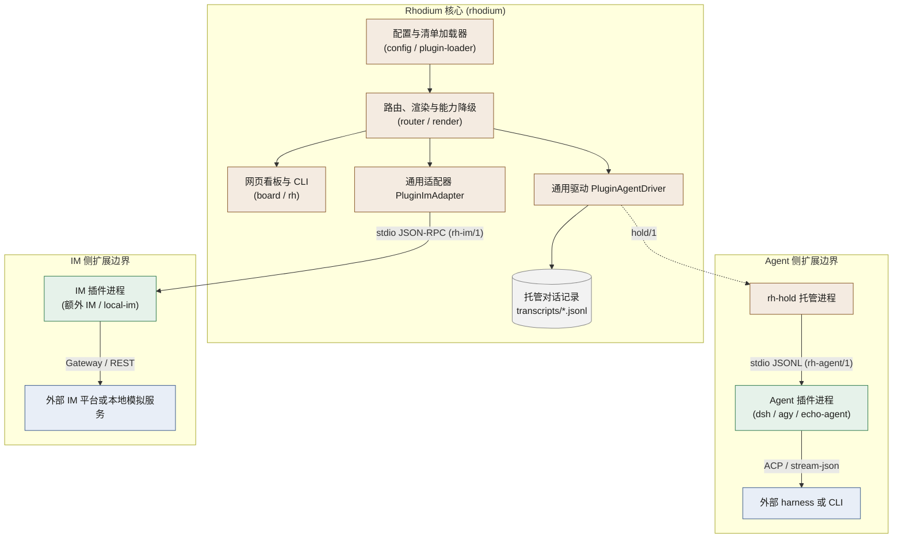
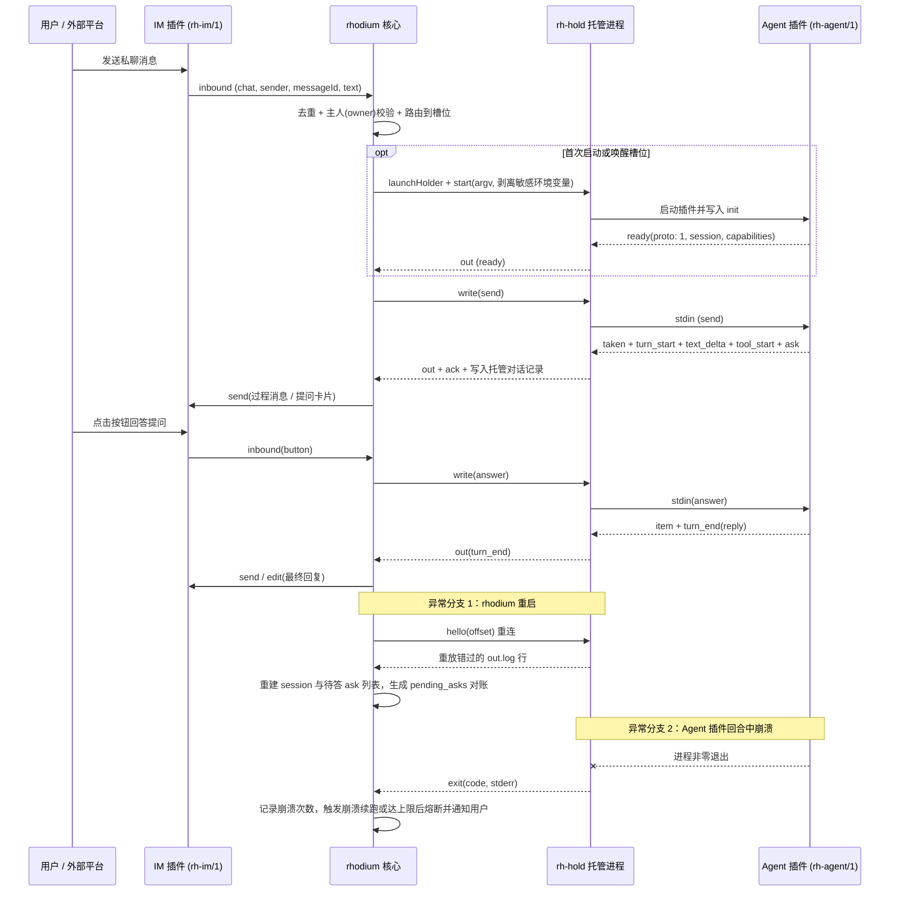
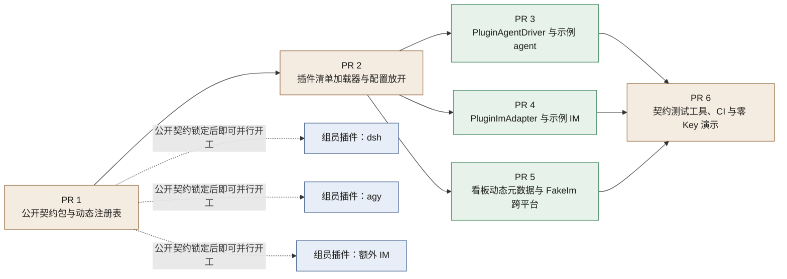

# 插件化规格

这篇回答：Rhodium-OSS 怎么把 agent 驱动和 IM 适配器做成插件体系、插件协议与加载失败行为怎么定、怎么支持跨平台和 CI、如何零 Key 演示、三个组员插件对核心有什么要求、实现怎么拆 PR，以及哪些决策待拍板。

前置阅读：[术语表](../../GLOSSARY.md)、[产品说明](../product.md)、[ADR-0002](../adr/0002-one-daemon-plus-holders.md)、[ADR-0007](../adr/0007-satori-for-bot-apps.md)、[ADR-0008](../adr/0008-own-im-adapters.md)、[ADR-0009](../adr/0009-no-acp.md)、[ADR-0011](../adr/0011-codex-private-app-server.md)、[ADR-0015](../adr/0015-out-of-process-plugins.md)、[架构](../architecture.md)、[IM 文字与交互规范](../im-style.md)、[v1 规格](v1.md)

## 1. 目标与范围

### 1.1 核心场景

单用户在个人电脑上，通过命令行 `rh`、网页看板或 IM 向 Rhodium 发送消息，由核心调度对应槽位调用内置或[插件](../../GLOSSARY.md)驱动完成回合，并将可核对的结果返回原入口；按配置接入独立构建的插件后，无需修改或重编核心源码即可新增 agent 种类或 IM 平台，插件被禁用或运行失败时系统按约定降级并给出明确反馈。

### 1.2 本期做什么

- **两类扩展点**：支持接入新的 agent 种类（经 `rh-agent/1` 协议）和新的 IM 平台（经 `rh-im/1` 协议），内置三家 agent（Claude、pi、Codex）与内置 IM（QQ、Telegram、飞书、fake）保持原生实现不变。
- **显式清单加载与失败隔离**：在 `config.toml` 中通过 `[plugins.<id>]` 登记插件目录，读取并校验 `plugin.json` [插件清单](../../GLOSSARY.md) 与版本要求；配置失败、清单损坏、运行崩溃均隔离在单个插件内。
- **核心内部表开放化**：放开 `AgentKind` 与 `Platform` 联合类型限制，为非内置种类在对话记录、终端切换、设置带回、看板图标等查找表提供安全默认值。
- **公开契约包与契约测试器**：提供零内部依赖的 TypeScript 契约包与语言无关的黑盒[契约测试](../../GLOSSARY.md)脚本，随仓库附带两个最小示例插件（`echo-agent` 与 `local-im`）。
- **跨平台支持、自动化 CI 与零 Key 演示**：确保 Linux、Windows、macOS 可用；补全 GitHub Actions 构建与测试流程；提供不依赖任何真实 API Key 和真实 IM 账号的完整可重复演示路径。

### 1.3 本期明确不做什么

- 不做插件市场、远程在线下载、热加载或运行时免重启动态插拔插件代码（启用、禁用或升级插件需要重启 `rhodium`）。
- 不做插件 agent 的 Herdr TUI 模式切换与网页终端嵌入（插件槽位的 `tui` 能力为 `false`）。
- 不做插件 agent 的外部磁盘历史扫描和 Herdr pane 导入（`rh import` 与自动扫描仅对内置三家生效）。
- 不做插件 IM 的交互式扫码建 Bot 向导（`rh bot` 创建向导保持内置三家，插件 IM Bot 在 `config.toml` 中填写 `[bots.<name>]` 后配合 `rh pair` 配对主人）。
- 不做插件 IM 的 QQ 专属被动回复窗口与额度重投模型（仅保留内置 `qq` 自己用 `qq_quota`）。
- 不做跨插件版本热兼容或操作系统级容器沙箱。

---

## 2. 总体架构与关键流程

### 2.1 总体架构

核心与插件之间采用全独立进程架构（选择依据见 [ADR-0015](../adr/0015-out-of-process-plugins.md)）。核心把插件当作黑盒协议对端，插件只能通过[插件协议](../../GLOSSARY.md)与核心交互，不能导入 `src/` 内部任何代码。



### 2.2 关键业务流程与故障分支

下图展示一条消息经 IM 插件进入核心、送入跑在托管进程中的 Agent 插件、完成工具调用与提问、再返回 IM 的完整链路，以及重启重放与崩溃续跑两条关键恢复分支：



---

## 3. 插件 API 与协议契约

### 3.1 核心替插件做什么、不支持什么

| 能力领域 | 核心统一承担（插件无需自写） | 插件自己实现 | 不支持或降级说明 |
|---|---|---|---|
| 进程与重启托管 | `rh-hold` 保活、`out.log` 落盘与重启重放、`taken`/`written` 投递状态跟踪、`pending_asks` 重建对账 | 按行消费 stdin、按行写 stdout | 不要求插件实现日志重放或连接恢复服务端 |
| 槽位生命周期 | 空闲回收（`idleReap`）、崩溃自动续跑、连续崩溃熔断、并发上限（`maxRunning`）、定时任务 | 在 `close` 时正常清理下游进程并退出 | — |
| 对话记录与展示 | 写入[托管对话记录](../../GLOSSARY.md)，驱动网页对话页、`rh read`、槽位时间线 `/resume` | 通过 `turn_start` / `item` / `tool_start` / `turn_end` 报出标准事件 | 不支持 `rh import` 扫盘导入；不接管已有外部进程 |
| 合规与安全 | 保留内置名称、剥离 `ANTHROPIC_*` 等凭据环境变量、IM 主人校验、配对流程、来源行与系统提示拼装 | IM 插件原样透传发送者 ID；Agent 插件读取 `init.systemPromptFile` | 不允许任何非 `claude` 插件获取 Claude 订阅凭据 |
| 路由与渲染降级 | 消息排队、分段截断、Markdown 降级纯文本、工具折叠、`/rh_*` 命令、按钮分页、发送限流与超时记 `unknown` | 如实声明 `Capabilities`（agent 能力或 IM 平台能力） | 插件 IM 不支持 `qq_quota`、不支持 `rh bot` 扫码建 Bot |
| 终端与专属特性 | 统一拒绝提示（切 TUI、`/ultracode` 等） | — | 不支持切 Herdr TUI；不支持 Claude 订阅额度窗口自动续跑 |

### 3.2 Agent 插件协议：`rh-agent/1`

Agent 插件由 `rh-hold` 直接作为子进程拉起。进程内通过 stdin（核心写入）与 stdout（插件写入）交换 UTF-8 编码、换行符 `\n`（核心解析时兼容 `\r\n`）分隔的 JSON 对象，单行上限 64MB。插件的诊断日志必须写到 `stderr`（由 `rh-hold` 记入 `err.log`），严禁向 `stdout` 输出非 JSON 调试文本。

#### 核心发给插件的消息（stdin）

| 消息 `type` | 说明 | 关键字段 |
|---|---|---|
| `init` | 启动后发出的第一条消息，用于握手与传参 | `proto: 1`、`conv`、`session: { new: string } \| { resume: string }`、`cwd`、`systemPromptFile`、`approval: boolean`、`model?: string \| null`、`effort?: string \| null`、`resumed?: boolean`、`config: Record<string, string>` |
| `send` | 发送一条用户或内部消息开始或加入回合 | `id`、`text`、`human: boolean`、`mode: "turn" \| "steer"`、`images?: { mimeType: string; data: string }[]` |
| `interrupt` | 中断当前正在进行的回合（对应 `/stop` 或 `!`） | 无额外字段；插件中断后仍需正常发出本回合的 `turn_end` |
| `answer` | 把用户的回答或审批决定交给插件 | `requestId`、`answer`（与核心 `AskAnswer` 同构：`permission` / `question` / `plan`） |
| `approval` | 在进程运行中切换审批模式（仅当 `capabilities.liveApproval` 为真时调用） | `on: boolean` |
| `command` | 执行插件声明支持的通用命令（例如 `model`、`effort`、`compact`、`usage`、`context`、`status`） | `id`、`name`、`args: string` |
| `close` | 通知插件优雅关闭下游进程并退出 | 无额外字段；若 `durations.stopGrace` 内未退出，核心依次发 `TERM`、`KILL` |

#### 插件发给核心的消息（stdout）

| 消息 `type` | 说明 | 关键字段 |
|---|---|---|
| `ready` | 握手完成通知，收到后核心才写入排队的 `send` | `proto: 1`、`session: string \| null`、`selfStarted?: boolean`、`capabilities?: { liveApproval?: boolean; steer?: boolean; commands?: string[]; models?: { id: string; label?: string; efforts?: string[] }[] }`、`version?: string` |
| `fatal` | 启动或握手阶段无法继续（如找不到下游 CLI 或配置错误） | `message: string`、`retryable?: boolean`（为 `false` 时核心直接报出原因，不做无意义的反复重启） |
| `taken` | 确认插件已将 `id` 对应的 `send` 写进下游对话（崩溃时不再重发提示） | `inputId: string` |
| `turn_start` | 一个新回合开始；若 `ready.session` 为 `null`，可在首回合补报 `session` | `input?: string`、`session?: string` |
| `text_delta` | 助手回答的流式正文增量 | `text: string` |
| `tool_start` | 发起工具调用（结果尚未返回，可能随后触发 `ask`） | `id: string`、`name: string`、`input: unknown` |
| `item` | 一条完整助手消息或一次工具调用完成 | `item: { kind: "message"; text: string } \| { kind: "tool"; id?: string; name: string; input: unknown; result?: { text: string; error?: boolean } }` |
| `ask` | 向用户提问或请求工具审批 | `requestId: string`、`kind: "question" \| "plan" \| "permission"`、`tool: string`、`input: unknown`、`toolUse?: string` |
| `ask_cancel` | 下游撤回一个尚未回答的提问 | `requestId: string` |
| `turn_end` | 回合结束并空闲，触发最终回复推送与后续排队消息投递 | `reply?: string`、`background?: boolean` |
| `usage` | 上报上下文窗口或单轮 token 用量 | `inputTokens?: number`、`outputTokens?: number`、`contextTokens?: number`、`maxContextTokens?: number` |
| `command_result` | 对应 `command` 请求的结构化结果 | `id: string`、`ok: boolean`、`result?: CommandResult`、`error?: string` |
| `error` | 运行期非致命协议或下游错误提示 | `detail: string`、`recoverable?: boolean` |

#### 输入输出示例（`rh-agent/1`）

```json
{"type":"init","proto":1,"conv":"01JXYZ0001","session":{"new":"conv-uuid-1"},"cwd":"/tmp/demo","systemPromptFile":"/tmp/state/prompt/slot1.md","approval":false,"model":null,"effort":null,"resumed":false,"config":{"mockFixture":"/tmp/dsh-sample.jsonl"}}
{"type":"ready","proto":1,"session":"conv-uuid-1","capabilities":{"liveApproval":false,"steer":false,"commands":["model","status","context"]}}
{"type":"send","id":"in-001","text":"[来自 网页]\n列出当前目录","human":true,"mode":"turn"}
{"type":"taken","inputId":"in-001"}
{"type":"turn_start","input":"in-001"}
{"type":"tool_start","id":"tc-1","name":"list_dir","input":{"path":"."}}
{"type":"item","item":{"kind":"tool","id":"tc-1","name":"list_dir","input":{"path":"."},"result":{"text":"README.md\nsrc/"}}}
{"type":"text_delta","text":"当前目录包含 README.md 和 src/。"}
{"type":"item","item":{"kind":"message","text":"当前目录包含 README.md 和 src/"}}
{"type":"turn_end","reply":"当前目录包含 README.md 和 src/。"}
```

#### 关键运行语义

- **`steer: false` 降级**：如果插件在 `ready.capabilities.steer` 声明不支持插话（或省略该字段），路由在当前回合未结束时把新消息先留在队列里（不标失败），待 `turn_end` 到达后再以 `mode: "turn"` 写入；以 `!` 开头打断时，核心先发 `interrupt`，待旧回合 `turn_end` 到来后再发新消息。
- **通用命令子集与自动拒绝**：只有列入 `ready.capabilities.commands`（且交集于插件清单静态声明）的通用命令才会转发 `command` 到插件。`new` 与 `resume` 始终由核心自己处理；`stop` 固定映射为 `interrupt`；未声明支持的命令（例如 `/ultracode`、`/compact`）由核心直接向用户返回“该 agent 不支持此命令”，不惊动插件进程。
- **动态会话 ID 与重启重建**：部分 agent 只有在首回合启动后才会给出自己的会话 ID，此时插件可以在 `ready` 里传 `session: null`，再在第一次 `turn_start` 携带 `session` 字符串，核心即落库记录。`rhodium` 重启连接旧 `rh-hold` 时，`PluginAgentDriver` 在重放 `out.log` 过程中重新收集尚未配对的 `ask` 列表，并在重放完成时统一向主循环发出 `pending_asks`，插件侧无需任何重放或状态恢复代码。
- **核心托管对话记录**：由于插件的底层格式各异甚至不可读（例如加密或私有数据库），核心在每收到用户 `taken`、`item`、`turn_end` 时，同步将标准化条目追加到 `<stateDir>/transcripts/<agentKind>/<convId>.jsonl`，格式复用内置的对话块结构，因此看板对话页、折叠工具行、`rh read` 和 `/resume` 列表对所有插件 agent 开箱即用。

---

### 3.3 IM 插件协议：`rh-im/1`

IM 插件由 `rhodium` 在主守护进程中按“每个已启用的插件 Bot 一个进程”的方式直接拉起。双方经 stdin/stdout 交换单行 JSON-RPC 2.0 风格消息（请求带 `id`，通知不带 `id`），单行上限 64MB，插件日志写到 `stderr`。

#### 核心向插件发起的请求（核心 -> 插件）

| 方法 `method` | 必填性 | 说明 | 主要参数与返回值 |
|---|---|---|---|
| `init` | 必选 | 进程启动后的首次握手，核心校验平台能力表 | 参数：`{ proto: 1, botId, botName, config }`；返回：`{ proto: 1, capabilities: Capabilities }` |
| `send` | 必选 | 发送一条文本、Markdown、按钮或文件消息 | 参数：`{ chat, message: OutboundMessageWire }`（其中本地文件已打包为 `path` 与 `name`，由插件读取上传）；返回：`SendResult` |
| `edit` | 按能力 | 编辑已发出的消息（仅当 `capabilities.progress === "edit"` 或 `stream` 时调用） | 参数：`{ chat, messageId, message }`；返回：`SendResult` |
| `drop_buttons` | 按能力 | 撤掉已发消息上的按钮（仅当 `capabilities.buttons` 为真时调用） | 参数：`{ chat, messageId }`；返回：`SendResult` |
| `answer_press` | 按能力 | 应答一次按钮回调（仅当 `capabilities.buttons` 为真时调用） | 参数：`{ chat, press, text }`；返回：`{ ok: true }` |
| `fetch_attachment` | 按需 | 在核心确认发送者为主人后，拉取入站附件内容到指定临时目录 | 参数：`{ attachmentId, destPath }`；返回：`{ ok: true, size, mimeType? }` |
| `set_menu` | 按能力 | 同步斜杠命令菜单（仅当 `capabilities.menu.maxItems > 0` 时调用） | 参数：`{ items: MenuItem[], chat?: string }`；返回：`{ ok: true }` |
| `set_row` | 按能力 | 同步底部按钮行（仅当 `capabilities.menu.row` 有值时调用） | 参数：`{ row: RowButton[], chat?: string }`；返回：`{ ok: true }` |
| `profile` | 可选 | 获取 Bot 头像与主人昵称/头像（失败或未实现均可返回空对象） | 参数：`{ you: string \| null }`；返回：`{ botBase64?, youBase64?, name? }` |
| `shutdown` | 必选 | 核心退出或移除 Bot 时通知插件优雅断开平台连接并退出 | 参数：`{}`；返回：`{ ok: true }` |

#### 插件发给核心的通知与请求（插件 -> 核心）

| 名称 | 类型 | 说明 | 主要载荷 |
|---|---|---|---|
| `connected` | 通知 | 汇报连接建立或断线状态（用于看板状态点与故障统计） | `{ up: boolean, error?: string }` |
| `inbound` | 通知 | 上报一条外部平台收到的消息或按钮按下事件 | `{ chat, messageId, sender, text, at, quote?, ref?, button?, voice?, attachments?: { id, kind, name?, mimeType? }[] }` |
| `kept_get` | 请求 | 读取核心为本 Bot 持久化保存的断点或游标键值 | 参数：`{ key: string }`；返回：`{ value: string \| null }` |
| `kept_set` | 请求 | 写入或删除本 Bot 的持久化键值（核心自动加 `plugin:<botId>:` 前缀隔离） | 参数：`{ key: string, value: string \| null }`；返回：`{ ok: true }` |

#### 输入输出示例（`rh-im/1`）

```json
{"jsonrpc":"2.0","id":1,"method":"init","params":{"proto":1,"botId":"bot_01","botName":"my-discord","config":{"token":"redacted-at-runtime","guildPolicy":"dm-only"}}}
{"jsonrpc":"2.0","id":1,"result":{"proto":1,"capabilities":{"progress":"edit","editEvery":1000,"finalEdit":true,"buttons":true,"maxButtons":25,"sendLimit":{"kind":"rate","perChatPerSecond":2},"menu":{"scope":"global","maxItems":50},"maxTextLength":2000,"maxFileBytes":{"image":10485760,"file":26214400},"markdown":{"extensions":[]}}}}
{"jsonrpc":"2.0","method":"connected","params":{"up":true}}
{"jsonrpc":"2.0","method":"inbound","params":{"chat":"dm-user-1","messageId":"msg-900","sender":"user-1","text":"你好","at":1763690000000}}
{"jsonrpc":"2.0","id":2,"method":"send","params":{"chat":"dm-user-1","message":{"text":"收到，已交给槽位处理。"}}}
{"jsonrpc":"2.0","id":2,"result":{"status":"sent","messageId":"msg-901"}}
```

#### 安全与可靠性约定

- **单 Bot 凭据隔离**：`init.params.config` 只包含这个 `[bots.<name>]` 表和对应 `[plugins.<id>.config]` 的非内部字段（剔除 `platform`、`target`、`owner`），不经命令行参数传递，也不写入日志。
- **主人验证与懒下载**：IM 插件不在本地做主人白名单判断，也不自主触发路由。`inbound` 通知里如果带有文件或图片，只能先给核心一个不透明 `attachmentId`；核心验证 `sender` 确实属于该 Bot 的 `owners`（或配对码流程合法）后，才反向调用 `fetch_attachment` 落盘，防止陌生人恶意投递大文件耗尽磁盘或流量。
- **消息去重与发送兜底**：核心保留统一的 `seen(chat, messageId)` 检查，避免插件断线重连后重复提交同一条入站消息。`send` / `edit` RPC 超过 `durations.pluginRpc`（默认 `30s`）无响应时，核心按“结局不明（`unknown`）”落库，绝不自动重发。
- **进程看守与熔断**：IM 插件进程在运行中意外退出时，核心按 `1s`、`2s`、`4s`、`8s`、`16s`、`30s` 指数退避重启；若连续未发出 `connected(up: true)` 即退出或持续报错达 `limits.botFailures`（默认 5 次），核心停止重启，将该 Bot 标为 `faulted` 并在主窗口和看板发出告警。

---

### 3.4 公开契约包：`packages/plugin-sdk/`

为让 TypeScript/JavaScript 插件作者获得强类型提示、同时绝对不依赖核心内部实现（满足课程“不依赖核心内部代码”的硬要求），核心仓库抽取独立子包 `packages/plugin-sdk/`（零运行期第三方依赖，不从 `src/` 导入任何文件）：

- `manifest.ts`：`PluginManifest` 类型定义与 `validateManifest(json)` 纯函数校验器。
- `agent.ts`：`rh-agent/1` 的消息联合类型（`CoreToAgentMessage`、`AgentToCoreMessage`）与行级 JSONL 读写帮助函数。
- `im.ts`：`rh-im/1` 的 JSON-RPC 方法与能力表类型（复用与核心同源对齐的 `Capabilities`、`SendResult`、`OutboundMessage` 等纯契约结构）。
- 非 JS/TS 插件（例如 Python、Go、Rust 编写的插件）不需要引用该包，直接按 3.2 与 3.3 的 JSON 行协议实现即可。

---

## 4. 加载、配置、版本校验与失败行为

### 4.1 插件目录与清单文件 `plugin.json`

核心不自动扫描 `$HOME` 或全局目录来“猜测加载”未知代码。每个插件以目录形式放在用户可控的本地位置（例如仓库内开发的 `plugins/<id>/` 或安装目录），目录根下必须有一个 `plugin.json` 清单文件：

```json
{
  "manifestVersion": 1,
  "kind": "agent",
  "id": "dsh",
  "name": "DeepSeek Harness",
  "statusName": "DeepSeek Harness",
  "version": "0.1.0",
  "protocol": "rh-agent/1",
  "minRhodium": "1.5.0",
  "program": "dsh",
  "command": ["bun", "run", "dist/index.js"],
  "commandByPlatform": {
    "win32": ["bun.exe", "run", "dist/index.js"]
  },
  "capabilities": {
    "liveApproval": false,
    "steer": false,
    "commands": ["model", "status", "context"]
  },
  "requiredConfig": [],
  "optionalConfig": ["fixture"]
}
```

清单字段约束：

| 字段 | 适用种类 | 说明与校验规则 |
|---|---|---|
| `manifestVersion` | 通用 | 固定整数 `1` |
| `kind` | 通用 | 只能是 `"agent"` 或 `"im"` |
| `id` | 通用 | 匹配 `^[a-z][a-z0-9_-]{0,31}$`，且不能与保留内置名冲突 |
| `name` | 通用 | 展示名称（非空字符串，例如 `"Discord"`、`"Antigravity"`） |
| `statusName` / `label` | 各自 | agent 清单用 `statusName`（`/status` 显示名）；IM 清单用 `label`（来源行与看板平台名） |
| `version` | 通用 | SemVer 版本号（`x.y.z`） |
| `protocol` | 通用 | agent 必须为 `"rh-agent/1"`，IM 必须为 `"rh-im/1"` |
| `minRhodium` | 通用 | 最低核心版本号（SemVer）；核心版本低于该值则拒绝加载 |
| `command` / `commandByPlatform` | 通用 | 启动入口数组（至少 1 项）；其中相对路径按清单所在目录解析；按 `process.platform` 优先取 `commandByPlatform` |
| `program` | 仅 `agent` | 默认下游可执行程序名，可被 `config.toml` 的 `[programs]` 覆盖 |
| `capabilities` | 通用 | 静态能力声明：agent 声明支持的命令和 `liveApproval`；IM 声明默认 `Capabilities` 供 `config` 检查，运行期以握手回传为准 |
| `requiredConfig` / `optionalConfig` | 通用 | 声明插件期望在 `[plugins.<id>.config]` 或 `[bots.<name>]` 中提供的键名列表；核心用于启动前拼写检查与脱敏提示 |

保留内置名称清单（禁止插件覆盖）：
- **Agent 保留名**：`claude`、`pi`、`codex`
- **IM 保留名**：`qq`、`telegram`、`feishu`、`fake`、`me`、`web`

### 4.2 配置文件 `config.toml`

在 `config.toml` 中显式登记要加载的插件：

```toml
[durations]
pluginHandshake = "10s"
pluginRpc = "30s"

[programs]
dsh = "dsh"
agy = "agy"

[plugins.dsh]
path = "./plugins/dsh"
enabled = true

[plugins.dsh.config]
# 仅示范可选静态配置，严禁在文档或测试样例中填写真实密钥
fixture = "./fixtures/dsh-acp.jsonl"

[plugins.discord]
path = "./plugins/discord"
enabled = true

[bots.my-discord]
platform = "discord"
token = "ENV_OR_0600_LOCAL_SECRET"
owner = "1234567890"
target = "work/main"
```

规则说明：
- `path` 支持绝对路径或相对 `config.toml` 所在目录的路径（是否允许相对路径在 §11 作为待拍板项确认）。
- `enabled` 默认为 `true`；设为 `false` 时核心不加载该插件，视为显式禁用。
- IM 插件 Bot 所需的密钥放在 `0600`（Windows 为本人私有 ACL）保护的 `config.toml` `[bots.<name>]` 表中，沿用既有安全模型。
- 每次启用、禁用、修改清单或修改插件配置均需重启 `rhodium` 生效（与 `config.toml` 其他配置修改约定一致）。

### 4.3 两阶段版本与契约校验

1. **阶段 1（启动期静态校验）**：`rhodium` 读取 `config.toml` 后，对每条启用的 `[plugins.<id>]` 读取 `<path>/plugin.json`。校验 JSON 合法性、`manifestVersion === 1`、`kind`、`id` 与配置键名一致、非保留名、非重复 ID、`protocol` 匹配、`minRhodium <= 当前核心版本`、启动命令文件可定位，以及 `requiredConfig` 项是否齐全。
2. **阶段 2（运行期握手校验）**：拉起插件进程后，核心在 `durations.pluginHandshake`（默认 `10s`）内等待 `ready`（agent）或 `init` 结果（IM），强制校验返回 `proto === 1`；对于 IM 插件，还必须用结构检查函数核验其 `capabilities`（如 `progress`、`sendLimit`、`maxTextLength`、`maxFileBytes` 等必选字段类型合法，防止残缺能力表让渲染器崩溃）。
3. **演进兼容策略**：在 `/1` 协议家族内只允许新增可选字段，通信双方必须忽略不认识的字段；不兼容的破坏性变更升级到 `rh-agent/2` 或 `rh-im/2`，当前版本不要求同时运行多代协议。

### 4.4 禁用与失败行为矩阵

所有禁用与故障均不得导致 `rhodium` 进程崩溃、不得影响内置驱动与内置 IM 工作，且表现必须与以下文档一致：

| 场景 | 触发条件 | 核心行为与日志 | 对用户与槽位/Bot 的外显表现 |
|---|---|---|---|
| 显式禁用 | `[plugins.<id>]` 设 `enabled = false` | 不读取入口、不注册到可用列表、不启动进程；记 `info` 日志 `plugin disabled` | `rh doctor` 标注 `已禁用`；对应新建槽位拒绝并提示“插件 `<id>` 已禁用”；若旧槽位历史对话用了该插件，发消息时提示“插件 `<id>` 已禁用，请启用或切换对话”；若 `[bots.<name>]` 引用它，跳过连接并标出原因 |
| 清单或静态校验失败 | 路径不存在、`plugin.json` 缺失或损坏、字段非法、保留名冲突、`minRhodium` 不满足、缺 `requiredConfig` | 隔离该插件，核心继续正常启动；`pluginRegistry` 记录状态 `failed` 与脱敏错误；记 `error` 日志 `plugin load failed` | 看板顶部与 `rh doctor` 列出该插件及具体原因；向依赖它的槽位或 `rh new --agent <id>` 返回明确中文错误“插件 `<id>` 加载失败：<具体原因>” |
| Agent 插件握手超时 / `fatal` / 坏输出 | 超出 `pluginHandshake` 未回 `ready`、`ready.proto !== 1`、收到 `fatal` 或非法 JSON 行 | 终止该子进程（`TERM`->`KILL`）；`retryable: false` 时直接落为未运行并停止无意义续跑；非法 JSON 行触发 `protocol_error` 并按协议异常上报 | 槽位回到 `off`/`crashed`，向联系窗口与看板事件发送脱敏故障通知（附 `err.log` 末行） |
| Agent 插件回合中崩溃或卡死 | 进程意外非零退出，或关闭阶段超时 | 经托管进程写出 `exit`；走核心现有崩溃续跑逻辑，10 分钟内连续崩溃 3 次触发熔断；关闭超时则 `TERM` 后 `KILL` | 触发续跑时发状态提示；达熔断上限后停在未运行状态并告知用户需手动恢复 |
| IM 插件握手失败 / 能力表非法 | 找不到命令、`init` 超时、能力表校验不通过 | 中止启动该 Bot 的适配器，不计入在线适配器，核心其余 Bot 与看板正常服务；记 `error` 日志 `plugin im init failed` | 该 Bot 状态标为 `faulted`（故障），在看板拓扑图/列表亮故障点，并在主窗口（若有）发出通知 |
| IM 插件运行期崩溃或 RPC 超时 | 运行中退出，或 `send`/`edit` 超过 `pluginRpc`（30s）未响应 | 运行崩溃按退避重连，连续失败达 `limits.botFailures`（5 次）熔断标 `faulted`；单次 RPC 超时将出站记录标记为 `unknown`，绝不重发 | 看板显示重连中或故障，主窗口收一条故障通知；`rh send` 回执写明“不知道发出去没有” |

---

## 5. 核心内部改造清单

基于对 Rhodium-OSS 现有源码的完整扫描，需要将内部对 `AgentKind` 和 `Platform` 的静态封闭假设打开为“内置固定种类 + 运行时已加载插件”的双层结构：

| 序号 | 核心文件 | 现状问题 | 改造内容与非内置默认值 |
|---|---|---|---|
| 1 | `src/contracts.ts` | `AgentKind = "claude" \| "pi" \| "codex"` 与 `Platform = "qq" \| "telegram" \| "feishu" \| "fake"` 为闭集联合 | 拆分为 `BuiltinAgentKind` / `AgentKind = BuiltinAgentKind \| (string & {})` 与 `BuiltinPlatform` / `Platform = BuiltinPlatform \| (string & {})`；既不丢内置三家的编译期静态检查，又允许任意已注册插件 ID |
| 2 | `src/agents.ts` | 静态导出 `AGENTS`、`AGENT_KINDS`、`TYPING`、`headlessEnv()`、`terminalUnset()` | 增加 `builtin`、`tui`、`importable`、`steer`、`supportedCommands` 属性；保留内置定义不变，提供运行时插件注册函数 `registerAgentPlugin()` 与动态查询函数 `agentDef(kind)`；非内置插件默认 `claudeKeys: false`、`tui: false`、`importable: false`，确保 `headlessEnv` 自动剥离全部 Anthropic/Claude/Herdr 凭据 |
| 3 | `src/platforms.ts` | 静态导出 `PLATFORMS`、`MADE`（依赖 `Exclude<Platform, "fake">`） | 保留 `BUILTIN_PLATFORMS` 与 `MADE` 仅包含 `qq`、`telegram`、`feishu`（供 `rh bot` 向导使用）；提供 `registerPlatformPlugin()` 与 `platformDef(p)`，动态提供 `label` 与 `capabilities()` |
| 4 | `src/config.ts` | `loadConfig` 在加载阶段硬校验 `programs` 键名与 `[bots.<name>].platform`，拒绝未知平台 | 新增 `[plugins.<id>]` 表结构与 `durations.pluginHandshake`、`durations.pluginRpc` 解析；先校验保留键与结构，再对照内置表与已解析插件清单校验 `[programs]` 和 `[bots.<name>].platform` |
| 5 | `src/plugin-loader.ts`（新增） | 无清单加载与隔离机制 | 启动时按 `config.plugins` 读取并校验 `plugin.json`，输出成功注册项与隔离失败表（含禁用、校验错误与版本不兼容状态），绝不抛出未捕获异常中断主进程 |
| 6 | `src/plugin-agent.ts`（新增）与 `src/runner.ts` | `runner.ts` 中 `DRIVERS` 只映射内置三家，`deliver()`、`attach()`、`resumable()` 依赖静态表 | 新增实现 `AgentDriver` 的 `PluginAgentDriver`，把 `rh-agent/1` 翻译为标准 `AgentEvent` 并在输出事件时写入托管对话记录；`runner.ts` 对插件种类实例化该驱动，对禁用或加载失败的插件返回明确错误退出事件 |
| 7 | `src/plugin-im.ts`（新增）与 `src/daemon.ts` | `daemon.ts` 中 `ADAPTERS` 只映射四家，直接调用 `ADAPTERS[bot.platform]` | 新增实现 `ImAdapter` 的 `PluginImAdapter`，管理单个 IM 插件子进程、JSON-RPC 调用、超时和退避熔断；`daemon.ts` 启动时跳过禁用或故障的插件 Bot 并标为 `faulted` |
| 8 | `src/transcript.ts` | `FORMATS` 仅含内置三家，`listConversations` 只扫内置目录 | 内置三家保持原样；新增通用格式读写 `<stateDir>/transcripts/<agentKind>/<convId>.jsonl`，供插件对话的读取、看板预览和 `/resume` 列表使用；目录导入扫描跳过插件种类 |
| 9 | `src/tui.ts` 与 `src/windows-tui-launch.ts` | `TERMINAL`、`RULES`、`packages` 为 `Record<AgentKind, ...>` | 改为 `Partial<Record<BuiltinAgentKind, ...>>`；在切换到终端入口先检查 `agentDef(kind).tui`，为 `false` 时友好拒绝（“该 agent 插件不支持终端模式”） |
| 10 | `src/router.ts`、`src/commands.ts`、`src/im-commands.ts`、`src/feishu.ts` | `CARRY` 为 `Record<AgentKind, ...>`、`slashMenu` 与 `/rh_agent` 依赖静态 `AGENT_KINDS`、`router.ts` 假设 `ONBOARD` 涵盖所有非 fake 平台 | `CARRY` 窄化为 `BuiltinAgentKind`；通用命令检查插件 `supportedCommands` 并在不支持时友好拒绝；`steer: false` 时排队等待回合结束；`/rh_agent` 与 `rh new --agent` 改读动态注册列表 |
| 11 | `src/board.ts`、`web/src/*` 与 `src/doctor.ts` | `board.ts` 用静态 `THROUGH` 正则匹配来源行、用 `AGENT_KINDS` 查记录；前端 `common.tsx`/`faces.tsx`/`tools.tsx`/`create.tsx`/`palette.tsx`/`card.tsx`/`write.tsx` 持有 `Record<AgentKind, ...>` 或静态下拉列表 | `board.ts` 的 `THROUGH` 动态包含插件平台 `label`，并在 `/api/board` 与 `/api/slot` 返回 `meta.agents`、`meta.platforms` 与 `plugins` 健康状态；前端取消写死联合，对非内置 agent 渲染通用芯片/首字母徽章和通用工具图标，隐藏插件的 TUI 切换和导入入口；`rh doctor` 输出每个已配置插件的加载与连接状态 |

---

## 6. 跨平台支持（Linux、Windows、macOS）

Rhodium 1.5.0 已在仓库中具备 Windows 原生托管进程（`holder/src/windows.rs` 命名管道、Job Object、NTFS ACL 检查、`scripts/windows-build.ps1`）与 macOS 原生托管进程（`live.lock` 探针、`scripts/macos-package.sh`）。插件体系直接复用并补齐三平台一致性：

| 平台要点 | Linux | Windows | macOS |
|---|---|---|---|
| 启动命令解析 | 读 `commandByPlatform.linux` 或 `command`，相对路径基于清单目录 `path.resolve` | 读 `commandByPlatform.win32` 或 `command`；显式传递 `windowsHide: true` 防止弹黑框；支持 `.exe`、`.cmd`（经内置命令解析）与 `bun run` 入口 | 读 `commandByPlatform.darwin` 或 `command` |
| 进程托管与管道 | `rh-hold` 通过 systemd 用户服务托管，stdin/stdout 管道直连插件 | `rh-hold.exe` 独立拉起并用 Job Object 管理插件及其子进程树；通过命名管道向控制面汇报 | `rh-hold` 独立拉起，通过 `live.lock` 与 `probe` 核验存活 |
| 环境变量过滤 | 精确键名匹配剔除 `ANTHROPIC_*`、`CLAUDE*` 等变量 | 键名**大小写不敏感**匹配剔除（Windows 环境块大小写不敏感）；保留 `SystemRoot`、`COMSPEC`、`APPDATA`、`LOCALAPPDATA`、`PATHEXT` 等系统必需变量 | 同 Linux |
| 编码与行尾 | 固定 UTF-8、`\n` | 协议解析按 `trimEnd()` 兼容 `\r\n`；核心给子进程注入 `PYTHONUTF8=1`（防止 Windows 默认 GBK 损坏中文 JSON） | 同 Linux |
| 退出时子树清理 | 依靠 `KillMode=mixed` 与 cgroup 自动收掉孙进程 | 依靠 Job Object 的 `JOB_OBJECT_LIMIT_KILL_ON_JOB_CLOSE` 收掉孙进程 | 无 cgroup，协议要求插件在收到 `close` 或 stdin EOF 时主动终止自己拉起的下游子进程；契约测试显式核查无残留进程 |
| 本地开发与假平台演示 | `FakeIm` 默认走 Unix socket，同时支持回环 TCP | `FakeIm` 改支持 `127.0.0.1:<port>` 本地 TCP（避开 Windows 命名管道需手工配 SDDL 的问题），同时修正 `src/dev.ts` 在 Windows 单文件打包下的 `Bun.main` 判断与退出提示 | 支持 Unix socket 与回环 TCP |

---

## 7. 测试与 CI

### 7.1 契约测试与分层验证

按课程大作业要求，测试覆盖**正常输入处理**、**边界/失败处理**、**扩展接入**三类行为，且全部使用假服务或录制样例，不消耗真实模型额度或 API Key：

- **核心单元测试（纯进程内或子进程，无 systemd/Herdr 依赖）**：
  - `plugin-loader.test.ts`：清单校验、保留名拦截、版本不兼容拒绝、`enabled = false` 禁用、损坏 JSON 隔离。
  - `plugin-agent.test.ts`：通用驱动生命周期、`steer: false` 排队、非支持命令拒绝、托管对话记录落盘、`rhodium` 重启后 `out.log` 重放与 `pending_asks` 对账、`fatal(retryable=false)` 停止续跑。
  - `plugin-im.test.ts`：能力表校验、主人验证隔离、`fetch_attachment` 懒下载、`kept` 键前缀隔离、RPC 超时记 `unknown`、连续崩溃触发熔断。
  - `plugin-env.test.ts`：在父进程注入诱饵环境变量 `ANTHROPIC_API_KEY`、`CLAUDE_CODE_OAUTH_TOKEN`，验证插件子进程完全读不到。
- **独立黑盒契约测试工具 `scripts/plugin-conformance.ts`**：
  - 用法：`bun scripts/plugin-conformance.ts --manifest <path/to/plugin.json> [--config <json>] [--timeout 10000]`。
  - **Agent 插件 7 项契约检查**：
    1. 清单字段与协议声明静态核对；
    2. 环境变量中无敏感凭据泄漏；
    3. 握手成功并在超时内回传 `ready`；
    4. 正常一轮问答：`send` -> `taken` -> `turn_start` -> `item`/`text_delta` -> `turn_end`；
    5. 提问或审批交互（若支持）或不支持命令的规范响应；
    6. 打断 `interrupt` 能力响应与优雅关闭 `close`（及子进程无残留）；
    7. 故意喂入畸形/超限输入或模拟失败时的错误回报规范。
  - **IM 插件 7 项契约检查**：
    1. 清单与能力表核对；
    2. `init` 握手并在超时内发 `connected`；
    3. `send` 正常文本与超长/Markdown 边界处理；
    4. `edit` / `drop_buttons` / `set_menu` 按能力声明一致表现；
    5. `kept_get` / `kept_set` 读写闭环；
    6. 模拟发送失败时返回规范 `{ status: "failed" }` 而非进程崩溃；
    7. `shutdown` 优雅退出且无残留进程。
- **核心内置最小示例插件（随仓库提交，供 CI 与演示复现）**：
  - `examples/plugins/echo-agent/`：约 80 行零依赖脚本，实现 `rh-agent/1`，包含正常回显、工具调用模拟、一次提问交互与错误模拟触发词（如收到 `/fail` 时返回 `error`）。
  - `examples/plugins/local-im/`：约 100 行零依赖脚本，实现 `rh-im/1`，经本地回环 HTTP/WebSocket 或标准读写管道与脚本交互，可演示收发、编辑和模拟平台失败。

### 7.2 故意引入小错误并恢复的演示用例

为方便课程验收现场展示“测试确实能捉出缺陷”，在文档和演示脚本中固定一个可快速复现的小错误用例：
- **引入错误**：在核心 `src/agents.ts` 的环境变量过滤中临时注释掉 `CLAUDE_KEYS` 匹配条件（或将 `src/plugin-loader.ts` 中 `minRhodium` 版本检查的比较号反写）。
- **运行验证**：执行 `bun test test/plugin-env.test.ts`（或 `plugin-loader.test.ts`），立即观察到断言失败并给出明确失败信息。
- **恢复与通过**：撤销该行改动后重跑同一命令，全部断言恢复通过。

### 7.3 GitHub Actions CI 方案

#### 为什么无法直接全套跑现有的 135 个测试

对仓库 `test/` 目录下全部 135 个测试文件的扫描结果显示：
- **22 个纯单元测试**不依赖外部系统服务，可直接运行；
- **113 个集成/功能测试**中，绝大多数通过 `test/instance.ts` 拉起真实 `systemd-run --user` / `systemctl --user`、调用 `herdr` 终端或启动 Playwright 浏览器。GitHub 托管的 Ubuntu Runner 往往缺少完整的用户级 dbus/systemd 会话环境，因此无法直接原封不动执行那批重集成测试，直接全跑 `bun test` 会大面积因环境缺失而挂起或报错。
- 另外，现有的 `.github/workflows/release.yml` 仅支持手动触发，且写死了 `if: github.repository == 'RhodiumTeam/Rhodium'`，只做打包不跑测试，不能满足课程“push 与 PR 自动构建并测试”的要求。

#### CI 工作流改造方案

1. **新增 `.github/workflows/ci.yml`**（在 `push` 和 `pull_request` 到 `main` 时自动触发）：
   - **`linux-check`（`ubuntu-24.04`）**：
     1. 安装 Rust 工具链与 `bun install --frozen-lockfile`；
     2. 跑基础静态检查：`cargo fmt --check --manifest-path holder/Cargo.toml` 与 `bun run typecheck`；
     3. 跑完整构建：`scripts/build.sh dist`，验证生成可运行的 `dist/rhodium` 与 `dist/rh-hold`；
     4. 跑无需 systemd 的纯单元测试集 + 新增的全部插件单元测试（`test/plugin-*.test.ts`）+ 用 `scripts/plugin-conformance.ts` 对两个示例插件和组员各插件跑黑盒契约测试；
     5. 跑端到端无头集成烟测（仅限测试环境变量启用 detached holder 模式，绕开 GitHub Runner 缺少 `systemd --user` 的限制，验证“真实 `rhodium` + `rh-hold` + `FakeIm` + 插件”完整链路；生产环境 Linux 仍保持默认 systemd 不变）。
   - **`windows-check`（`windows-2022`）**：
     1. 整合原 `.github/workflows/windows-native.yml` 的工作流步骤，避免重复维护两份 Windows 流水线；
     2. 跑 `bun run typecheck`、`./scripts/windows-build.ps1`、`windows-task.ps1 -WhatIf`；
     3. 跑 Windows 原生 holder 烟测与协议回归，外加 Windows 下的插件单元测试及示例插件契约测试（直接验证 Windows `.cmd`/UTF-8/隐藏窗口行为）。
   - **`macos-check`（`macos-14`）**：
     - 设为仅 `workflow_dispatch` 手动按需触发（私有仓库 macOS Runner 消耗 10 倍额度，由手动发版前或改到 Darwin 代码时触发；在 §11 列为待拍板项）。
2. **调整 `.github/workflows/release.yml`**：
   - 去掉 `if: github.repository == 'RhodiumTeam/Rhodium'` 仓库名硬编码，使 `Rhodium-OSS` 仓库在打正式提交或发布前可复用同一工作流构建成品与 `SHA256SUMS`。

---

## 8. 零 Key 演示路径

面向助教机器（支持 Windows、Linux、macOS），全程不需要任何大模型 API Key，也不需要真实 QQ/Telegram/飞书/Discord 账号，可稳定重复演示“接入前 -> 零改核心接入插件 -> 失败/禁用行为 -> 测试捉虫”完整闭环：

1. **准备环境与核对基础能力**：
   - 使用构建产物 `dist/rhodium`（或源码 `bun src/main.ts`），配合一份本地演示配置 `demo/config.toml`：启用内置 `fake` IM（TCP 本地回环）与内置假 agent，启动控制面，打开本机网页看板（`http://127.0.0.1:7800`）或运行 `rh dev --fake --config demo/config.toml`。
2. **接入前基线测试**：
   - 通过 `fake` IM 或网页看板向内置默认槽位发送一组固定样例输入（如“介绍这个工作区”），记录基础处理结果与耗时。
3. **零修改核心源码接入独立插件**：
   - 核验核心代码或二进制未变更（检查 `git diff src/` 为空，或对比核心二进制 SHA-256 不变）。
   - 将独立构建好的 `dsh` 插件（离线回放模式，读取随仓附带的录制 ACP 样例）和额外 IM 插件（本地模拟模式）在 `demo/config.toml` 中通过 `[plugins.*]` 与 `[bots.*]` 启用并重启 `rhodium`。
   - 运行 `rh doctor` 与打开看板确认新 agent 种类和新平台已出现在列表；使用同一组样例输入通过新插件完成问答、工具调用和提问卡片交互，对比接入前后多出的实质协议能力与结构化输出。
4. **验证禁用与失败行为（对照 §4.4 文档）**：
   - 将其中一个插件设为 `enabled = false` 重启，验证内置槽位和另一插件正常工作，指向禁用插件时给出明确中文提示；
   - 准备一份坏清单测试配置与一个触发模拟退出的输入，启动观察核心不崩溃、`rh doctor` 与日志精确报出错误原因。
5. **现场测试捉虫演示**：
   - 按 §7.2 引入小错误，运行单条测试命令确认失败，恢复后再跑确认通过。

---

## 9. 三个组员插件的接入要求

本节只定义三个后续插件对核心的能力与协议需求，插件内部如何实现由各负责组员设计：

### 9.1 DeepSeek Harness 插件（`dsh`）

- **对接途径**：底层托管 `dsh acp`（MIT 许可，TypeScript 编写的 DeepSeek 官方 harness 的 ACP stdio 模式）。
- **对核心的要求**：
  1. **支持非插话排队**：`dsh` 走标准 ACP v1，回合进行中不支持中途插话，核心必须依据插件回报的 `steer: false` 把回合中收到的新消息排队到 `turn_end` 后再写入；`!` 消息先发 `interrupt`（对应插件发 `session/cancel`）。
  2. **提问与重启对账**：插件将 ACP 的 `session/request_permission` 与 `elicitation` 映射为 `rh-agent/1` 的 `ask` 消息，核心负责把用户回答通过 `answer` 送回，并在 `rhodium` 重启时经 `pending_asks` 对账防止丢提问。
  3. **程序路径与配置透传**：核心通过 `config.toml` `[programs.dsh]`（默认 `"dsh"`）及 `init.config` 把可执行文件位置和录制样例路径（演示/测试用 `mockFixture`）传给插件。
  4. **环境变量清理**：核心在拉起 `dsh` 插件时剥离 Anthropic/Claude 凭据变量，同时保留用户配置给 DeepSeek 的非 Anthropic 变量（如 `DEEPSEEK_API_KEY` 等，在无 Key 测试中则完全不配置）。
  5. **通用命令子集与降级**：支持通过 `ready.capabilities.commands` 声明实际实现的子集（如 `model`、`status`、`context`），未声明的（如 `ultracode`、`compact`）由核心自动拒绝，不在插件内重复写拒绝文案。
  6. **托管对话记录**：插件无需反向解析 DeepSeek 内部存储，由核心通过 `item`/`turn_end` 自动写入 `<stateDir>/transcripts/dsh/`。
- **插件侧风险与测试约定**：`dsh` 处于预览期，接口可能变化，组员需锁定版本；CI 和助教演示必须通过录制好的 ACP JSON-RPC 样例文件跑通，不依赖真实 DeepSeek API Key。

### 9.2 Antigravity 插件（`agy`）

- **实测依据与决策阶梯**：本机已实测 `agy 1.5.13` 带有 `-p --input-format stream-json --output-format stream-json`、`--conversation <ID>`、`agy acp` 与 `--dangerously-skip-permissions`；但社区有反馈非 TTY 管道下 `stream-json` 可能吞输出或卡死（如 `antigravity-cli` 上游反馈过相关情况）。因此组员开工第一件事是用半天验证本机管道输出稳定性：
  - **路径 1（首选）**：如果非 TTY 管道下 `stream-json` 稳定输出，优先走 `stream-json`。这样与 `dsh` 的 ACP 形成两种截然不同的协议翻译（JSON-RPC vs stream-json），避免同质化。
  - **路径 2（备选）**：如果管道 `stream-json` 卡死或丢失流式输出，切换为包装 `agy acp`（由 `agy` 插件自己独立实现 ACP 客户端翻译，不与 `dsh` 共用代码）。
  - **路径 3（兜底）**：若 `agy` 在无头或无凭据录制下受阻，改接 Gemini CLI（`gemini --acp`）或 OpenCode（`opencode acp`），同样通过 `rh-agent/1` 独立接入。
- **对核心的要求（以上三条路径对核心接口完全透明，核心零改动）**：
  1. **系统提示路径**：插件可通过 `init.systemPromptFile` 获取 Rhodium 的规则说明路径并在首次或每轮注入。
  2. **延后会话 ID 上报**：新建会话时 `agy` 可能在启动后或首轮完成后才返回 `<ID>`，核心支持 `ready.session` 为 `null`，并在首轮 `turn_start.session` 补录到数据库，供下一轮用 `--conversation <ID>` 续接。
  3. **审批切换策略**：`agy` 主要通过启动参数控制权限跳过（如 `--dangerously-skip-permissions`），核心尊重其 `liveApproval: false`，改审批开关后等待槽位空闲自动重启生效。
  4. **托管对话记录（关键要求）**：`agy` 自身的 SQLite 会话库是未公开 protobuf，核心不得要求插件读取它；看板历史和 `rh read` 完全由核心记的 `<stateDir>/transcripts/agy/` 提供（虽然本机另有明文 `transcript.jsonl`，交由核心统一记录最稳妥且格式一致）。
  5. **环境变量隔离与不碰现有面板**：核心拉起插件时剥离 `HERDR_*` 与 Anthropic 凭据变量，插件在测试和运行时严格禁止读写用户正在使用的 Herdr 会话或系统守护进程。
  6. **支持单回合式或常驻式封装**：如果 `agy` 最终走的是单回合命令行模式，插件包装进程自己保持常驻并讲 `rh-agent/1`，在每次收到 `send` 时按保存的 `session` 续接外部命令，核心无需感知下游是否每次重建子进程。

### 9.3 额外 IM 插件

- **平台推荐**：推荐 **Discord**（或备选 **Matrix** / **Slack Socket Mode**）。Discord 的 Bot 申请免国内企业主体审核、开发者门户几分钟可创建 Bot 并使用官方 Gateway 长连接（无需公网 HTTPS Webhook 回调域名）、支持消息编辑、`inline` 按钮与单聊/频道测试，最适合课程周期并满足跨平台无公网部署要求。
- **对核心的要求**：
  1. **标准 `rh-im/1` 能力接入**：核心仅依赖插件声明的能力表，自动完成过程消息推送（`progress: "edit"`）、超长分片（Discord 2000 字上限）、Markdown 转义和按钮交互。
  2. **凭据字段无写死约束**：核心不限制 `[bots.<name>]` 的凭证键名，将用户填写的任意字符串键经 `init.params.config` 透传给插件，同时在日志和错误消息中统一打码不回显。
  3. **断点/游标存储**：核心向插件提供按 `botId` 命名空间隔离的 `kept_get`/`kept_set` RPC，方便插件保存 Gateway session/resume 游标或同步状态，不需插件自建数据库。
  4. **不强求全量平台能力**：即便额外 IM 不支持底栏按钮行（`menu.row` 留空）、不支持斜杠菜单同步（`menu.maxItems: 0`）或不支持内联按钮（`buttons: false`），核心渲染器必须依据能力表自动降级为纯文本数字编号选项，保证核心路径 100% 可用。

---

## 10. 实现拆解（PR 规划与并行分工）

方案拍板后，建议将核心插件化与配套工具拆分为 6 个独立 PR，供多成员协作与并行开发：



| PR 编号 | 范围与改动文件 | 前置依赖 | 预估规模 | 可并行性 | 验收标准 |
|---|---|---|---|---|---|
| **PR 1** | **公开契约包与动态注册表**：新增 `packages/plugin-sdk/`；放开 `src/contracts.ts` 联合类型；升级 `src/agents.ts`、`src/platforms.ts`、`src/tui.ts`、`src/router.ts`、`src/commands.ts`、`src/windows-tui-launch.ts` 的查找表为开放注册加安全默认值 | 无 | 中（约 1.5 人日） | 首步串行 | 内置全部原有单测与类型检查通过；公开类型包无任何指向 `src/` 的导入；合并后三位组员即可据此协议开始插件开发 |
| **PR 2** | **插件清单加载器与配置放开**：新增 `src/plugin-loader.ts`；扩展 `src/config.ts` 解析 `[plugins.<id>]`、`pluginHandshake`/`pluginRpc` 超时与放开 `[bots]`/`[programs]` 校验；增强 `src/doctor.ts` 显示插件状态 | PR 1 | 中（约 1.5 人日） | 合并后解锁 PR 3/4/5 | 覆盖合法清单、损坏 JSON、保留名冲突、版本过低、`enabled = false` 的全部单元测试通过 |
| **PR 3** | **通用 Agent 插件驱动与托管记录**：新增 `src/plugin-agent.ts` 与 `examples/plugins/echo-agent/`；更新 `src/runner.ts`、`src/transcript.ts` 接入 `PluginAgentDriver` 与托管对话记录读写，支持 `pending_asks` 重建与 `steer: false` 排队 | PR 2 | 大（约 2 人日） | 与 PR 4、PR 5 并行 | `echo-agent` 跑通对话、工具、提问、重启回放、崩溃续跑与环境变量隔离单元测试 |
| **PR 4** | **通用 IM 插件适配器与进程看守**：新增 `src/plugin-im.ts` 与 `examples/plugins/local-im/`；更新 `src/daemon.ts` 接入 `PluginImAdapter`、能力表校验、懒下载附件、`kept` 键隔离、超时 `unknown` 与退避熔断 | PR 2 | 大（约 2 人日） | 与 PR 3、PR 5 并行 | `local-im` 跑通收发、编辑、按钮、主人拦截、超时与连续崩溃熔断单元测试 |
| **PR 5** | **看板动态元数据与跨平台本地模拟**：更新 `src/board.ts`（动态 `THROUGH` 正则与插件元数据接口）、`web/src/*`（`common.tsx`/`create.tsx`/`palette.tsx`/`card.tsx`/`tools.tsx`/`write.tsx`/`faces.tsx` 通用渲染与隐藏插件 TUI/导入入口）、`src/fake-im.ts` 与 `src/dev.ts`（增加回环 TCP 与 Windows 打包路径修补） | PR 2 | 中（约 1.5 人日） | 与 PR 3、PR 4 并行 | 看板在未知 agent/platform 下正常展示徽章和对话记录；Windows/Linux 下 `rh dev --fake` 跑通 |
| **PR 6** | **契约测试器、CI 与零 Key 演示**：新增 `scripts/plugin-conformance.ts` 与故意报错演示指南；新增 `.github/workflows/ci.yml` 并调整 `release.yml`；补全 `demo/` 零 Key 演示配置与脚本 | PR 3, 4, 5 | 中（约 1.5 人日） | 汇聚收尾 | GitHub Actions 在 `push` 与 PR 上跑通 Linux 与 Windows 真实构建与测试并留有成功记录；助教机器零 Key 演示走通 |

---

## 11. 待拍板的问题

以下 7 项设计或选型决策需要你最终拍板，然后才会写入后续执行计划：

1. **插件形态选择**
   - **选项 A（推荐）**：Agent 插件（`rh-agent/1`）与 IM 插件（`rh-im/1`）**全部采用独立进程**，通过 stdio 按行 JSON 通信，Agent 插件直接跑在现有的 `rh-hold` 内。
     - 理由：彻底隔离崩溃与阻塞、阻断同进程内存读其他 Bot 凭据、语言无关、Windows/macOS/Linux 打包加载一致。
   - **选项 B**：混合形态（Agent 走独立进程，IM 走同进程动态 `import()` JS）。
     - 代价：IM 插件仍可拖垮整台主进程并触及内存凭据，且跨平台打包单文件后外部 JS 带依赖加载问题多。
   - **选项 C**：全部走同进程动态 `import()` JS。
     - 代价：丧失进程/内存/故障隔离，且将插件死锁在 Bun/JS 运行时。

2. **额外 IM 插件选哪个平台**
   - **选项 A（推荐）**：**Discord**。
     - 理由：开发者后台几分钟可申请测试 Bot，免企业资质审核，官方 Gateway 支持 WebSocket 长连接无需公网回调域名，具备编辑、按钮和富文本等差异化能力，且团队和助教易复现。
   - **选项 B**：**Matrix**。
     - 理由：开放联邦协议、可本地起轻量 homeserver 做纯离线演示；但生态 SDK 体积和同步状态复杂度高于 Discord。
   - **选项 C**：**Slack（Socket Mode）**。
     - 理由：支持长连接无需公网域名，能力丰富；但创建 App 与工作区权限配置略琐碎。
   - **选项 D**：钉钉 / 企业微信。
     - 代价：企业认证与审批周期长，且不方便助教本地验证。

3. **Antigravity（`agy`）对接协议与排雷策略**
   - **选项 A（推荐）**：组员开工先花半天实测 `agy` 在非 TTY 管道下 `--input-format stream-json --output-format stream-json` 是否稳定；**稳定则首选 `stream-json`**（与 `dsh` 的 ACP 形成真双协议对比），**卡死则切换包装 `agy acp`**（由 `agy` 插件自己独立翻译，不与 `dsh` 共用代码），**均不通则改接 Gemini CLI / OpenCode**。
   - **选项 B**：跳过测试，直接全部改用 `agy acp`。
     - 代价：若 `stream-json` 本机已修好则错失差异更大的第二协议形态。
   - **选项 C**：直接放弃 `agy`，从一开始就换成 Gemini CLI（`gemini --acp`）或 OpenCode（`opencode acp`）。

4. **组员插件代码的仓库组织方式**
   - **选项 A（推荐）**：放在 `Rhodium-OSS` 同仓库的 `plugins/<name>/` 目录下，各自有独立的 `package.json`（或依赖声明）、独立构建命令和 `plugin.json`，不导入核心 `src/`；通过独立的 PR 提交与互相 Review。
     - 理由：完全契合课程单一提交 ZIP 打包、GitHub Actions CI 统一校验、PR 交叉 Review 与零核心源码修改核验的要求。
   - **选项 B**：三个插件各建独立的外部 Git 仓库，最终提交时以子目录复制或 submodule 拼进课程提交 ZIP。
     - 代价：增加 submodule / 跨仓同步与统一 CI 跑契约测试的复杂度。

5. **`config.toml` 中插件 `path` 是否支持相对路径**
   - **选项 A（推荐）**：支持绝对路径，也支持**相对于 `config.toml` 所在目录**的相对路径（由配置加载器在读取后 `resolve` 成规范绝对路径再送权限与命令校验）。
     - 理由：课程演示包和 CI 配置可以直接把 `config.toml` 与 `plugins/` 一起解压在任意新目录直接跑通，助教不用手动改绝对路径；生产环境仍推荐使用绝对路径。
   - **选项 B**：延续核心其他路径（`stateDir`、`socketDir`）的规矩，强制要求必须是绝对路径。
     - 代价：演示包必须在运行前用脚本动态生成或改写 `config.toml`。

6. **GitHub Actions CI 矩阵与 Linux 无-systemd 集成测试模式**
   - **选项 A（推荐）**：`push` 与 PR 时自动跑 **`ubuntu-24.04`（核心检查 + 构建 + 纯单测 + 插件单测 + 示例契约测试 + 仅测试用无-systemd detached 模式端到端插件烟测）** 与 **`windows-2022`（构建 + 原生 holder 烟测 + 插件单测 + 契约测试）**；`macos-14` 设为 `workflow_dispatch` 手动触发（节省私有仓库 10 倍分钟数）。
   - **选项 B**：Linux 上只跑纯单元测试和黑盒契约测试，端到端 `rhodium` 集成测试只在 Windows Runner 上跑。
   - **选项 C**：每次 push 同时自动跑齐 Linux、Windows、macOS 三平台全量流水线。

7. **插件 agent 对话记录策略**
   - **选项 A（推荐）**：由核心将 `rh-agent/1` 回传的输入、助手回复、工具调用统一记入 `<stateDir>/transcripts/<agentKind>/<convId>.jsonl`（**托管对话记录**）。
     - 理由：像 `agy` 这类底层是未公开 protobuf 数据库的 agent，若不托管记录，网页对话页和 `rh read` 将完全空白；统一托管后，所有插件 agent 自动拥有完整历史、折叠工具行与 `/resume` 列表。
   - **选项 B**：核心不为插件记托管对话记录，插件自己不提供就不展示历史。
     - 代价：看板对话页打开插件槽位时没有历史与工具明细，只适合纯一次性对话。
