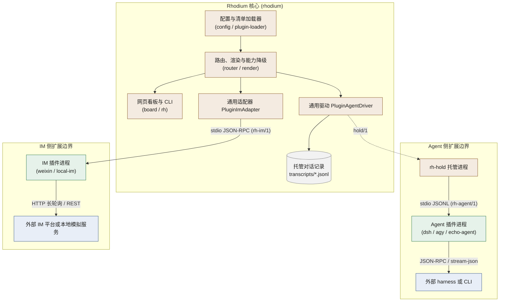
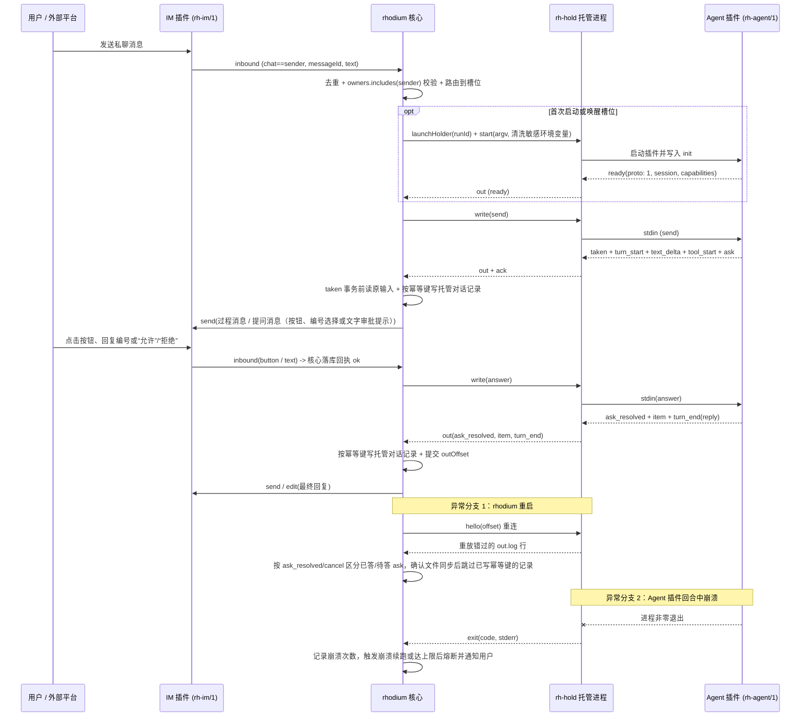
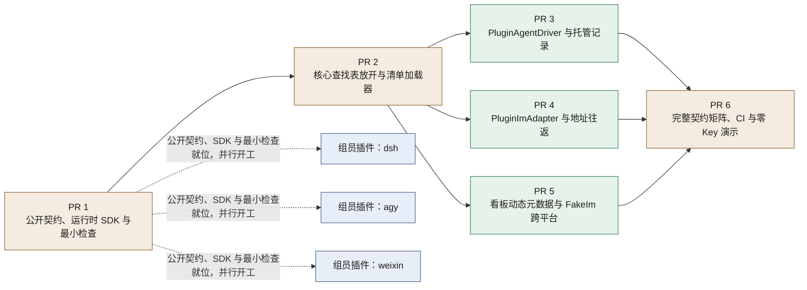

# 插件化规格

这篇回答：Rhodium-OSS 怎么把 agent 驱动和 IM 适配器做成插件体系、插件协议与加载失败行为怎么定、插件图标、插件目录扫描、插件对话导入和插件建 Bot 向导怎么做、怎么支持跨平台和 CI、如何零 Key 演示、三个组员插件对核心有什么要求、实现怎么拆 PR，以及已拍板的选型决策记录。

前置阅读：[术语表](../../GLOSSARY.md)、[产品说明](../product.md)、[ADR-0002](../adr/0002-one-daemon-plus-holders.md)、[ADR-0007](../adr/0007-satori-for-bot-apps.md)、[ADR-0008](../adr/0008-own-im-adapters.md)、[ADR-0009](../adr/0009-no-acp.md)、[ADR-0011](../adr/0011-codex-private-app-server.md)、[ADR-0015](../adr/0015-out-of-process-plugins.md)、[架构](../architecture.md)、[IM 文字与交互规范](../im-style.md)、[v1 规格](v1.md)

## 1. 目标与范围

### 1.1 核心场景

单用户在个人电脑上，通过命令行 `rh`、网页看板或 IM 向 Rhodium 发送消息，由核心调度对应槽位调用内置或[插件](../../GLOSSARY.md)驱动完成回合，并将可核对的结果返回原入口；按配置接入独立构建的插件后，无需修改或重编核心源码即可新增 agent 种类或 IM 平台，插件被禁用或运行失败时系统按约定降级并给出明确反馈。

### 1.2 本期做什么

- **两类扩展点**：支持接入新的 agent 种类（经 `rh-agent/1` 协议）和新的 IM 平台（经 `rh-im/1` 协议），内置三家 agent（Claude、pi、Codex）与内置 IM（QQ、Telegram、飞书、fake）保持原生实现不变。
- **目录扫描、显式登记与失败隔离**：核心扫描 `config.toml` 旁的 `plugins/` 目录，扫到的插件默认加载；`[plugins.<id>]` 可禁用某个插件，也可用 `path` 从别处登记插件（§4.5）。核心读取并校验 `plugin.json` [插件清单](../../GLOSSARY.md)与版本要求；配置失败、清单损坏、运行崩溃均隔离在单个插件内。
- **插件图标、对话导入与建 Bot 向导**：插件可在清单里带图标，看板在内置图标出现的地方显示它（§4.6）；agent 插件可声明支持导入本机已有的对话（§3.5）；IM 插件可声明支持 `rh bot` 建 Bot 向导（§3.6）。
- **核心内部表开放化**：放开 `AgentKind` 与 `Platform` 联合类型限制，为非内置种类在对话记录、终端切换、设置带回、看板图标等查找表提供安全默认值。
- **公开契约、运行时 SDK 与契约测试器**：提供零内部依赖的 TypeScript 契约与运行时 SDK（`packages/plugin-sdk/`，含 `AgentPlugin`/`ImPlugin` 接口与 `runAgentPlugin`/`runImPlugin` 运行时辅助）及语言无关的黑盒[契约测试](../../GLOSSARY.md)脚本，随仓库附带两个基于 SDK 实现的最小示例插件（`echo-agent` 与 `local-im`）。
- **跨平台支持、自动化 CI 与零 Key 演示**：确保 Linux、Windows、macOS 可用；补全 GitHub Actions 构建与测试流程；提供不依赖任何真实 API Key 和真实 IM 账号的完整可重复演示路径。

### 1.3 本期明确不做什么

- 不做插件市场、远程在线下载、热加载或运行时免重启动态插拔插件代码（启用、禁用或升级插件需要重启 `rhodium`）。
- 不做插件 agent 的 Herdr TUI 模式切换与网页终端嵌入（插件槽位的 `tui` 能力为 `false`）。
- 不做插件 agent 的 Herdr pane 导入。插件对话只能按对话 ID 导入（§3.5）。
- 不做插件 IM 在 IM 里的建 Bot 向导（§3.6）。不声明向导的插件 IM，Bot 可在 `config.toml` 中手写 `[bots.<name>]` 后用 `rh pair` 配对主人。
- 不扫描家目录或全局目录里的插件，扫描 `plugins/` 时不跟随符号链接（§4.5）。
- 不做插件 IM 的 QQ 专属被动回复窗口与额度重投模型（仅保留内置 `qq` 自己用 `qq_quota`）。
- 不做跨插件版本热兼容或操作系统级容器沙箱。

---

## 2. 总体架构与关键流程

### 2.1 总体架构

核心与插件之间采用全独立进程架构（选择依据与信任边界见 [ADR-0015](../adr/0015-out-of-process-plugins.md)）。核心把插件当作黑盒协议对端，插件只能通过[插件协议](../../GLOSSARY.md)与核心交互，不能导入 `src/` 内部任何代码。



### 2.2 关键业务流程与故障分支

下图展示一条消息经 IM 插件进入核心、送入跑在托管进程中的 Agent 插件、完成工具调用与提问、再返回 IM 的完整链路，以及重启重放与崩溃续跑两条关键恢复分支（`rh-hold` 只转发和落盘原始字节，托管对话记录由 `rhodium` 核心按幂等键写入，与 [ADR-0002](../adr/0002-one-daemon-plus-holders.md) 一致）：



---

## 3. 插件 API 与协议契约

### 3.1 核心替插件做什么、不支持什么

| 能力领域 | 核心统一承担（插件无需自写） | 插件自己实现 | 不支持或降级说明 |
|---|---|---|---|
| 进程与重启托管 | `rh-hold` 保活、`out.log` 落盘与重启重放、`taken`/`written` 投递状态跟踪、`pending_asks` 重建与对账 | 按行消费 stdin、按行写 stdout；对同一 `requestId` 的重复 `answer` 须幂等去重（至多向下游交付一次），首次交付成功后发出 `ask_resolved`（交付进行中不得提前发出） | 不要求插件实现日志重放或连接恢复服务端 |
| 槽位生命周期 | 空闲回收（`idleReap`）、崩溃自动续跑、连续崩溃熔断、并发上限（`maxRunning`）、定时任务、`interrupt` 超时回收 | 在 `close` 时正常清理下游进程并退出 | — |
| 对话记录与展示 | 按幂等键写入[托管对话记录](../../GLOSSARY.md)，驱动网页对话页、`rh read`、槽位时间线 `/resume`；导入时把插件转好的标准块写在托管对话记录开头 | 通过 `turn_start` / `item` / `tool_start` / `turn_end` 报出标准事件；声明 `import` 的插件回答一次性查询，列出本机对话并把已有内容转成标准块（§3.5） | 不支持 Herdr pane 导入；不接管已有外部进程 |
| 合规与安全 | 保留内置名称（含 `herdr`）、清洗环境变量（含 Windows 混合大小写过滤）、集中执行配对、主人校验（`owners.includes(m.sender)`）与投递决定、`rh doctor` 巡检插件进程子树 | IM 插件承担平台账号身份认证并原样上报发送者 ID（私聊归一为用户 ID）；Agent 插件读取 `init.systemPromptFile`，遵守三条红线（不得拉起 `claude` 或包装 Claude Code、不得用 Claude 订阅、仅本人触发） | 插件属于用户显式信任代码；不允许任何非内置 `claude` 驱动获取 Claude 订阅凭据 |
| 路由与渲染降级 | 消息排队、分段截断、Markdown 降级纯文本、工具折叠、`/rh_*` 命令、按钮分页、发送限流与超时记 `unknown` | 如实声明 `Capabilities`（agent 能力或 IM 平台能力） | 插件 IM 不支持 `qq_quota`；建 Bot 向导可在网页看板和终端 `rh bot` 里跑，且只对声明 `wizard` 的插件（§3.6） |
| 终端与专属特性 | 统一拒绝提示（切 TUI、`/ultracode` 等） | — | 不支持切 Herdr TUI；不支持 Claude 订阅额度窗口自动续跑 |

### 3.2 Agent 插件协议：`rh-agent/1`

Agent 插件由 `rh-hold` 直接作为子进程拉起。进程内通过 stdin（核心写入）与 stdout（插件写入）交换 UTF-8 编码、换行符 `\n`（核心解析时兼容 `\r\n`）分隔的 JSON 对象，单行上限 64MB。插件的诊断日志必须写到 `stderr`（由 `rh-hold` 记入 `err.log`），严禁向 `stdout` 输出非 JSON 调试文本。

#### 核心发给插件的消息（stdin）

| 消息 `type` | 说明 | 关键字段 |
|---|---|---|
| `init` | 启动后发出的第一条消息，用于握手与传参 | `proto: 1`、`conv`、`session: { new: string } \| { resume: string }`、`cwd`、`systemPromptFile`、`program?: string \| null`（来自 `[programs.<id>]` 覆盖值或清单 `program`）、`approval: boolean`、`model?: string \| null`、`effort?: string \| null`、`resumed?: boolean`、`config: Record<string, string>` |
| `send` | 发送一条用户或内部消息开始或加入回合 | `id`、`text`、`human: boolean`、`mode: "turn" \| "steer"`、`images?: { mimeType: string; data: string }[]` |
| `interrupt` | 中断当前正在进行的回合（对应 `/stop` 或 `!`） | 无额外字段；插件取消下游回合后应尽快发出 `turn_end` |
| `answer` | 把用户的回答、审批决定或 `ask_timeout` 默认回答交给插件（跨核心重启为至少一次投递；插件同一进程运行内须按 `requestId` 幂等去重，至多向下游交付一次） | `requestId`、`answer`（与核心 `AskAnswer` 同构：`permission` / `question` / `plan`） |
| `approval` | 在进程运行中切换审批模式（仅当 `capabilities.liveApproval` 为真时调用） | `on: boolean` |
| `command` | 执行插件声明支持的通用命令（例如 `model`、`effort`、`compact`、`usage`、`context`、`status`） | `id`、`name`、`args: string` |
| `close` | 通知插件优雅关闭下游进程并退出 | 无额外字段；若 `durations.stopGrace` 内未退出，核心依次发 `TERM`、`KILL` |

#### 插件发给核心的消息（stdout）

| 消息 `type` | 说明 | 关键字段 |
|---|---|---|
| `ready` | 握手完成通知，收到后核心才写入排队的 `send` | `proto: 1`、`session: string \| null`、`selfStarted?: boolean`、`capabilities?: { liveApproval?: boolean; steer?: boolean; commands?: string[]; models?: { id: string; label?: string; efforts?: string[] }[] }`、`version?: string` |
| `fatal` | 启动或握手阶段无法继续（如找不到下游 CLI 或配置错误） | `message: string`、`retryable?: boolean`（为 `false` 时核心直接报出原因，不做无意义的反复重启） |
| `taken` | 确认插件已将 `id` 对应的 `send` 写进下游对话（崩溃时不再重发提示） | `inputId: string` |
| `turn_start` | 一个新回合开始；若 `ready.session` 为 `null`，可在首回合补报 `session` | `input?: string`、`session?: string` |
| `session` | 独立补报下游分配的真实会话 ID（用于启动与回合开始之后才拿到 ID 的 agent） | `session: string` |
| `text_delta` | 助手回答的流式正文增量 | `text: string` |
| `tool_start` | 发起工具调用（结果尚未返回，可能随后触发 `ask`） | `id: string`、`name: string`、`input: unknown` |
| `item` | 一条完整助手消息或一次工具调用完成 | `item: { kind: "message"; text: string } \| { kind: "tool"; id?: string; name: string; input: unknown; result?: { text: string; error?: boolean } }` |
| `ask` | 向用户提问或请求工具审批 | `requestId: string`、`kind: "question" \| "plan" \| "permission"`、`tool: string`、`input: unknown`、`toolUse?: string` |
| `ask_resolved` | 确认插件已将 `requestId` 对应的 `answer` 成功交付给下游（闭合该提问，防止重放重弹；仅在首次交付成功后发出，此后重收同一 `requestId` 的重复 `answer` 可再次发出以确认闭合；首次交付仍在进行中时不得提前发出） | `requestId: string` |
| `ask_cancel` | 下游撤回一个尚未回答的提问 | `requestId: string` |
| `turn_end` | 回合结束并空闲，触发最终回复推送与后续排队消息投递；也可附带迟到 `session` | `reply?: string`、`background?: boolean`、`session?: string` |
| `usage` | 上报上下文窗口或单轮 token 用量 | `inputTokens?: number`、`outputTokens?: number`、`contextTokens?: number`、`maxContextTokens?: number` |
| `command_result` | 对应 `command` 请求的结构化结果 | `id: string`、`ok: boolean`、`result?: CommandResult`、`error?: string` |
| `error` | 运行期非致命协议或下游错误提示 | `detail: string`、`recoverable?: boolean` |

#### 输入输出示例（`rh-agent/1`）

```json
{"type":"init","proto":1,"conv":"01JXYZ0001","session":{"new":"conv-uuid-1"},"cwd":"/tmp/demo","systemPromptFile":"/tmp/state/prompt/slot1.md","program":"dsh","approval":false,"model":null,"effort":null,"resumed":false,"config":{"fixture":"/tmp/dsh-sample.jsonl"}}
{"type":"ready","proto":1,"session":"conv-uuid-1","capabilities":{"liveApproval":true,"steer":false,"commands":["compact"]}}
{"type":"send","id":"in-001","text":"[来自 网页]\n列出当前目录","human":true,"mode":"turn"}
{"type":"taken","inputId":"in-001"}
{"type":"turn_start","input":"in-001"}
{"type":"tool_start","id":"tc-1","name":"list_dir","input":{"path":"."}}
{"type":"ask","requestId":"req-1","kind":"permission","tool":"list_dir","input":{"path":"."},"toolUse":"tc-1"}
{"type":"answer","requestId":"req-1","answer":{"kind":"permission","allow":true}}
{"type":"ask_resolved","requestId":"req-1"}
{"type":"item","item":{"kind":"tool","id":"tc-1","name":"list_dir","input":{"path":"."},"result":{"text":"README.md\nsrc/"}}}
{"type":"text_delta","text":"当前目录包含 README.md 和 src/。"}
{"type":"item","item":{"kind":"message","text":"当前目录包含 README.md 和 src/"}}
{"type":"turn_end","reply":"当前目录包含 README.md 和 src/。"}
```

#### 关键运行语义

- **迟到会话 ID 上报与落库时点**：部分外部 agent 只有在首回合运行中甚至回合结束时才能拿到真实会话 ID。插件可以在 `ready.session` 先填 `null`，随后在 `turn_start.session`、独立的 `{"type":"session","session":"<id>"}` 事件或 `turn_end.session` 中上报真实 ID。`PluginAgentDriver` 收到任意非空 `session` 立即更新 `info.session`；`src/runner.ts` 的 `output()` 在处理该输出行所在的同一数据库事务里，只要 `driver.info.session` 有效且库中 `conversation.sessionId` 仍为空，立即落库写入 `conversation.sessionId`。此后无论进程重启还是空闲回收，下一进程启动时都会以 `session: { resume: "<id>" }` 续接。
- **`steer: false` 降级**：如果插件在 `ready.capabilities.steer` 声明不支持插话（或省略该字段），路由在当前回合未结束时把新消息先留在队列里（不标失败），待 `turn_end` 到达后再以 `mode: "turn"` 写入；以 `!` 开头打断时，核心先发 `interrupt`，待旧回合 `turn_end` 到来后再发新消息。
- **`interrupt` 语义、超时兜底与 `close` 宽限关系**：
  - 正常路径：`interrupt` 只中断当前回合、不杀插件进程；插件终止下游本轮运行后应尽快发出 `turn_end`（不带最终回复），让槽位回到空闲并继续投递排队的后续消息。
  - 超时升级：新增配置 `durations.pluginInterrupt`（默认 `"10s"`），独立于 `durations.stopGrace`（默认 `"5s"`）。发出 `interrupt` 后若超过 `pluginInterrupt` 仍未收到 `turn_end`，`PluginAgentDriver` 判定插件卡死并强制关停进程：按 `close` 流程先发 `{"type":"close"}` 与 `eof()`，等待 `durations.stopGrace`；未退出则依次 `TERM`、再等 `durations.stopGrace`、最后 `KILL`。进程退出后路由清掉 `interruptedAt` 并拉起新进程投递排队的后续消息。
- **`ask` 超时（`ask_timeout`）行为**：沿用现有 `src/router.ts` 与 `src/asks.ts` 的 `timeoutAnswer()` 逻辑，不新增协议消息类型。当未答提问超过 `durations.askTimeout`（默认 `30m`，`0s` 不超时）时，核心自动通过标准 `answer` 消息向插件下发默认回答：
  - `permission`：`{ "kind": "permission", "allow": false, "message": "用户暂时无法回答，请按你的最佳判断继续" }`；
  - `plan`：`{ "kind": "plan", "approve": false, "message": "用户暂时无法回答，没有批准这个计划。请用 rh send me 把计划摘要发给用户（你是子槽位时，写在最终回复里），然后停下来，等用户回复再继续。" }`；
  - `question`：`{ "kind": "question", "answers": { "<问题>": "用户暂时无法回答，请按你的最佳判断继续" } }`。
  - 核心同步在 IM 撤掉提问按钮；插件照常消费该 `answer` 并回报 `ask_resolved`。
- **区分尚待回答与已回答的 `ask`（重启恢复、对账与重复 `answer` 去重）**：
  - `PluginAgentDriver` 在重放或实时读取 `out.log` 时维护当前进程的未闭合提问集合：收到 `ask` 加入集合；收到 `ask_resolved`、`ask_cancel`、对应 `toolUse` 的完成 `item` 或 `turn_end` 时移出集合。
  - `rhodium` 重启重连 `rh-hold` 并重放完 `out.log` 后，`replayed()` 只把仍留在未闭合集合中的提问作为 `pending_asks` 发给路由：
    - 若崩溃前用户已答且核心已交付（数据库状态为 `delivered`），`out.log` 里已有 `ask_resolved`，根本不会出现在 `pending_asks`；即便进程恰好在写出 `ask_resolved` 前崩掉，路由在处理 `pending_asks` 时也会比对数据库 `state.listed`（包含已 `delivered` 记录），绝不重复弹出旧提问；
    - 若崩溃前用户已答但尚未完成 `delivered` 落库（数据库状态为 `answered`，`out.log` 无 `ask_resolved`），它仍在 `pending_asks` 中，路由会立即触发重新下发 `answer`。
  - **重复 `answer` 语义与插件幂等去重**：`src/runner.ts` 的 `answer()` 先等待驱动把 `answer` 写入插件，再在后续数据库事务中将提问状态改为 `delivered`。若第一次 `answer` 已写入仍存活的插件进程，而核心在更新数据库前退出且插件尚未写出 `ask_resolved`，重连时核心会看到数据库仍为 `answered` 且 `out.log` 中该提问未闭合，从而再次下发同一个 `answer`。`state.listed` 只能防止向用户重复弹题，不能阻止插件把同一批准/回答重复交给下游。因此 `rh-agent/1` 公开契约规定：`answer` 跨核心重启为**至少一次（at-least-once）投递**；插件在**同一次进程运行内必须按 `requestId` 去重**，对同一 `requestId` **至多向下游交付一次**，并严格区分三态：
    - **首次交付仍在进行中（`in-flight`）**：若收到同一 `requestId` 的重复 `answer`，插件必须合并等待，不再向下游重复执行，也**暂不发出 `ask_resolved`**，待首次下游交付真正成功后才发出确认；
    - **首次交付已成功后（`delivered`）**：若再次收到同一 `requestId` 的重复 `answer`，插件必须忽略重复的下游执行，并可再次发出 `{"type":"ask_resolved","requestId":"<id>"}` 以便核心闭合提问并将状态更新为 `delivered`；
    - **首次交付失败/已关闭（`cancelled`）**：若首次向下游交付失败（如抛出异常）并已发出 `ask_cancel`，同一进程运行内必须保留该 `requestId` 的已关闭标记，拒绝后续迟到的重复 `answer`——既不再调用下游（防止因首次仅回执丢失而二次批准），也不发出 `ask_resolved`。
- **通用命令子集与自动拒绝**：只有列入 `ready.capabilities.commands`（且与清单静态声明一致）的通用命令才会转发 `command` 到插件。`new` 与 `resume` 始终由核心自己处理；`stop` 固定映射为 `interrupt`；未声明支持的命令（例如 `/ultracode`、`/compact`）由核心直接向用户返回“该 agent 不支持此命令”，不惊动插件进程。
- **核心托管对话记录（唯一写入者、残尾修复与首次同步、检查点顺序及幂等去重）**：
  - **为什么统一托管**：各家插件 agent 的本地记录格式各异（有的写自有格式 JSONL，有的不落盘或结构随版本变化），由核心统一记录在 `<stateDir>/transcripts/<agentKind>/<convId>.jsonl`，让网页对话页、`rh read` 和槽位时间线 `/resume` 无需为每家插件单独写解析器，展示格式也完全一致。
  - **唯一写入者**：仅由 `rhodium` 核心（`src/runner.ts` 调用 `src/transcript.ts`）写入；`rh-hold` 保持只转发和落盘字节，不解析协议。
  - **稳定幂等键（消除“写文件后、提交数据库 `outOffset` 前崩溃”的重复）**：
    - `launchHolder` 每次拉起新进程时生成一个进程运行标识 `runId`（ULID，持久化在 `holder` 表中，同一次运行的重连保持不变，下次新起进程换新值）；
    - 写入托管记录 JSONL 的每条条目携带唯一幂等键 `"k"`：
      - 用户/内部输入条目：`k = "in:" + inputId`；
      - 插件输出事件条目（`tool_start`、`item`、`turn_end`）：`k = "out:" + runId + ":" + lineEndOffset`（`lineEndOffset = pos + nl + 1`，即该行在本次 `out.log` 中的精确结束字节偏移）。
  - **重开追加前修复残缺末行与首次扫描统一同步**：
    - 唯一写入者（`src/transcript.ts`）在一次 `rhodium` 进程运行中首次打开某对话的托管记录文件准备追加或推进检查点前，必须从头扫描已有内容，加载已落盘的 `"k"` 集合，并记录最后一个完整且可解析为合法 JSON 的 `\n` 结尾记录的结束字节偏移；
    - 若文件末尾存在未以 `\n` 结尾的半行或损坏无法解析的残尾，写入者必须先将文件截断（`truncate` / `ftruncate`）回最后一个完整记录的 `\n` 之后；**无论本次打开是否触发截断，首次恢复扫描完成后都必须对文件执行一次 `fsync` 同步**，确保盘上已有的全部完整可读行真实落盘，然后再进入重放或追加，既防止半行与后续记录粘连损坏，也消除“完整可读行尚未同步到盘”的窗口。
  - **写盘同步与提交数据库检查点的先后顺序（含断电前提边界）**：
    - 写入托管记录与推进检查点必须严格遵循“**命中已有 `"k"` 可跳过重复追加，但必须先确认文件已完成 `fsync` 同步，才能在 `src/runner.ts` 的 `loop.batch()` 事务中推进 SQLite `outOffset` 检查点**”的规则（首次恢复扫描后统一 `fsync` 一次覆盖既有完整行；每条新追加的完整 `\n` 行同样必须先 `fsync` 落盘后再提交检查点）：
      1. 若在 JSONL 完整行写入或 `fsync` 完成前中断（包括“仅写出半行”与“完整行与 `\n` 已写入页缓存但尚未 `fsync` 就退出”两种情况），SQLite `outOffset` 尚未提交；重启后该输出行仍满足 `replay === false`，写入者首次重开扫描先截断残尾（若有）并统一 `fsync` 一次：半行被截断的记录重新追加完整行并 `fsync`，已成完整行命中 `"k"` 的记录跳过重复追加，均在确认文件已 `fsync` 同步后再推进 `outOffset`；
      2. 若在 JSONL 完整行 `fsync` 完成后、SQLite `outOffset` 提交前中断，重启重放时写入者加载 `"k"` 并经首次统一 `fsync` 确认同步后跳过重复追加，再推进 `outOffset`；
      3. 若 SQLite `outOffset` 已提交，该记录此前已确认 `fsync` 落盘；重启时 `replay === true` 直接跳过写盘，读侧准确读到一次。
    - **断电恢复的前提边界**：上述断电不丢托管记录的承诺以 `out.log` 中的原始输出在重启后仍可重放为前提——基线 `holder/src/main.rs` 的 `pump_out()` 对 `out.log` 执行 `write_all` 写盘而未逐行 `fsync`，本方案不改变 `rh-hold` 的逐行写盘机制；对已落入 `out.log` 可重放的记录以及已 `fsync` 并提交检查点的托管记录，重启恢复均保证不丢不重。
  - **三道去重防线**：
    1. `replay === true`（`pos + nl < l.seen`）的已处理行只恢复驱动内存状态，不触发托管记录写盘；
    2. 写入层（`src/transcript.ts`）首次打开文件扫描并截断末行残尾（若有）后统一 `fsync` 一次；命中已有 `"k"` 时可跳过重复追加，但必须先确认文件已同步，才允许推进 SQLite `outOffset` 检查点；每条新写入必带 `"k"` 且先 `fsync` 后再提交检查点；
    3. 读取层（`/api/messages` 与 `rh read`）按 `"k"` 去重；即使写入者尚未重开修复，读侧也会忽略文件末尾因异常退出或断电截断的不完整末行。
  - **用户输入获取时序（消除 `taken` 清空正文的竞态）**：
    - 在 `src/runner.ts` 处理 `taken` 事件、**调用 `loop.batch()` 提交数据库事务（`router.ts` 会在此事务把 `agentInput` 的 `body` 和 `images` 置为 `null`）之前**，先从 `store` 读取该 `inputId` 尚未清空的 `body`、`images` 与发送时间，以 `k = "in:" + inputId` 幂等追加写入托管对话记录并 `fsync`（或命中已有 `"k"` 并确认首次扫描 `fsync` 完成后推进检查点）；
    - 如果上次进程恰好在“写出 `taken` 后、提交数据库事务前”崩溃，`agentInput.body` 与 `images` 仍完整保存在数据库里，重启重放 `out.log`（此时 `replay === false`）依然能取回完整原文写入（若上次留有半行会先截断修复，若完整行已写但未同步则经重开扫描统一 `fsync` 后跳过重复追加再推进检查点）；若数据库事务已提交，则 `outOffset` 已前进（`replay === true`）且 `"in:" + inputId` 已落盘，不会重复也不会丢失。

---

### 3.3 IM 插件协议：`rh-im/1`

IM 插件由 `rhodium` 在主守护进程中按“每个已启用的插件 Bot 一个进程”的方式直接拉起。双方经 stdin/stdout 交换单行 JSON-RPC 2.0 风格消息（请求带 `id`，通知不带 `id`），单行上限 64MB，插件日志写到 `stderr`。

#### 核心向插件发起的请求（核心 -> 插件）

| 方法 `method` | 必填性 | 说明 | 主要参数与返回值 |
|---|---|---|---|
| `init` | 必选 | 进程启动后的首次握手，核心校验平台能力表 | 参数：`{ proto: 1, botId, botName, config }`；返回：`{ proto: 1, capabilities: Capabilities }` |
| `send` | 必选 | 发送一条文本、Markdown、按钮或文件消息 | 参数：`{ chat, message: OutboundMessageWire }`（本地文件以 `path` 与 `name` 传入，由插件读取上传）；返回：`SendResult` |
| `edit` | 按能力 | 编辑已发出的消息（仅当 `capabilities.progress === "edit"` 或声明了 `capabilities.stream` 时调用；`Capabilities.progress` 仅取 `"append" \| "edit"`，流式能力由独立字段 `stream?: number` 声明） | 参数：`{ chat, messageId, message }`；返回：`SendResult` |
| `drop_buttons` | 按能力 | 撤掉已发消息上的按钮（仅当 `capabilities.buttons` 为真时调用） | 参数：`{ chat, messageId }`；返回：`SendResult` |
| `answer_press` | 按能力 | 应答一次按钮回调（仅当 `capabilities.buttons` 为真时调用） | 参数：`{ chat, press, text }`；返回：`{ ok: true }` |
| `fetch_attachment` | 按需 | 在核心确认发送者为主人后，拉取入站附件内容到指定临时目录 | 参数：`{ attachmentId, destPath }`；返回：`{ ok: true, size, mimeType? }` |
| `set_menu` | 按能力 | 同步斜杠命令菜单（仅当 `capabilities.menu.maxItems > 0` 时调用） | 参数：`{ items: MenuItem[], chat?: string }`；返回：`{ ok: true }` |
| `set_row` | 按能力 | 同步底部按钮行（仅当 `capabilities.menu.row` 有值时调用） | 参数：`{ row: RowButton[], chat?: string }`；返回：`{ ok: true }` |
| `profile` | 可选 | 获取 Bot 头像与主人昵称/头像（失败或未实现均可返回空对象） | 参数：`{ you: string \| null }`；返回：`{ botBase64?, youBase64?, name? }` |
| `shutdown` | 必选 | 核心退出或移除 Bot 时通知插件优雅断开平台连接并退出 | 参数：`{}`；返回：`{ ok: true }` |

#### 插件发给核心的通知与请求（插件 -> 核心）

| 名称 | 类型 | 说明 | 主要载荷 |
|---|---|---|---|
| `connected` | 通知 | 汇报连接建立或断线状态（用于看板状态点与故障统计） | `{ up: boolean, error?: string }` |
| `inbound` | 请求 | 上报一条外部平台收到的消息或按钮按下事件（私聊固定令 `chat === sender`）；核心在该条消息落盘提交 SQLite 事务（含去重检查、配对或入站记录写入）后才返回 `{ ok: true }` | 参数：`{ chat, messageId, sender, text, at, quote?, ref?, button?, voice?, attachments?: { id, kind, name?, mimeType? }[] }`；返回：`{ ok: true }` |
| `kept_get` | 请求 | 读取核心为本 Bot 持久化保存的断点、游标或私聊通道映射 | 参数：`{ key: string }`；返回：`{ value: string \| null }` |
| `kept_set` | 请求 | 写入或删除本 Bot 的持久化键值（核心自动加 `plugin:<botId>:` 前缀隔离） | 参数：`{ key: string, value: string \| null }`；返回：`{ ok: true }` |

#### 私聊地址归一、会话上下文与入站批次交接约定

现有 `src/router.ts` 在首次配对时依赖 `m.chat === m.sender` 自动将该私聊设为主窗口，后续的 `ownerChat()` 和主动推送也统一把私聊记录的 `platformChatId` 与 `owners` 中的用户 ID 直接匹配。为保证各类外部 IM 平台都能跑通“配对 -> 主窗口 -> 重启 -> 主动发回原私聊”且重启不丢消息，契约统一采用**由 IM 插件负责私聊地址归一、出站上下文持久还原，并在核心落库回执后再推进批次游标**（与核心内置的 `src/feishu.ts` 保持同一模式）：

1. **单条入站归一与上下文先存**：收到私聊消息或交互时，IM 插件把 `inbound.sender` 与 `inbound.chat` **都填为平台用户 ID**；若平台私聊通道/房间 ID 与用户 ID 分离，可在发 `inbound` 前用 `kept_set("dm:" + userId, platformChannelId)` 持久化通道映射；若平台（例如微信官方 Bot `openclaw-weixin`）用 `from_user_id` 发私聊、但回复须携带最近收到的 `context_token`，同样可在发 `inbound` 前用 `kept_set("ctx:" + userId, contextToken)` 先保存该用户的上下文令牌。
2. **批次游标须在整批 `inbound` 全部获核心落库回执后再推进**：对于按批拉取的平台（例如 `getupdates` 单次返回同批消息 `A`、`B` 与下一批游标 `get_updates_buf`），插件必须先逐条发出 `inbound` 请求并等待核心返回 `{ ok: true }`（表示核心已把该消息提交进 SQLite，且等待期间双向循环继续并发响应核心反调的 `fetch_attachment`）；**必须等该批全部 `inbound` 请求都拿到 `{ ok: true }` 回执后，才能调用 `kept_set("sync_buf", nextCursor)` 推进批次游标**。这样即使在送出 `A` 后、送出 `B` 或推进游标前进程崩溃重启，重拉同一批消息时 `A` 命中核心 `seen(chat, messageId)` 去重只触发一次，`B` 仍会被完整投递而不会越过游标丢失。
3. **出站还原**：核心调用 `send(chat, ...)`、`edit(chat, ...)` 或 `drop_buttons(chat, ...)` 时，`chat` 传入的是用户 ID。插件按顺序解析：先查内存缓存 -> 未命中查 `kept_get("dm:" + chat)` / `kept_get("ctx:" + chat)`；对地址分离平台必要时按用户 ID 创建或获取私聊通道并写回 `kept_set`，对依赖入站会话上下文的平台（如微信官方 Bot）若无已保存的 `context_token` 则明确返回 `{ status: "failed", error: ... }`。
4. 如此核心的 `chat` 表、主窗口绑定与跨重启主动消息路由完全不用区分平台地址模型，插件重启后通过 `kept_get` 也能立刻还原通道或会话上下文。

#### 输入输出示例（`rh-im/1`）

```json
{"jsonrpc":"2.0","id":1,"method":"init","params":{"proto":1,"botId":"bot_01","botName":"my-weixin","config":{"token":"redacted-at-runtime","baseUrl":"https://ilinkai.weixin.qq.com"}}}
{"jsonrpc":"2.0","id":1,"result":{"proto":1,"capabilities":{"progress":"append","buttons":false,"sendLimit":{"kind":"rate","perChatPerSecond":1},"menu":{"scope":"global","maxItems":0},"maxTextLength":2000,"maxFileBytes":{"image":10485760,"file":26214400},"markdown":null}}}
{"jsonrpc":"2.0","method":"connected","params":{"up":true}}
{"jsonrpc":"2.0","id":10,"method":"kept_set","params":{"key":"ctx:wx-user-1","value":"ctx-tok-99"}}
{"jsonrpc":"2.0","id":10,"result":{"ok":true}}
{"jsonrpc":"2.0","id":11,"method":"inbound","params":{"chat":"wx-user-1","messageId":"msg-900","sender":"wx-user-1","text":"你好","at":1763690000000}}
{"jsonrpc":"2.0","id":11,"result":{"ok":true}}
{"jsonrpc":"2.0","id":12,"method":"kept_set","params":{"key":"sync_buf","value":"cursor-001"}}
{"jsonrpc":"2.0","id":12,"result":{"ok":true}}
{"jsonrpc":"2.0","id":2,"method":"send","params":{"chat":"wx-user-1","message":{"text":"收到，已交给槽位处理。"}}}
{"jsonrpc":"2.0","id":2,"result":{"status":"sent","messageId":"msg-901"}}
```

#### 安全与可靠性约定

- **单 Bot 凭据隔离**：`init.params.config` 只包含这个 `[bots.<name>]` 表和对应 `[plugins.<id>.config]` 的非内部字段（剔除 `platform`、`target`、`owner`），不经命令行参数传递，也不写入日志。
- **平台认证与核心主人校验分工**：平台侧消息来源的身份认证由 IM 插件承担并原样填充 `sender`；配对码拦截、主人校验（`owners.includes(m.sender)`）、去重和路由决定全部留在 `rhodium` 核心执行。陌生人的 `inbound` 绝不触发 agent。带附件的消息只传不透明 `attachmentId`，核心确认发送者为主人后才反调 `fetch_attachment` 落盘，防止陌生人投递大文件耗尽资源。
- **消息去重与发送兜底**：核心保留统一的 `seen(chat, messageId)` 检查，避免插件断线重连后重复提交同一条入站消息（配合上述 `inbound` 回执后再推游标保证同批不漏不重）。当插件返回 `unknown`（如平台已收但 HTTP 回执丢失、断连或超时），或 `send` / `edit` RPC 超过 `durations.pluginRpc`（默认 `30s`）无响应时，核心一律按“结局不明（`unknown`）”落库，绝不自动重发。
- **进程看守与熔断**：分两种情况。
  - **进程活着、报连不上平台**：插件发 `connected(up: false)`，核心照内置 Bot 处理。连续达 `limits.botFailures`（默认 5 次）时，把该 Bot 标为 `faulted`，在主窗口和看板告警，说它会一直自动重连。核心不结束插件进程，由插件自己重试。插件之后发 `connected(up: true)`，核心把它标回在线，并照内置 Bot 发恢复通知。
  - **进程本身反复退出**：插件进程在运行中意外退出时，核心按 `1s`、`2s`、`4s`、`8s`、`16s`、`30s` 指数退避重启，退避只看退出次数，不看离线报告。进程连续退出、而且退出前都没发过 `connected(up: true)`，达 `limits.botFailures` 次时，核心停止重启，把该 Bot 标为 `faulted`，告警说已停止重连。

---

### 3.4 公开契约与运行时 SDK：`packages/plugin-sdk/`

为让 TypeScript/JavaScript 插件作者只需像实现一个类一样编写插件（调用 `runAgentPlugin(new X())` 或 `runImPlugin(new X())`），同时绝对不依赖核心内部实现（满足课程“不依赖核心内部代码”的硬要求），核心仓库抽取独立子包 `packages/plugin-sdk/`（零运行期第三方依赖，严禁从 `src/` 导入任何文件）。其他语言（Python、Go、Rust 等）不绑定该 SDK，仍可直接按 §3.2 与 §3.3 的 stdio 协议编写：

- **模块组成**：
  - `manifest.ts`：`PluginManifest` 类型定义与 `validateManifest(json)` 纯函数校验器（含保留名与禁止拉起 `claude` 校验）。
  - `stdio.ts`：UTF-8 按行 JSON 读写封装（解析兼容 `\r\n`，守住 64MB 单行上限，日志仅写 `stderr` 绝不污染 `stdout`）。
  - `agent.ts`：`rh-agent/1` 协议消息类型（`CoreToAgentMessage`、`AgentToCoreMessage`）、`AgentPlugin` 接口、`AgentContext` 事件发射器、`PluginFatalError`、`AgentPluginRunOptions`（含可选 `interruptTimeoutMs` 与 `closeTimeoutMs`）与 `runAgentPlugin(plugin, opts?)` 运行时入口。
  - `im.ts`：`rh-im/1` 协议 JSON-RPC 与 `Capabilities` 类型、`ImPlugin` 接口、`ImContext` 上下文、`PluginSendFailedError` 与 `runImPlugin(plugin)` 运行时入口。
  - `index.ts`：统一导出全部公开类型与运行时辅助函数。

- **Agent 插件接口 `AgentPlugin` 与运行时 `runAgentPlugin(plugin, opts?)`**：
  - 插件作者仅需实现：`init(params, ctx)`（返回 `{ session, capabilities, selfStarted?, version? }`）、`send(msg, ctx)`（经 `ctx.taken` / `ctx.turnStart` / `ctx.session` / `ctx.textDelta` / `ctx.toolStart` / `ctx.item` / `ctx.ask` / `ctx.askCancel` / `ctx.usage` / `ctx.turnEnd` / `ctx.error` 上报事件）、`interrupt(ctx)`，按需实现 `answer?(requestId, answer, ctx)` / `approval?(on, ctx)` / `command?(name, args, ctx)` 与 `close?()`。`opts` 支持配置 `interruptTimeoutMs`（默认 `10_000` ms，对齐 `durations.pluginInterrupt`，便于测试缩小时限）与 `closeTimeoutMs`（默认 `5_000` ms，对齐 `durations.stopGrace`）。
  - SDK 运行时自动承担：
    1. **按行读 stdin 与非阻塞分派控制消息**：消费 stdin JSONL 并把事件/结果序列化写入 stdout。SDK **绝不阻塞等待 `plugin.send()` 完成后才读下一行 stdin**：无论 `plugin.send()` 选择“仅把回合入队便立即返回”，还是“等待整轮结束后再 resolve”，SDK 都异步追踪该 Promise 并保持 stdin 读循环持续运转。因此回合仍在 `send()` 内等待 `ask` 回答或执行工具时，后续到达的 `answer`、`interrupt`、`approval`、`command` 与 `close` 均可实时分派，不会互相死锁；
    2. 校验 `init.proto === 1`：`plugin.init()` 成功后自动发出 `ready`，若抛出 `PluginFatalError(msg, { retryable })` 或未捕获异常则自动发出 `fatal` 后退出；
    3. **内置 §3.2 `answer` 三态幂等去重与限时拒绝收尾**：按 `requestId` 维护 `in-flight` / `delivered` / `cancelled` 三态记录：
       - `in-flight`（首次交付进行中）：重收重复 `answer` 时合并等待，不重复调用 `plugin.answer()` 且**暂不发出 `ask_resolved`**；
       - `delivered`（首次交付成功）：首次 `plugin.answer()` 成功后标为 `delivered` 并自动发出 `ask_resolved`，此后重收重复 `answer` 忽略下游执行并自动重发 `ask_resolved` 确认闭合；
       - `cancelled`（回答失败/已关闭分支）：当 `plugin.answer()` 抛出异常或 reject 时：
         1. SDK **绝不发出 `ask_resolved`**，将该 `requestId` 状态从 `in-flight` **迁移并保留为 `cancelled`（不删除该 `requestId` 记录）**，同时释放所有合并等待中的重复 `answer`；
         2. 在同一次进程运行期内，若管道中随后再收到同一 `requestId` 的迟到重复 `answer`，命中 `cancelled` 状态直接拒绝/忽略：**既不再调用 `plugin.answer()`（避免首次仅回执丢失导致的二次批准），也不发出 `ask_resolved`**；
         3. SDK 将错误记 `stderr` 后依次发出 `{"type":"ask_cancel","requestId":"<id>"}` 与 `{"type":"error","detail":...,"recoverable":false}`，并由 SDK 本地触发 `plugin.interrupt(ctx)`；
         4. **本地中断限时收尾**：由于该次中断由 SDK 本地发起、核心 §3.2 的 `durations.pluginInterrupt` 计时器未必已启动，SDK 必须为其启动受 `opts.interruptTimeoutMs`（默认 `10_000` ms）约束的本地限时计时器：若回合在时限内通过 `turn_end` 回到空闲则恢复正常服务；若 `plugin.answer()` 抛出 `PluginFatalError`、`plugin.interrupt()` 抛错，或**超出 `interruptTimeoutMs` 仍未完成中断/未发出 `turn_end`**，SDK 立即走统一退出清理路径（单次执行受 `opts.closeTimeoutMs` 默认 `5_000` ms 限制的 `plugin.close()` 后以非零退出码退出），交由 `rh-hold` 与核心崩溃续跑/告警接管，绝不无限挂起；
    4. 将 `command()` 的返回值或异常自动包装为 `command_result`，其余运行期未捕获异常统一转报为 `error`（记录堆栈到 `stderr`，不污染 `stdout`）；
    5. 收到 `close`、stdin EOF、`SIGTERM` 或 `SIGINT` 时，保证在受 `opts.closeTimeoutMs` 约束下只执行一次 `plugin.close()` 清理下游子进程后退出。

- **IM 插件接口 `ImPlugin` 与运行时 `runImPlugin(plugin)`**：
  - 插件作者仅需实现：`init(params, ctx)`（返回 `Capabilities`）、`send(chat, message, ctx)`（返回 `SendResult`），按能力/按需实现 `edit?` / `dropButtons?` / `answerPress?` / `fetchAttachment?` / `setMenu?` / `setRow?` / `profile?` 与 `shutdown?()`。
  - SDK 运行时自动承担：
    1. 管理双向并发 JSON-RPC 2.0 消息循环：分发核心请求并回传 `result`/`error`，同时通过 `ctx.connected(up, error?)`、`ctx.inbound(msg): Promise<void>`（发送 `inbound` 请求并等待核心落库回执 `{ ok: true }`，等待期间仍并发响应 `fetch_attachment` 等核心反调）、`ctx.keptGet(key)`、`ctx.keptSet(key, value)` 发送通知及关联反向请求 `id` 的异步回调；
    2. 校验 `init.proto === 1`，将 `plugin.init()` 返回的 `Capabilities` 包装为 `{ proto: 1, capabilities }`，初始化抛错转回规范 JSON-RPC error 并退出；
    3. **保留 `unknown` 发送结局语义**：SDK **原样透传**插件 `send`/`edit`/`dropButtons` 返回的 `SendResult`（`sent` / `failed` / `unknown`），绝不将 `unknown` 降级为 `failed`。当上述发送调用抛出**未捕获异常**（例如网络中断、超时、HTTP 回执丢失等无法判断平台是否已收到的异常）时，SDK 记录 `stderr` 并统一映射为 **`{ status: "unknown", error }`**（与基线 `src/telegram.ts`、`src/feishu.ts` 一致）；仅当插件明确返回 `{ status: "failed", error }` 或抛出明确失败的 **`PluginSendFailedError`**（确认消息未发出或被平台明确拒收）时才返回 `failed`（未实现 `profile` 时自动返回 `{}`）；
    4. 收到 `shutdown`、stdin EOF、`SIGTERM` 或 `SIGINT` 时保证只执行一次 `plugin.shutdown()`，回传 `{ ok: true }` 后干净退出。

```ts
// Agent 插件接入示例（零内部源码导入）
import { runAgentPlugin, type AgentContext, type AgentInitParams, type AgentPlugin, type AgentReadyInfo, type AgentSendParams } from "@rhodium-oss/plugin-sdk";

class MyAgent implements AgentPlugin {
  async init(params: AgentInitParams, _ctx: AgentContext): Promise<AgentReadyInfo> {
    return { session: "new" in params.session ? params.session.new : params.session.resume, capabilities: { steer: false } };
  }
  async send(msg: AgentSendParams, ctx: AgentContext): Promise<void> {
    ctx.taken(msg.id);
    ctx.turnStart(msg.id);
    ctx.textDelta("处理中...");
    ctx.item({ kind: "message", text: "已完成。" });
    ctx.turnEnd("已完成。");
  }
  async interrupt(): Promise<void> {}
}

runAgentPlugin(new MyAgent());
```

```ts
// IM 插件接入示例（以微信官方 Bot 为例：显式标注 Capabilities / SendResult 并委托客户端返回真实结局）
import { runImPlugin, type Capabilities, type ImContext, type ImInitParams, type ImPlugin, type OutboundMessageWire, type SendResult } from "@rhodium-oss/plugin-sdk";
import { WeixinClient } from "./client";

class WeixinImPlugin implements ImPlugin {
  private client!: WeixinClient;

  async init(params: ImInitParams, ctx: ImContext): Promise<Capabilities> {
    this.client = new WeixinClient(params.config, ctx);
    this.client.startPolling(); // 后台启动 getupdates 长轮询，不阻塞 init()
    ctx.connected(true);
    return {
      progress: "append",
      buttons: false,
      sendLimit: { kind: "rate", perChatPerSecond: 1 },
      menu: { scope: "global", maxItems: 0 },
      maxTextLength: 2000,
      maxFileBytes: { image: 10485760, file: 26214400 },
      markdown: null,
    };
  }

  async send(chat: string, message: OutboundMessageWire, ctx: ImContext): Promise<SendResult> {
    const contextToken = await ctx.keptGet(`ctx:${chat}`);
    if (!contextToken) return { status: "failed", error: "缺少 context_token，请先在微信向 Bot 发送一条消息" };
    // 若平台明确拒收返回 failed；若 HTTP 超时或回执丢失抛出网络异常，SDK 会映射为 unknown
    return await this.client.sendText(chat, message.text, contextToken);
  }
}

runImPlugin(new WeixinImPlugin());
```

### 3.5 Agent 插件对话导入：一次性查询

声明支持导入的 agent 插件，能把本机已有的对话交给 Rhodium 接管成槽位（[导入](../../GLOSSARY.md)）。核心用一次性查询问插件：本机有哪些对话、某段对话说过什么。一次性查询不开回合，也不进托管进程。

#### 清单字段

- agent 清单新增可选字段 `"import": true`。缺省为 `false`。
- 只有 `import` 为 `true` 的插件才进 `rh import` 的列表和网页导入对话框（看板元数据里 `importable` 取这个值）。
- `paneImport` 对插件始终为 `false`：插件对话只按对话 ID 导入，不从 Herdr pane 导入。

#### 一次性查询怎么跑

1. `rhodium` 直接拉起插件（不经 `rh-hold`），命令、`${PLUGIN_DIR}` 展开、环境清洗、`RHODIUM_PLUGIN_DIR` 与 `PYTHONUTF8=1` 都和正常启动一样，但不带槽位变量（`RHODIUM_SOCKET`、`RHODIUM_SLOT`、`RHODIUM_TOKEN`）；工作目录是查询的 `dir`，没有 `dir` 时是插件目录。
2. 核心写入的第一行是 `query`，不是 `init`。一个进程只答一次查询。
3. 插件写出一行 `query_result`，然后以退出码 `0` 退出。
4. 核心等 `query_result` 最多 `durations.pluginRpc`（默认 `30s`）。超时或进程先退出，都算这次查询失败：核心关掉 stdin，等 `durations.stopGrace` 后依次发 `TERM`、`KILL`，并取 `stderr` 末行作原因。
5. 查询失败只影响这一次列表或导入，不计入槽位崩溃次数，也不改插件的加载状态。

#### 消息

| 方向 | 消息 | 字段 |
|---|---|---|
| 核心 -> 插件 | `query`（`query: "list"`） | `proto: 1`、`id`、`dir: string \| null`（只列在这个目录开的对话；`null` 列全部）、`program`、`config`（同 `init` 的同名字段） |
| 核心 -> 插件 | `query`（`query: "read"`） | `proto: 1`、`id`、`session`（要读的对话 ID）、`program`、`config` |
| 插件 -> 核心 | `query_result`（答 `list`） | `id`、`ok: true`、`conversations: { id: string; dir: string; title: string; updatedAt: number; count?: number; busy?: boolean }[]` |
| 插件 -> 核心 | `query_result`（答 `read`） | `id`、`ok: true`、`blocks: ImportBlock[]` |
| 插件 -> 核心 | `query_result`（失败） | `id`、`ok: false`、`error: string` |

- `conversations[].id` 必须匹配 `^[A-Za-z0-9_-]{1,128}$`：只用字母、数字、`_` 和 `-`，不含 `:`（含 `:` 的会被 `rh import` 当成 Herdr pane），也不含 `.` 和 `/`（它要拼进托管对话记录的文件名）。不合格的对话，核心整条丢掉，不列也不导入。
- `conversations[].dir` 是对话开在的绝对目录。插件找不到目录的对话不列出，因为槽位要有目录。
- `title` 是对话的标题，没有就取第一句用户消息的开头。`updatedAt` 是毫秒时间戳。`count` 是对话的消息条数，插件算不出就不给。
- `busy: true`：别的进程正占着这段对话（例如用户在另一个终端开着它）。怎么判断由插件自己决定。
- `ImportBlock` 是核心的标准块，和 `item` 事件同构，外加用户消息：
  - `{ kind: "user"; text: string; at?: number }`
  - `{ kind: "assistant"; text: string; at?: number }`
  - `{ kind: "tool"; id?: string; name: string; input: unknown; result?: { text: string; error?: boolean }; at?: number }`
- 插件不认识的内容（思考过程、系统消息、图片）直接略过，不报错。
- 单行上限仍是 64MB。

```json
{"type":"query","proto":1,"id":"q-1","query":"list","dir":"/home/u/proj","program":"agy","config":{}}
{"type":"query_result","id":"q-1","ok":true,"conversations":[{"id":"3f2a9c1e","dir":"/home/u/proj","title":"整理 README","updatedAt":1763690000000},{"id":"77b0d4aa","dir":"/home/u/proj","title":"修登录页","updatedAt":1763600000000,"busy":true}]}
{"type":"query","proto":1,"id":"q-2","query":"read","session":"3f2a9c1e","program":"agy","config":{}}
{"type":"query_result","id":"q-2","ok":true,"blocks":[{"kind":"user","text":"整理 README","at":1763680000000},{"kind":"tool","id":"t1","name":"read_file","input":{"path":"README.md"},"result":{"text":"# Demo"}},{"kind":"assistant","text":"已整理。"}]}
```

#### 列表和导入在核心里怎么走

- **`rh import`、`rh import --dir <目录>` 与 IM 的 `/rh_import`**：核心照旧列出内置三家的对话，再对每个声明 `import` 的已加载插件发一次 `list`（`dir` 为要列的目录）。
  - 已有槽位用过的对话（同一 agent、同一会话 ID）照旧不列。
  - `busy` 的对话列出，后面标“正被别的进程使用”。
  - 某个插件的查询失败：其余照常列出，末尾加一行“插件 `<id>` 列不出对话：<原因>”。
- **`rh import <对话 ID>`**：先照旧在内置三家的磁盘记录里按前缀找；找不到，再对每个声明 `import` 的插件发 `list`（`dir: null`），按前缀匹配 `conversations[].id`。
  - 匹配到多段（含跨插件），照旧报“写长一点”。
  - 匹配到的对话 `busy`：拒绝，“对话 `<id>` 正被别的进程使用，先关掉它再导入”。
  - 一段都没找到，而有插件查询失败：报“磁盘上没有对话 `<id>`”，并附上失败插件的原因。
- **网页导入对话框**：`GET /api/importable?agent=<插件 ID>` 对插件发 `list`。
  - 按 `dir` 由插件过滤，按 `q` 由核心只比对标题（插件对话不做全文搜索），不分页，一次返回全部。
  - `ImportRow` 新增 `busy?: true`；对话框把这一行显示成不能选。
  - `ImportRow.count` 改成可选：插件给了 `count` 就带上，没给就省略；对话框没有条数时不画条数图标。
  - `GET /api/importable/messages` 对插件发 `read`，只取 `user` 与 `assistant` 块做预览。
  - 查询失败返回 `502` 和中文原因，对话框照常显示错误。
- **导入一段插件对话**：
  1. 核心对插件发 `read`，拿到标准块。`read` 失败就整个导入失败，什么都不建。
  2. 路由照旧建槽位（`state: "off"`、`session` 为对话 ID），不启动它。
  3. 核心把标准块写在这个对话的托管对话记录开头（`<stateDir>/transcripts/<agentKind>/<convId>.jsonl`），转法和运行时写 `item` 相同，幂等键为 `"import:" + 序号`，时间取块的 `at`，没有就取导入时刻。
  4. 之后槽位第一次启动，照旧发 `init.session = { resume: "<对话 ID>" }`，由插件接着下游的这段对话。
  - 已知上限：第 2、3 步之间 `rhodium` 崩溃，槽位留下但托管记录没有导入的历史；接着对话不受影响。真碰上再加“导入未完成”标记重写。
  - 已知上限：`busy` 只在列表和导入时看一次；之后有别的进程打开同一段对话，由插件在 `init` 时自己报 `fatal`。

#### SDK 与契约测试

- `AgentPlugin` 新增两个可选方法：
  - `listConversations?(params: AgentQueryParams): Promise<ImportConversation[]>`，`params` 为 `{ dir: string | null; program: string | null; config: Record<string, string> }`；
  - `readConversation?(session: string, params: AgentQueryParams): Promise<ImportBlock[]>`。
- `runAgentPlugin` 读到第一行是 `query` 时，不调 `init`：
  - 调对应方法，把返回值包成 `query_result` 写出后以 `0` 退出；
  - 方法没实现，写 `ok: false`、`error: "该插件不支持导入"`；
  - 方法抛错，写 `ok: false` 与错误消息，堆栈记 `stderr`。
- 契约测试器对声明 `import` 的插件加一项：
  - 发 `list`（`dir: null`），要求超时内收到合法 `query_result`，每个 `conversations[].id` 都匹配上面的字符集，并且进程退出；
  - `conformance.json` 给了 `importSession` 时，再发 `read`，要求 `blocks` 非空且每块合法。
- 没声明 `import` 的插件不测这一项。

---

### 3.6 IM 插件建 Bot 向导：`rh bot <名字> <插件平台>`

声明支持向导的 IM 插件可从网页看板「新建 Bot」或终端 `rh bot` 走完建 Bot 的流程（[建 Bot 向导](../../GLOSSARY.md)）。两处复用相同的插件协议。网页列出已加载且声明 `wizard: true` 的插件，显示二维码、链接、等待状态和输入提示。核心校验凭据、写配置和配对主人。

#### 清单字段

- IM 清单新增可选字段 `"wizard": true`。缺省为 `false`。
- `rh bot <名字> <平台>` 的平台可以是声明了 `wizard` 的已加载 IM 插件 ID；没声明的，路由照旧拒绝，并提示手写 `[bots.<名字>]`。
- 插件平台不收 `--api-root` 与 `--paste`。要指向本地模拟服务，写在 `[plugins.<id>.config]` 里。

#### 向导怎么跑

1. `rh bot` 照旧先由路由检查名字和绑定的槽位，再在 `rhodium` 里开一个建 Bot 流程（`src/bot-flow.ts`）。
2. `rhodium` 拉起插件（命令、环境清洗与 IM 插件正常启动相同），第一个请求是 `wizard`，不是 `init`。插件进程只为这一次向导存在。
3. 插件按顺序报出步骤，核心把它们记进流程的日志；`rh bot` 照旧每秒取一次流程状态并显示。
4. 插件以 `wizard` 的返回值报“完成”，带上要写进配置的字段，然后退出。
5. 核心检查字段，照旧经路由写进 `config.toml` 的 `[bots.<名字>]`（`add_bot`），再走已有的配对流程（`rh pair`，显示配对码，等主人发码）。

#### 消息

| 方向 | 名称 | 类型 | 载荷 |
|---|---|---|---|
| 核心 -> 插件 | `wizard` | 请求 | 参数：`{ proto: 1, botName, config }`（`config` 只有 `[plugins.<id>.config]`）；返回：`{ config: Record<string, string>, text?: string }`，即“完成”这一步 |
| 插件 -> 核心 | `wizard_step` | 通知 | `{ kind: "qr", data: string, text?: string }`：把 `data` 画成二维码，下面印 `text` |
| 插件 -> 核心 | `wizard_step` | 通知 | `{ kind: "link", url: string, text?: string }`：印出链接 |
| 插件 -> 核心 | `wizard_step` | 通知 | `{ kind: "waiting", text: string }`：印一行等待中的状态 |
| 插件 -> 核心 | `wizard_input` | 请求 | 参数：`{ label: string, secret?: boolean }`；返回：`{ value: string }`。`secret` 为真时终端不回显 |
| 核心 -> 插件 | `shutdown` | 请求 | 用户取消（Ctrl-C、终端断开）或流程超时；插件停下并退出 |

- 步骤按到达顺序显示，同一种步骤可以出现多次（例如二维码过期后换一张新的）。
- `wizard_input` 期间流程进入 `paste` 状态，流程视图带上 `prompt: { label, secret }`；`rh bot` 照旧经 `credentials` 操作把输入交回，核心再作为 `wizard_input` 的返回值交给插件。
- 输入的值和完成字段只留在内存里，直到写进配置，不进回复、事件、日志和数据库（同内置向导）。

```json
{"jsonrpc":"2.0","id":1,"method":"wizard","params":{"proto":1,"botName":"my-weixin","config":{}}}
{"jsonrpc":"2.0","method":"wizard_step","params":{"kind":"qr","data":"https://liteapp.weixin.qq.com/q/xxxx","text":"用手机微信扫码"}}
{"jsonrpc":"2.0","method":"wizard_step","params":{"kind":"waiting","text":"已扫码，请在手机上确认"}}
{"jsonrpc":"2.0","id":7,"method":"wizard_input","params":{"label":"输入手机上显示的数字","secret":false}}
{"jsonrpc":"2.0","id":7,"result":{"value":"123456"}}
{"jsonrpc":"2.0","id":1,"result":{"config":{"token":"redacted-at-runtime","baseUrl":"https://ilinkai.weixin.qq.com","accountId":"bot-1"},"text":"微信 Bot 已绑定"}}
```

#### 完成字段的检查

- 每个值都必须是字符串。
- 键只能是清单 `requiredConfig` 与 `optionalConfig` 里的；`platform`、`target`、`owner` 一律不收，主人只经配对产生。
- `requiredConfig` 里的键在完成字段与 `[plugins.<id>.config]` 合起来后必须齐全。
- 不合格：流程失败，原因写明哪个键不对，配置不改。
- 第一个 `requiredConfig` 键的值与已有 Bot 相同：照旧拒绝“配置里已经有这个 Bot 了”。

#### 失败与超时

| 情况 | 核心行为 | `rh bot` 看到的 |
|---|---|---|
| 插件 `durations.pluginHandshake`（默认 `10s`）内既没发 `wizard_step` 也没发 `wizard_input` | 发 `shutdown`，等 `durations.stopGrace` 后 `TERM`、`KILL` | 失败，“插件 `<id>` 的向导没有响应” |
| `wizard` 返回 JSON-RPC 错误 | 进程退出后流程失败 | 失败，原因是错误消息 |
| 插件在报“完成”前退出（中途退出） | 流程失败，配置不改 | 失败，“插件 `<id>` 的向导中途退出（退出码 N）：<stderr 末行>” |
| 用户 Ctrl-C 或终端断开 | 照旧取消流程，发 `shutdown`，随后 `TERM`、`KILL` | 退出，配置不改 |
| 30 分钟没建完 | 照旧作废流程，同取消 | 失败，“30 分钟内没有建完，这次作废了” |
| 收到不认识的 `kind` 或残缺的步骤 | 当作中途失败，发 `shutdown` | 失败，“插件 `<id>` 的向导报了看不懂的一步” |

第一条 `wizard_step` 或 `wizard_input` 一到，首步计时就停；之后只受 30 分钟总时限约束，用户输入多久都不算超时。

写进配置以后的事（配对码过期、配对完成）和内置向导完全一样。

#### SDK 与契约测试

- `ImPlugin` 新增可选方法 `wizard?(params: ImWizardParams, ctx: ImWizardContext): Promise<ImWizardDone>`：
  - `ImWizardParams` 为 `{ botName: string; config: Record<string, string> }`；
  - `ImWizardContext` 提供 `qr(data, text?)`、`link(url, text?)`、`waiting(text)`、`input(label, { secret? }): Promise<string>` 与 `signal: AbortSignal`；
  - `ImWizardDone` 为 `{ config: Record<string, string>; text?: string }`。
- `runImPlugin` 收到的第一个请求是 `wizard` 时，不调 `init`：
  - 调 `plugin.wizard()`，把返回值作为 `wizard` 的结果回传后以 `0` 退出；
  - 方法没实现，回 JSON-RPC 错误 `-32601`；
  - 方法抛错，回 JSON-RPC 错误并以非零码退出；
  - 期间收到 `shutdown`、stdin EOF 或信号，触发 `signal`，回 `{ ok: true }` 后退出。
- 契约测试器对声明 `wizard` 的插件加一项：
  - 按 `conformance.json` 的 `wizardInputs`（按 `label` 给值）回答每个 `wizard_input`；
  - 要求第一条 `wizard_step` 或 `wizard_input` 在握手时限内到达（之后回答 `wizard_input` 不受这个时限约束），每一步合法，最后收到的完成字段通过上面的检查；
  - 再跑一次，在第一步后发 `shutdown`，要求进程在 `stopGrace` 内退出。
- 没声明 `wizard` 的插件不测这一项。

---

## 4. 加载、配置、版本校验与失败行为

### 4.1 插件目录、清单 `plugin.json` 与启动契约

每个插件是一个目录，目录根下必须有一个 `plugin.json` 清单文件。插件目录放在 `config.toml` 旁的 `plugins/<id>/` 下由核心扫描到（§4.5），或放在别处由 `[plugins.<id>].path` 显式登记。核心不扫描 `$HOME` 或全局目录。

```json
{
  "manifestVersion": 1,
  "kind": "agent",
  "id": "dsh",
  "name": "DeepSeek Harness",
  "statusName": "DeepSeek Harness",
  "version": "0.1.0",
  "protocol": "rh-agent/1",
  "minRhodium": "1.5.0",
  "program": "dsh",
  "command": ["bun", "run", "${PLUGIN_DIR}/dist/index.js"],
  "commandByPlatform": {
    "win32": ["bun.exe", "run", "${PLUGIN_DIR}/dist/index.js"]
  },
  "capabilities": {
    "liveApproval": true,
    "steer": false,
    "commands": ["compact"]
  },
  "requiredConfig": [],
  "optionalConfig": ["provider", "model", "fixture"],
  "icon": "icon.svg"
}
```

#### 清单字段约束

| 字段 | 适用种类 | 说明与校验规则 |
|---|---|---|
| `manifestVersion` | 通用 | 固定整数 `1` |
| `kind` | 通用 | 只能是 `"agent"` 或 `"im"` |
| `id` | 通用 | 匹配 `^[a-z][a-z0-9_-]{0,31}$`，且不能与保留内置名冲突 |
| `name` | 通用 | 展示名称（非空字符串，例如 `"微信官方 Bot"`、`"Antigravity"`） |
| `statusName` / `label` | 各自 | agent 清单用 `statusName`（`/status` 显示名）；IM 清单用 `label`（来源行与看板平台名） |
| `version` | 通用 | SemVer 版本号（`x.y.z`） |
| `protocol` | 通用 | agent 必须为 `"rh-agent/1"`，IM 必须为 `"rh-im/1"` |
| `minRhodium` | 通用 | 最低核心版本号（SemVer）；核心版本低于该值则拒绝加载 |
| `command` / `commandByPlatform` | 通用 | 启动参数数组（至少 1 项）；支持占位符 `${PLUGIN_DIR}` 展开为清单所在目录的规范绝对路径；按 `process.platform` 优先取 `commandByPlatform`；禁止指向 `claude` |
| `program` | 仅 `agent` | 默认下游可执行程序名，可被 `config.toml` 的 `[programs]` 覆盖；禁止写为 `claude` |
| `capabilities` | 通用 | 静态能力声明：agent 声明支持的命令和 `liveApproval`；IM 声明默认 `Capabilities` 供 `config` 检查，运行期以握手回传为准 |
| `requiredConfig` / `optionalConfig` | 通用 | 声明插件期望在 `[plugins.<id>.config]` 或 `[bots.<name>]` 中提供的键名列表；核心用于启动前检查与脱敏提示；建 Bot 向导的完成字段也只能用这些键（§3.6） |
| `icon` | 通用，可选 | 插件目录里一个 SVG 或 PNG 的相对路径；检查不过只丢图标（§4.6） |
| `import` | 仅 `agent`，可选 | 为 `true` 时插件回答一次性查询，支持导入本机对话（§3.5） |
| `wizard` | 仅 `im`，可选 | 为 `true` 时插件支持网页和 `rh bot` 建 Bot 向导（§3.6） |

#### 保留内置名称与合规禁止项

- **Agent 保留名**：`claude`、`pi`、`codex`、`herdr`（`herdr` 已被 `config.toml` 的 `[programs].herdr` 占用，避免同名插件占用宿主的终端宿主配置键）
- **IM 保留名**：`qq`、`telegram`、`feishu`、`fake`、`me`、`web`
- **静态合规拒绝**：清单的 `program` 与 `command` / `commandByPlatform` 的可执行文件名及参数中不得出现 `claude`（包括 `claude`、`claude.exe`、`claude.cmd`），防止以插件形式包装 Claude Code。

#### 实际启动契约与带空格路径解析

1. **区分“插件入口程序”与“下游外部 CLI”**：
   - `src/runner.ts` 在启动槽位前，只按 `command[0]`（经 `${PLUGIN_DIR}` 展开）查找和等待**插件入口程序**（裸命令名如 `"bun"` / `"bun.exe"` 经 `cfg.agentPath` 走 `locate()`；含路径分隔符或绝对路径直接检查文件是否存在）。
   - **下游外部 CLI**（`manifest.program`，可被 `[programs.<id>]` 覆盖）在启动槽位前**不做存在性拦截**，而是通过 `init.program` 传递给插件。这样插件在离线回放/Mock 模式下即使本机未安装真实 `dsh` / `agy` 也能正常启动跑通；在真实模式下由插件自己依据 `init.program` 定位下游程序，找不到时向核心发送 `fatal(retryable: false)` 并报错。
2. **跨目录与带空格路径解析**：
   - Agent 插件进程的工作目录（`cwd`）是**槽位工作目录**（可能带有空格，且与插件所在目录不同）。
   - 因此清单中的相对脚本或相对二进制不得依赖 `cwd`，一律通过 **`${PLUGIN_DIR}`** 引用插件清单所在目录（例如 `["bun", "run", "${PLUGIN_DIR}/dist/index.js"]`），由核心按 `path.resolve(pluginDir, ...)` 展开为完整绝对路径，并直接以参数数组传给 `rh-hold` / `Bun.spawn`（**绝不经过 shell 拼接**）。
   - 核心同时向插件进程注入环境变量 `RHODIUM_PLUGIN_DIR`（插件清单所在规范绝对路径），方便插件定位随包附带的相对路径资源或配置。

### 4.2 配置文件 `config.toml`

`plugins/` 下扫到的插件不用写任何配置。要禁用扫到的插件、给它配置，或从别处登记插件，写 `[plugins.<id>]`：

```toml
[durations]
pluginHandshake = "10s"
pluginInterrupt = "10s"
pluginRpc = "30s"

[programs]
dsh = "dsh"
agy = "agy"

[plugins.dsh]
path = "./plugins/dsh"
enabled = true

[plugins.dsh.config]
# 仅示范可选静态配置，严禁在文档或测试样例中填写真实密钥
fixture = "./fixtures/dsh-sdk.jsonl"

[plugins.weixin]
# 扫到的 plugins/weixin 不用写 path；写了 path 就改用那个目录
enabled = true

[plugins.old-agent]
enabled = false  # 禁用 plugins/old-agent

[bots.my-weixin]
platform = "weixin"
token = "ENV_OR_0600_LOCAL_SECRET"
# 本地零 Key 模拟测试时可填 baseUrl = "http://127.0.0.1:18080" 与 cdnBaseUrl = "http://127.0.0.1:18080/c2c"
# 首次配对验证时不要预填 owner（也不要在配置中预设 mainChat），运行 rh pair my-weixin 即可完成配对并自动设主窗口；
# 若跳过配对直接预绑定主人，可取消下行注释（预填 owner 后普通 rh pair 会被拒绝，仅允许 rh pair --add）
# owner = "wx-user-id"
target = "work/main"
```

规则说明：
- `[plugins.<id>].path` 可省略：省略时用扫到的 `plugins/<id>/`（合并规则见 §4.5）。写了时支持绝对路径，也支持**相对于 `config.toml` 所在目录**的相对路径（读取配置后由核心统一 `resolve` 为规范绝对路径，方便课程演示包在任意解压目录直接运行，无需脚本改写配置；生产环境仍推荐使用绝对路径）。
- `enabled` 默认为 `true`；设为 `false` 时核心不加载该插件，视为显式禁用，扫到的插件也一样。
- IM 插件 Bot 所需的密钥放在 `0600`（Windows 为本人私有 ACL）保护的 `config.toml` `[bots.<name>]` 表中，沿用既有安全模型。
- 每次启用、禁用、修改清单或修改插件配置均需重启 `rhodium` 生效（与 `config.toml` 其他配置修改约定一致）。

### 4.3 两阶段版本与契约校验

1. **阶段 1（启动期静态校验）**：`rhodium` 读取 `config.toml` 并扫描 `plugins/` 后，对每个启用的插件（扫到的和登记的）读取 `<目录>/plugin.json`。校验 JSON 合法性、`manifestVersion === 1`、`kind`、`id` 与配置键名或扫到的目录名一致、非保留名（含 `herdr`）、非重复 ID、`protocol` 匹配、`minRhodium <= 当前核心版本`、不指向 `claude`、启动命令第 0 项可定位，以及 `requiredConfig` 项是否齐全。
2. **阶段 2（运行期握手校验）**：拉起插件进程后，核心在 `durations.pluginHandshake`（默认 `10s`）内等待 `ready`（agent）或 `init` 结果（IM），强制校验返回 `proto === 1`；对于 IM 插件，还必须用结构检查函数核验其 `capabilities`（如 `progress` 仅允许 `"append" | "edit"`、`markdown` 允许为 `null` 或合法结构、`sendLimit`、`maxTextLength`、`maxFileBytes` 等必选字段类型合法，既保证纯文本平台如微信官方 Bot 通过校验，又防止残缺能力表让渲染器崩溃）。
3. **演进兼容策略**：在 `/1` 协议家族内只允许新增可选字段，通信双方必须忽略不认识的字段；不兼容的破坏性变更升级到 `rh-agent/2` 或 `rh-im/2`，当前版本不要求同时运行多代协议。

### 4.4 禁用与失败行为矩阵

所有禁用与故障均不得导致 `rhodium` 进程崩溃、不得影响内置驱动与内置 IM 工作，且表现必须与以下文档一致：

| 场景 | 触发条件 | 核心行为与日志 | 对用户与槽位/Bot 的外显表现 |
|---|---|---|---|
| 显式禁用 | `[plugins.<id>]` 设 `enabled = false` | 不读取入口、不注册到可用列表、不启动进程；记 `info` 日志 `plugin disabled` | `rh doctor` 标注 `已禁用`；对应新建槽位拒绝并提示“插件 `<id>` 已禁用”；若旧槽位历史对话用了该插件，发消息时提示“插件 `<id>` 已禁用，请启用或切换对话”；若 `[bots.<name>]` 引用它，跳过连接并标出原因 |
| 清单或静态校验失败 | 路径不存在、`plugin.json` 缺失或损坏、字段非法、保留名冲突、指向 `claude`、`minRhodium` 不满足、缺 `requiredConfig`；扫到的插件同样适用（另有 `id` 与目录名不一致） | 隔离该插件，核心继续正常启动；`pluginRegistry` 记录状态 `failed` 与脱敏错误；记 `error` 日志 `plugin load failed` | 看板顶部与 `rh doctor` 列出该插件及具体原因；向依赖它的槽位或 `rh new --agent <id>` 返回明确中文错误“插件 `<id>` 加载失败：<具体原因>” |
| Agent 插件握手超时 / `fatal` / 坏输出 | 超出 `pluginHandshake` 未回 `ready`、`ready.proto !== 1`、收到 `fatal` 或非法 JSON 行 | 终止该子进程（`TERM`->`KILL`）；`retryable: false` 时直接落为未运行并停止无意义续跑；非法 JSON 行触发 `protocol_error` 并按协议异常上报 | 槽位回到 `off`/`crashed`，向联系窗口与看板事件发送脱敏故障通知（附 `err.log` 末行） |
| Agent 插件回合中崩溃或中断卡死 | 进程意外非零退出，或收到 `interrupt` 超过 `pluginInterrupt`（10s）仍不回 `turn_end` | 经托管进程写出 `exit`；意外退出走核心现有崩溃续跑逻辑，10 分钟内连续崩溃 3 次触发熔断；中断卡死先升为 `close` 再 `TERM`/`KILL` 后重启投递排队消息 | 触发续跑时发状态提示；达熔断上限后停在未运行状态并告知用户需手动恢复 |
| IM 插件握手失败 / 能力表非法 | 找不到命令、`init` 超时、能力表校验不通过 | 中止启动该 Bot 的适配器，不计入在线适配器，核心其余 Bot 与看板正常服务；记 `error` 日志 `plugin im init failed` | 该 Bot 状态标为 `faulted`（故障），在看板拓扑图/列表亮故障点，并在主窗口（若有）发出通知 |
| 图标不可用 | `icon` 不是插件目录里的 SVG/PNG、越界、不存在或超 256KB（§4.6） | 插件照常加载，丢掉图标；记 `warn` 日志 `plugin icon unusable` | `rh doctor` 一条警告；看板显示通用徽章 |
| 导入查询失败或超时 | `query` 超过 `pluginRpc`（30s）没回 `query_result`、进程先退出、回 `ok: false` 或不合法的结果（§3.5） | 收掉查询进程（关 stdin、`TERM`、`KILL`）；不计崩溃，不改插件状态 | 列表照常给出其余对话并写明这个插件列不出的原因；按 ID 导入或读历史失败时整个导入失败，不建槽位 |
| 建 Bot 向导失败或中途退出 | 首步超过 `pluginHandshake` 未到、`wizard` 报错、报“完成”前退出、完成字段不合格（§3.6） | 收掉向导进程，流程失败，配置不改 | `rh bot` 打印失败原因并以非零码退出 |
| IM 插件报连不上平台 | 进程活着，连续发 `connected(up: false)` | 照内置 Bot 计数，连续达 `limits.botFailures`（5 次）标 `faulted`，记日志 `bot keeps failing to reach its platform`；不结束插件进程；之后收到 `connected(up: true)` 即标回在线 | 看板显示故障；主窗口收一条故障通知，说它会一直自动重连；恢复时再收一条恢复通知 |
| IM 插件运行期崩溃、结局不明或 RPC 超时 | 运行中退出，`send`/`edit` 因回执丢失或未捕获异常返回 `unknown`，或超过 `pluginRpc`（30s）未响应 | 进程退出按退避重启；连续退出、且退出前没发过 `connected(up: true)`，达 `limits.botFailures`（5 次）时停止重启、标 `faulted`，记日志 `plugin im stopped reconnecting`；返回 `unknown` 或单次 RPC 超时均将出站记录标为 `unknown`，绝不重发 | 看板显示重连中或故障；停止重启时主窗口收一条通知，说已停止重连；`rh send` 回执写明“不知道发出去没有” |

### 4.5 插件目录扫描

核心启动时扫描 `config.toml` 所在目录下的 `plugins/`（[插件目录](../../GLOSSARY.md)），扫到的插件默认加载。用户不用为每个插件写 `[plugins.<id>]`。

#### 扫哪里、怎么扫

- 只扫 `<config.toml 所在目录>/plugins/` 这一层的子目录，不往下递归。
- 不扫家目录、`~/.config`、系统全局目录或别的任何地方。
- 不跟随符号链接（Windows 上含目录联接）：`plugins/` 本身是符号链接就不扫；子目录是符号链接就跳过，记 `info` 日志 `plugin scan skipped symlink`。
- 以 `.` 开头的子目录跳过。
- 子目录里没有 `plugin.json`：不算插件，跳过，不报错。
- `plugins/` 不存在：什么都不扫，不报错。
- 子目录名就是插件 ID，清单 `id` 必须与它一致。
- 扫描只读清单，不拉起任何进程。agent 插件到建槽位或槽位启动时才拉起，IM 插件到有 Bot 用它时才拉起，和登记的插件一样。
- 扫描在读配置时做（`src/config.ts`），所以 `[bots.<名字>].platform` 与 `[programs]` 可以引用扫到的插件。

#### 和 `[plugins.<id>]` 怎么合

| `config.toml` 里的写法 | `plugins/<id>/` 存在 | 结果 | `rh doctor` 的来源 |
|---|---|---|---|
| 没有 `[plugins.<id>]` | 是 | 加载 `plugins/<id>/` | 扫描到 |
| `[plugins.<id>]` 只有 `enabled = false` | 是 | 禁用，不读清单 | 扫描到 |
| `[plugins.<id>]` 没有 `path`，有 `config` 表 | 是 | 加载 `plugins/<id>/`，用这份 `config` | 扫描到 |
| `[plugins.<id>]` 有 `path` | 是或否 | 加载 `path` 指的目录，`plugins/<id>/` 不用 | 配置登记 |
| `[plugins.<id>]` 启用、没有 `path` | 否 | 该插件失败：“`plugins.<id>` 没有 `path`，`plugins/` 里也没有 `<id>`” | 配置登记 |

- `PluginConfigEntry` 新增 `source: "scan" | "config"`，加载器、`rh doctor` 和看板元数据都带上它。
- `rh doctor` 每个插件一行，写明来源，例如“插件 `dsh`（agent 0.1.0，扫描到）已加载”“插件 `weixin`（配置登记）已禁用”。

#### 扫到坏清单

- 扫到的清单损坏、字段非法、`id` 与目录名不一致、保留名冲突、指向 `claude`、版本过低或缺 `requiredConfig`，处理和登记的插件完全一样（§4.4“清单或静态校验失败”）：这个插件失败并隔离，核心照常启动。
- 原因前加上目录，例如“插件 `foo`（扫描到 `plugins/foo`）加载失败：invalid plugin.json: …”。
- 不想加载它，就删掉这个目录，或写 `[plugins.foo] enabled = false`。

#### 信任边界

单用户、单机的威胁模型下，能往用户自己的 `plugins/` 里写东西的人，本来就能以这个用户的身份跑代码，扫描不扩大攻击面。边界由 [ADR-0015](../adr/0015-out-of-process-plugins.md) §2 写明：只信 `config.toml` 旁边这一个目录和 `path` 显式指的目录。

### 4.6 插件图标

插件可以带一个图标，看板在显示内置 agent 或内置 IM 平台图标的地方显示它。

#### 清单字段

- 通用可选字段 `"icon"`：插件目录里的一个 SVG 或 PNG 文件的相对路径，例如 `"icon": "icon.svg"`。
- 加载时检查：
  - 是相对路径，扩展名是 `.svg` 或 `.png`（不分大小写）；
  - 解析真实路径后仍在插件目录里（不经 `..` 或符号链接跑到外面）；
  - 是普通文件，不超过 256KB。
- 检查不过：插件照常加载，只是没有图标；`rh doctor` 记一条警告“插件 `<id>` 的图标不可用：<原因>”。

#### 看板怎么取、怎么画

- 看板元数据 `agents[]` 与 `platforms[]` 新增 `icon?: string`，值为 `api/plugin-icon?id=<id>&v=<版本>`；没有可用图标时省略。
- `GET /api/plugin-icon?id=<id>`：
  - 只给已加载且图标可用的插件，否则 `404`；
  - 从插件目录读文件，`content-type` 按扩展名为 `image/svg+xml` 或 `image/png`；
  - 带 `x-content-type-options: nosniff` 与 `content-security-policy: sandbox`；
  - 地址随插件版本变，所以 `cache-control: private, max-age=31536000, immutable`。
- 前端只用 `` 显示图标，从不把 SVG 内联进页面，所以 SVG 里的脚本不会跑。
- 显示的地方只改两个公共组件，所有用到它们的地方自动跟上：
  - agent 图标：`web/src/common.tsx` 的 `AgentLogo`（建槽位、切 agent、卡片、额度卡、时间线、拓扑图等）；
  - IM 平台图标：`web/src/faces.tsx` 的 `Mark`（来源行、Bot 列表、拓扑图等）。
- 没有图标，或图片加载失败（`onError`）：照旧显示通用徽章（agent 为 `Bot` 图标，IM 为对话气泡）。

---

## 5. 核心内部改造清单

基于对 Rhodium-OSS 现有源码的完整扫描，需要将内部对 `AgentKind` 和 `Platform` 的静态封闭假设打开为“内置固定种类 + 运行时已加载插件”的双层结构：

| 序号 | 核心文件 | 现状问题 | 改造内容与非内置默认值 |
|---|---|---|---|
| 1 | `src/contracts.ts` | `AgentKind = "claude" \| "pi" \| "codex"` 与 `Platform = "qq" \| "telegram" \| "feishu" \| "fake"` 为闭集联合 | 拆分为 `BuiltinAgentKind` / `AgentKind = BuiltinAgentKind \| (string & {})` 与 `BuiltinPlatform` / `Platform = BuiltinPlatform \| (string & {})`；既不丢内置三家的编译期静态检查，又允许任意已注册插件 ID |
| 2 | `src/agents.ts` | 静态导出 `AGENTS`、`AGENT_KINDS`、`TYPING`、`headlessEnv()`、`terminalUnset()` | 增加 `builtin`、`tui`、`importable`、`steer`、`supportedCommands` 属性；保留内置定义不变，提供运行时插件注册函数 `registerAgentPlugin()` 与动态查询函数 `agentDef(kind)`；非内置插件默认 `claudeKeys: false`、`tui: false`、`paneImport: false`，`importable` 取清单 `import`（§3.5），确保 `headlessEnv` 自动剥离全部 Anthropic/Claude/Herdr 凭据 |
| 3 | `src/platforms.ts` | 静态导出 `PLATFORMS`、`MADE`（依赖 `Exclude<Platform, "fake">`） | 保留 `BUILTIN_PLATFORMS` 与 `MADE` 仅包含 `qq`、`telegram`、`feishu`（供 `rh bot` 向导使用）；提供 `registerPlatformPlugin()` 与 `platformDef(p)`，动态提供 `label` 与 `capabilities()` |
| 4 | `src/config.ts` | `loadConfig` 在加载阶段硬校验 `programs` 键名与 `[bots.<name>].platform`，拒绝未知平台 | 新增 `[plugins.<id>]`（支持相对 `config.toml` 目录解析）与 `durations.pluginHandshake`、`durations.pluginInterrupt`、`durations.pluginRpc` 解析；先校验保留键与结构，再对照内置表与已解析插件清单校验 `[programs]` 和 `[bots.<name>].platform` |
| 5 | `src/plugin-loader.ts`（新增） | 无清单加载与隔离机制 | 启动时按 `config.plugins` 读取并校验 `plugin.json`（含 `herdr` 保留名、禁止指向 `claude`、`${PLUGIN_DIR}` 展开），输出成功注册项与隔离失败表，绝不抛出未捕获异常中断主进程 |
| 6 | `src/plugin-agent.ts`（新增）与 `src/runner.ts` | `runner.ts` 中 `DRIVERS` 只映射内置三家，`start()` 会检查 `cfg.programs[agent]` 存在性，`deliver()`/`attach()` 依赖静态表 | 新增实现 `AgentDriver` 的 `PluginAgentDriver`：启动前只查插件入口、`init.program` 传覆盖下游路径、支持迟到 `session` 落库、`interrupt` 超时升级、`answer` 至少一次语义、`ask_resolved` 闭合与 `pending_asks` 重建、`steer: false` 排队、在 `taken` 事务前读原文并按 `holder.runId` + `lineEndOffset` 写托管对话记录 `fsync` 落盘后再提交 `loop.batch()` 的 `outOffset` 事务 |
| 7 | `src/plugin-im.ts`（新增）与 `src/daemon.ts` | `daemon.ts` 中 `ADAPTERS` 只映射四家，直接调用 `ADAPTERS[bot.platform]` | 新增实现 `ImAdapter` 的 `PluginImAdapter`，管理单个 IM 插件子进程、JSON-RPC 调用、超时或 `unknown` 结局保留、退避熔断与 `inbound.chat === inbound.sender` 归一契约；将 `inbound` 实现为带落库回执的请求，待 `daemon.ts` 主循环提交 SQLite 事务后返回 `{ ok: true }`；启动时跳过禁用或故障的插件 Bot 并标为 `faulted` |
| 8 | `src/transcript.ts` | `FORMATS` 仅含内置三家，`listConversations` 只扫内置目录 | 内置三家保持原样；新增通用格式幂等读写 `<stateDir>/transcripts/<agentKind>/<convId>.jsonl`：首次打开扫描加载 `"k"` 并截断末尾残缺或损坏半行（若有）后统一 `fsync` 一次；命中已有 `"k"` 可跳过重复追加但须确认文件已同步后方可推进 `outOffset`；新追加同样先 `fsync` 后提交检查点；读取端按 `"k"` 去重并容忍末尾不完整半行，供插件对话读取、看板预览和 `/resume` 列表使用 |
| 9 | `src/tui.ts` 与 `src/windows-tui-launch.ts` | `TERMINAL`、`RULES`、`packages` 为 `Record<AgentKind, ...>` | 改为 `Partial<Record<BuiltinAgentKind, ...>>`；在切换到终端入口先检查 `agentDef(kind).tui`，为 `false` 时友好拒绝（“该 agent 插件不支持终端模式”） |
| 10 | `src/router.ts`、`src/commands.ts`、`src/im-commands.ts`、`src/feishu.ts` | `CARRY` 为 `Record<AgentKind, ...>`、`slashMenu` 与 `/rh_agent` 依赖静态 `AGENT_KINDS`、`router.ts` 隐含假设所有非 fake 平台在 `ONBOARD` 中 | `CARRY` 窄化为 `BuiltinAgentKind`；通用命令检查插件 `supportedCommands` 并在不支持时友好拒绝；`steer: false` 时排队等待回合结束；`/rh_agent` 与 `rh new --agent` 改读动态注册列表 |
| 11 | `src/board.ts`、`web/src/*` 与 `src/doctor.ts` | `board.ts` 用静态 `THROUGH` 正则匹配来源行、用 `AGENT_KINDS` 查记录；前端多处持有 `Record<AgentKind, ...>` 或静态列表；`doctor.ts` 只检查内置 `claude` 进程参数 | `board.ts` 的 `THROUGH` 动态包含插件平台 `label`，在 `/api/board`、`/api/slot`、`/api/rhodium` 返回动态列表与插件状态；前端 `common.tsx`/`faces.tsx`/`tools.tsx`/`create.tsx`/`palette.tsx`/`card.tsx`/`write.tsx` 改用通用徽章（插件带图标时改用图标，§4.6）、隐藏 TUI 入口，未声明 `import` 的插件隐藏导入入口；`doctor.ts` 复用 `src/pi-pane-credentials.ts` 的 `doctorBare` 与 `anthropicSet` 巡检运行中插件进程子树是否拉起 `claude` 或带 `--bare`/Anthropic 凭据 |
| 12 | `src/detached.ts` 与 `holder/src/main.rs` | `detached = win32 \|\| darwin`；`holder/src/main.rs` 的 `probe` 命令仅对 Windows 和 macOS 编译 | 复用现有 `src/detached.ts`（增加仅测试生效开关 `process.env.RHODIUM_TEST_DETACHED === "1"`），并在 `holder/src/main.rs` 对 Linux 开放 `probe` 与 `live.lock`；生产环境 Linux 仍默认走 systemd |

---

## 6. 跨平台支持（Linux、Windows、macOS）

课程基线由 `windows-native@cc72fea` 导出，快照内 `package.json` 的版本为 `1.5.0`，许可证为 MIT；Windows 原生托管进程（`holder/src/windows.rs` 命名管道、Job Object、NTFS ACL 检查、`scripts/windows-build.ps1`）与 macOS 原生托管进程（`live.lock` 探针、`scripts/macos-package.sh`）随该快照继承。插件体系直接复用并补齐三平台一致性：

| 平台要点 | Linux | Windows | macOS |
|---|---|---|---|
| 启动命令与带空格路径 | 读 `commandByPlatform.linux` 或 `command`，`${PLUGIN_DIR}` 展开后经参数数组传递 | 读 `commandByPlatform.win32` 或 `command`，`${PLUGIN_DIR}` 展开后经参数数组传递（不经过 shell 拼接），槽位与插件目录带空格且互不相同时照常定位；显式传 `windowsHide: true` 防黑框 | 读 `commandByPlatform.darwin` 或 `command`，`${PLUGIN_DIR}` 展开后经参数数组传递 |
| 进程托管与管道 | 生产走 `rh-hold` + systemd 用户服务；无 systemd 的 CI 环境复用 `src/detached.ts`（`RHODIUM_TEST_DETACHED=1`） | `rh-hold.exe` 独立拉起并用 Job Object 管理插件及其子进程树；通过命名管道向控制面汇报 | `rh-hold` 独立拉起，通过 `live.lock` 与 `probe` 核验存活 |
| 环境变量过滤 | 精确键名匹配剔除 `ANTHROPIC_*`、`CLAUDE*` 等变量 | 键名**大小写不敏感**匹配剔除（覆盖 `Anthropic_Api_Key`、`claude_code_oauth_token` 等混合大小写键）；保留 `SystemRoot`、`COMSPEC`、`APPDATA`、`LOCALAPPDATA`、`PATHEXT` 等系统必需变量 | 同 Linux |
| 编码与行尾 | 固定 UTF-8、`\n` | 协议解析按 `trimEnd()` 兼容 `\r\n`；核心给子进程注入 `PYTHONUTF8=1`（防止 Windows 默认 GBK 损坏中文 JSON） | 同 Linux |
| 退出时子树清理 | 依靠 `KillMode=mixed` 与 cgroup 自动收掉孙进程 | 依靠 Job Object 的 `JOB_OBJECT_LIMIT_KILL_ON_JOB_CLOSE` 收掉孙进程 | 无 cgroup，协议要求插件在收到 `close` 或 stdin EOF 时主动终止自己拉起的下游子进程；契约测试显式核查无残留进程 |
| 本地开发与假平台演示 | `FakeIm` 默认走 Unix socket，同时支持回环 TCP | `FakeIm` 改支持 `127.0.0.1:<port>` 本地 TCP（避开 Windows 命名管道需手工配 SDDL 的问题），同时修正 `src/dev.ts` 在 Windows 单文件打包下的 `Bun.main` 判断与退出提示 | 支持 Unix socket 与回环 TCP |

---

## 7. 测试与 CI

### 7.1 契约测试、合规可验收项与分层验证

按课程大作业要求，测试覆盖**正常输入处理**、**边界/失败处理**、**扩展接入**三类行为，且全部使用假服务或录制样例，不消耗真实模型额度或 API Key：

- **三条合规硬规矩的可验收测试（必测项）**：
  1. 内置 Claude 驱动继续使用用户自己的原程序与登录路径，启动实参不含 `--bare`；
  2. 陌生人（不在 `owners` 内的发送者）从任意 IM 适配器（含插件 IM）发来的入站消息绝不触发 agent；
  3. `pi` 与所有外部插件不得使用 Claude 订阅凭据，保留并验证 **Windows 混合大小写环境变量键**（如 `Anthropic_Api_Key`、`CLAUDE_code_oauth_token`）的过滤回归测试。
- **核心单元测试与集成验收（无 systemd/Herdr 依赖）**：
  - `test/plugin-sdk.test.ts`：覆盖 `runAgentPlugin`（按行 JSON 读写、握手与 `ready`/`fatal`；**回合仍在 `send()` 内等待 `ask` 时仍可实时分派 `answer` 完成回合，或实时分派 `interrupt`/`close` 中断退出**；`answer` 三态去重（`in-flight`/`delivered`/`cancelled`）且首次交付成功前不发 `ask_resolved`；**回答失败 + 本地中断超时 + 迟到重复包用例**：配置较短 `interruptTimeoutMs`，模拟首次 `plugin.answer(reqId)` 拒绝、本地触发的 `plugin.interrupt()` 持续未完成，随后管道再送入同一 `reqId` 的重复 `answer`，断言**下游 `plugin.answer` 调用次数等于 1**、**`ask_resolved` 成功确认次数等于 0**、已发出 `ask_cancel` + `error`，且 SDK 在 `interruptTimeoutMs` 时限内走限时 `close()` 退出清理路径以非零码收尾；命令与运行期异常转报；`close`/EOF/`SIGTERM` 单次清理退出）与 `runImPlugin`（`init` 能力表回传；**`ctx.inbound()` 须等核心落库回执 `{ ok: true }` 才返回且等待期间并发响应 `fetch_attachment` 不死锁**；**保留 `unknown` 结局**：模拟平台已收到 1 条消息但 HTTP 回执丢失时，`send()` 返回 `unknown` 或抛网络异常均透传/映射为 `{ status: "unknown", error }`、绝不降级成 `failed` 且平台只收到 1 条；仅明确拒收/未发出返回 `failed`；`shutdown`/EOF 单次清理退出）。
  - `test/plugin-loader.test.ts`：清单校验、保留名拦截（含 `herdr`）、拦截指向 `claude` 的 `program`/`command`、版本不兼容拒绝、`enabled = false` 禁用、损坏 JSON 隔离，以及**直接用同一套校验函数验证本文档中的示例清单与握手样例**。
  - `test/plugin-agent.test.ts`：
    - 通用驱动生命周期、`steer: false` 排队、非支持命令拒绝、`fatal(retryable=false)` 停止续跑；
    - **重启重放不重复写托管对话记录、残缺末行修复与同步先后顺序**：1) 覆盖“写完整 JSONL 并 `fsync` 后、提交数据库 `outOffset` 前”中断并重启的边界恢复用例，验证历史条目不重不漏；2) **残缺末行恢复用例**：预先在 `<stateDir>/transcripts/<agentKind>/<convId>.jsonl` 写入 1 条完整 JSONL 记录及第 2 条记录的无 `\n` 截断半行，再触发重启重放恢复第 2 条记录，断言写入者先截断残尾再重放，且**网页读取路径（`/api/messages`）与 `rh read` 两条路径均能读到这两条记录、各仅一次**；3) **“完整行已写、尚未同步”窗口调用顺序用例**：预置一条完整可读的 JSONL 记录（模拟写完完整行与 `\n` 后、`fsync` 与提交 `outOffset` 前进程退出），重放同一 `"k"` 时用调用顺序断言验证：写入者跳过重复追加，但**对托管记录文件的 `fsync` 必须严格先于 SQLite `outOffset` 检查点提交完成**；
    - **`taken` 后不丢用户原输入**（验证在清空 `agentInput.body` 与 `images` 的事务提交前已写入并 `fsync`，或重启时经首次 `fsync` 同步或完整补写）；
    - **区分尚待回答与已回答 `ask` 的重启对账与重复 `answer` 去重**：1) 已送达 `delivered` 且有 `ask_resolved` 或数据库已记录的旧提问不再弹出，已 `answered` 未落为 `delivered` 的重发；2) **崩溃窗口重复 `answer` 用例**：模拟首次下游交付仍在进行中时核心退出（未标 `delivered` 且未发 `ask_resolved`），重连 `rh-hold` 后核心重发同一 `requestId` 的 `answer`，插件合并等待至首次交付成功；断言**在首次下游交付成功前 `ask_resolved` 确认数为 0**、**下游实际交付计数等于 1**、交付成功后发出确认、最终数据库提问状态落为 `delivered` 且不向用户重复弹题；
    - **`interrupt` 超时强制回收与续投**，以及 **`ask_timeout` 下发标准 `timeoutAnswer`**；
    - **迟到 `session` ID**（仅在首轮 `turn_end` 才上报）落库并在重启后以 `session: { resume }` 续接；
    - **跨目录带空格路径与无下游 CLI 离线回放**（槽位目录与插件目录互不相同且均包含空格，未安装下游 CLI 时离线样例正常跑通）。
  - `test/plugin-im.test.ts`：
    - 能力表校验、主人验证隔离（陌生人拒触发）、`fetch_attachment` 懒下载、`kept` 键前缀隔离、**`unknown` 不重发用例**（模拟平台已收但 HTTP 回执丢失或 RPC 超时 -> 落库 `unknown` 且绝不重发）、连续崩溃触发熔断；
    - **同批入站中断不丢不重用例**：模拟单次 `getupdates` 返回同批消息 `A`、`B` 及下一批游标 `nextCursor` -> `A` 获核心落库回执 `{ ok: true }` 后、`B` 未送达且游标尚未推进时中断重启 -> 重拉同一批后断言 **`A` 仅触发一次（命中 `seen` 去重）、`B` 最终完整收到并触发一次，且 `sync_buf` 仅在 `A` 与 `B` 全部获 `{ ok: true }` 后才推进**；
    - **私聊地址不同 ID 完整往返**：构造平台通道 ID（`dm-channel-99`）与用户 ID（`user-1`）不同的测试场景，完整验证“发配对码完成配对 -> 自动设为主窗口 -> 重启 `rhodium` 与 IM 插件 -> 主动推送消息精确发回 `dm-channel-99`”。
  - `test/plugin-env.test.ts`：在父进程注入诱饵环境变量（含 Windows 混合大小写变体），验证插件子进程完全读不到，且 `doctorBare` / `anthropicSet` 可巡检运行中的插件子树。
- **独立黑盒契约测试工具 `scripts/plugin-conformance.ts`（分两步交付）**：
  - **PR 1 提前交付最小可执行检查**：随公开契约与运行时 SDK 一起交付清单校验 + 环境变量防泄漏 + 握手 + 正常单回合/单消息往返 + 优雅退出检查，让三位组员在各自插件开工第一天就能基于 SDK 编写并运行自测；
  - **PR 6 扩展为完整 7+7 黑盒契约矩阵**（用法：`bun scripts/plugin-conformance.ts --manifest <path/to/plugin.json> [--config <json>] [--timeout 10000]`）：
    - **Agent 插件 7 项检查**：1) 清单字段与静态合规检查（非保留名、启动命令与 `program` 不得指向 `claude`）；2) 环境变量中无敏感凭据泄漏；3) 握手成功并在超时内回传 `ready`；4) 正常一轮问答；5) 提问、首次交付成功后发 `ask_resolved` 闭环与重复同一 `requestId` 的 `answer` 去重（处理中不提前确认），或不支持命令规范响应；6) 打断 `interrupt` 与优雅关闭 `close`（及子进程无残留）；7) 畸形/超限输入与模拟失败错误回报规范。
    - **按声明加测的项**：声明 `import` 的 agent 插件加测一次性查询（§3.5），声明 `wizard` 的 IM 插件加测建 Bot 向导（§3.6），带 `icon` 的插件在清单检查里核对图标（§4.6）。
    - **IM 插件 7 项检查**：1) 清单与能力表校验；2) `init` 握手并在超时内发 `connected`；3) `send` 正常文本与超长/纯文本分片/Markdown（含 `markdown: null`）边界处理；4) `edit` / `drop_buttons` / `set_menu` 按能力声明一致表现（未声明支持的能力跳过对应调用，如纯文本追加型平台仅测 `send`）；5) `kept_get` / `kept_set` 读写闭环（含私聊通道映射、同步游标与上下文令牌持久化验证）；6) 模拟发送失败或缺少会话上下文时返回规范 `{ status: "failed" }` 而非进程崩溃；7) `shutdown` 优雅退出且无残留进程。
- **核心内置最小示例插件（随仓库提交，供 CI 与演示复现，并作为组员参考样板）**：
  - `examples/plugins/echo-agent/`：基于 `packages/plugin-sdk/` 实现（`implements AgentPlugin` + `runAgentPlugin`，零第三方依赖），实现 `rh-agent/1`，包含正常回显、工具调用模拟、提问与复用 SDK 三态去重完成 `ask_resolved`、错误触发词（`/fail`）与延迟 `session` 模式。
  - `examples/plugins/local-im/`：基于 `packages/plugin-sdk/` 实现（`implements ImPlugin` + `runImPlugin`，零第三方依赖），实现 `rh-im/1`，模拟独立的用户 ID 与私聊通道 ID 映射，经本地回环接口演示收发、编辑和模拟平台失败。

### 7.2 故意引入小错误并恢复的演示用例

为方便课程验收现场展示“测试确实能捉出缺陷”，固定一个可快速复现的小错误用例：
- **引入错误**：在核心 `src/agents.ts` 的环境变量过滤中临时注释掉 `CLAUDE_KEYS` 匹配条件（或将 `src/plugin-loader.ts` 中 `minRhodium` 版本检查的比较号反写）。
- **运行验证**：执行 `bun --config=bunfig.ci.toml test test/plugin-env.test.ts`（或本机带 systemd 时 `bun test test/plugin-env.test.ts`），立即观察到断言失败。
- **恢复与通过**：撤销该行改动后重跑同一命令，全部断言恢复通过。

### 7.3 GitHub Actions CI 方案

#### 为什么需要独立 CI 配置并复用 `src/detached.ts`

1. **现有 135 个测试文件的依赖分布**：22 个纯单元测试无外部服务依赖，其余 113 个集成/功能测试通过 `test/instance.ts` 拉起 `systemd-run --user` / `systemctl --user`、调用 `herdr` 或启动 Playwright。
2. **`bunfig.toml` 预载 `test/cap.ts` 的限制**：仓库根 `bunfig.toml` 固定设置 `preload = ["./test/cap.ts"]`。在没有用户 D-Bus / systemd 会话的 Linux GitHub Runner 上，哪怕单跑 `bun test ./test/render.test.ts`，在跑第一条断言前就会因 `busctl --user` 失败报 `test/cap.ts: no memory cap for this test run`。
3. **解决方式（不新造另一套宿主路径）**：
   - 保留根 `bunfig.toml` 与 `test/cap.ts` 原样不动，守住开发者本机跑全套测试时的 8G cgroup 内存护栏；
   - 新增仅用于无 systemd CI 环境的 **`bunfig.ci.toml`**（`preload = []`）和封装脚本 **`scripts/ci-test.sh`**，由脚本使用 Linux 原生 `timeout` 与 `ulimit -v 8388608`（8GB 地址空间上限，配合独立 Runner VM 资源边界）限制单个测试命令的超时与内存，并显式通过 `bun --config=bunfig.ci.toml test`（注意 `--config=` 必须放在 `test` 子命令前，才能覆盖根 `bunfig.toml` 的预载）执行下列确切测试文件；
   - Linux 端的无头集成烟测直接复用 `src/detached.ts`（新增仅在测试生效的 `RHODIUM_TEST_DETACHED=1` 开关，并在 `holder/src/main.rs` 对 Linux 开放 `probe` 与 `live.lock`），**不新写一套“测试专用 detached 模式”**；生产环境 Linux 仍默认走 systemd；
   - 现有的 `.github/workflows/release.yml` 写死了 `if: github.repository == 'RhodiumTeam/Rhodium'`，只做手动打包不跑测试，需去掉仓库名限制以便课程仓库复用。

#### CI 工作流具体执行内容（`.github/workflows/ci.yml`）

在 `push` 和 `pull_request` 到 `main` 时自动触发以下两个常驻任务：

1. **`linux-check`（`ubuntu-24.04`）**：
   - `cargo fmt --check --manifest-path holder/Cargo.toml`
   - `bun run typecheck`
   - `scripts/build.sh dist`（验证生成可运行的 `dist/rhodium` 与 `dist/rh-hold`）
   - `scripts/ci-test.sh`（在 `ulimit -v 8388608` 与 `timeout` 保护下，用 `bun --config=bunfig.ci.toml test` 跑全量 22 个现有无系统依赖单测：`claude-fixtures`、`codex-fixtures`、`exchanges`、`fake-im`、`fixture-hygiene`、`hold`、`im-buttons`、`input-history`、`local`、`panels`、`pi-driver`、`pi-fixtures`、`qq-scan`、`render`、`session-processes`、`temp-dirs`、`terminal-select`、`ticks`、`topology-model`、`transcript`、`tui-anthropic-env`、`unread`，外加新增 `plugin-sdk`、`plugin-loader`、`plugin-agent`、`plugin-im`、`plugin-env`，以及 `RHODIUM_TEST_DETACHED=1` 下的 `plugin-e2e.test.ts`）
   - `bun scripts/plugin-conformance.ts --manifest examples/plugins/echo-agent/plugin.json` 与 `examples/plugins/local-im/plugin.json`（三个组员插件合并后同步加入）
2. **`windows-check`（`windows-2022`）**：
   - 课程基线 `7f2dea3` 的 `.github/workflows/windows-native.yml` 已在 `main` 的 `push` 与 `pull_request` 上自动触发并运行普通 `smoke`；其中的 `run_attempt` / `[preview package]` 仅控制可选预览打包，`herdr_tui_probe` 仅用于单独选择探针任务。整合到 `ci.yml` 时直接迁移原有的必跑构建与 `smoke` 步骤并补充插件单测与契约测试，**保留**预览打包与探针的可选触发门控（避免普通 PR 每次都打预览包），确保每次对 `main` 的 `push` 和 `pull_request` 自动执行：
     - `bun run typecheck`
     - `./scripts/windows-build.ps1` 与 `./scripts/windows-task.ps1 -InstallDir dist -TaskName rhodium-test-native -WhatIf`
     - 原生 holder 与跨平台烟测（`hold`、`windows-paths`、`session-processes`、`tui-process`、`windows-tui-launch`、`windows-native`、`native-holders`、`pi-pane-credentials`）
     - Windows 下的 `plugin-sdk`、`plugin-loader`、`plugin-agent`、`plugin-im`、`plugin-env` 与示例插件契约测试（实测带空格路径、混合大小写环境键过滤、`.cmd` / 隐藏窗口启动与 UTF-8 解析）
3. **`macos-check`（`macos-15`）**：
   - 已定为 `workflow_dispatch` 手动触发（见 §12 决策 4），不随普通 `push` 与 PR 自动运行。

---

## 8. 零 Key 演示路径

面向助教机器（支持 Windows、Linux、macOS），全程不依赖任何大模型 API Key，也不依赖真实 IM 账号。因为 `rh dev --fake` 只模拟 IM、仍按 `[programs]` 拉起 agent，演示配置必须把基线内置 `[programs].claude` 指向仓库自带的无凭据演示假 agent（`demo/baseline-agent`，复用 `test/fake-agent/` 机制），绝对不调用真实 `claude` 二进制或任何用户登录。

### 两阶段验收与对比矩阵

- **阶段 A（PR 6 核心验收）**：核心使用 `demo/baseline-agent` + 内置 `fake` IM；接入的核心示例插件为 `examples/plugins/echo-agent` 与 `examples/plugins/local-im`。
- **阶段 B（全组插件合入后的最终全新目录零 Key 集成验收）**：将最终制品解压到全新临时目录，使用**微信 Bot 未预填 `owner`、全局未设 `mainChat`** 的初始演示配置接入组员交付的 `dsh`（离线 SDK JSON-RPC 回放）、`agy`（离线回放）和 `weixin`（本地 `mock-weixin-server` HTTP 模拟模式）完成全流程验证（若同一配置中的 `fake` Bot 仍按 `rh dev --fake` 带有自己的 `socket` 与 `owner`，不影响微信 Bot 的首次配对与自动设主窗口）；若某部署场景选择跳过 `rh pair` 直接预绑定主人，可将预填 `owner` 作为另一种配置方式单独验证，不替代首次配对演示。

| 演示步骤 | 固定输入与操作 | 核对结果 |
|---|---|---|
| 1. 基线启动（无插件） | 使用 `demo/config.toml`（仅启用 `fake` IM + `demo/baseline-agent` + 本机看板 `127.0.0.1:7800` `auth = "none"`）启动核心 | 看板打开正常；运行 `rh doctor` 仅列出内置能力 |
| 2. 接入前输入基线 | 向内置槽位发送固定样例输入：“列出当前目录并确认是否修改” | 基线假 agent 返回固定纯文本响应（无结构化工具协议输出，无额外平台通道） |
| 3. 零改核心接入插件 | 核对 `git diff src/` 为空且核心二进制 SHA-256 不变；在**微信 Bot 未预填 `owner`、全局未设 `mainChat`** 的 `demo/config.toml` 启用独立构建好的插件并重启 `rhodium`，运行 `rh pair my-weixin` 后经本地模拟服务发送配对码及固定样例输入 | `rh doctor` 与看板列出新 agent 与 `weixin`；`weixin` 插件真实完成 `rh pair` 首次配对与**自动设主窗口**；随后分别验证两类无按钮纯文本交互——1) 选择题或选择面板（`/rh_use`/`/model`）显示数字编号、回复数字完成选择，2) 权限审批提示“允许”或“拒绝”（计划确认提示“批准”或“不批准”）、回复文字完成审批——并完成跨重启主动回推 |
| 4. 禁用与失败对照（§4.4） | 1) 将插件设 `enabled = false` 重启并向该槽位发消息；2) 用坏清单启动；3) 在运行中发 `/fail` 触发插件异常退出 | 核心进程始终存活且内置通道正常；禁用提示、坏清单 `rh doctor` 报错与崩溃续跑通知均与 §4.4 完全一致 |
| 5. 现场捉虫演示（§7.2） | 引入小错误 -> 跑测试命令 -> 恢复 -> 重跑 | 先红后绿，可现场复现 |

---

## 9. 三个组员插件的接入要求

本节只定义三个后续插件对核心的能力与协议需求，插件内部如何实现由各负责组员设计：

### 9.1 DeepSeek Harness 插件（`dsh`）

`dsh` 是 DeepSeek 官方的 agent harness（MIT 许可，TypeScript 编写，上游仓库 `deepseek-ai/deepseek-harness`）。下面的映射全在插件里做，核心不为它改动。依据是上游文档 `docs/cli-help.md`、`packages/bundle/sdk-app`、`packages/sdk/server` 与 `packages/sdk/protocol` 的中文 README。

- **对接途径**：插件常驻，拉起一个 `dsh --profile sdk`（等价写法 `dsh sdk`），在它的 stdio 上讲 dsh 原生的 SDK JSON-RPC 协议。
  - 协议是 JSON-RPC 2.0，一行一帧，以 `\n` 结尾。dsh 的 stdout 只放协议帧，诊断写 stderr，插件把它转进自己的 stderr。
  - 一个插件进程对应一个槽位，只开一个 dsh 会话。dsh 的 `session.event` 和 `session.status` 都会推送运行时里所有会话（含进程内子 agent 的子会话，带的是子会话 ID），插件对这两种通知只认 `sessionId` 等于本槽位会话的那些。否则一个子 agent 停下就会让插件提前发 `turn_end`：`reply` 被截断，核心还会在回合中途投递排队的消息。
  - `approval/request` 和 `user-question/ask` 不按会话过滤：子 agent 的审批和提问也交给这个客户端，插件照样转成 `ask`。
  - 被否掉的另两条路：`dsh acp`（2026-11-22 前的方案）多套一层通用协议，dsh 自己的审批、提问和恢复语义要再翻一遍；`dsh headless --json` 每个任务起一个进程、跑完就退，审批只能预设 `ask`/`never`，没有回传通道，提问和中断都接不上。
- **启动与握手（`init` → `initialize` → `ready`）**：
  - 插件用 `init.program`（`[programs.dsh]` 覆盖值，默认 `"dsh"`）拉起 `dsh --profile sdk`，然后发 `initialize`：
    - `cwd`：取 `init.cwd`；
    - `provider`：取 `init.config.provider`，缺省 `deepseek-official`（dsh 唯一会自动挂适配器的提供方）；
    - `model`：取 `init.model`，为空时取 `init.config.model`，两者都没有就报 `fatal(retryable: false)`；
    - `reasoningEffort`：`init.effort` 非空时才带；
    - `approvalRequests: true`：审批都走插件，见下文“审批与提问”；
    - `capabilities: { userQuestions: true }`：`ask_user_question` 工具的提问都交给插件。
  - `initialize` 的结果里 `serverInfo.name` 必须是 `deepseek-harness-sdk-runtime`，不是就报 `fatal(retryable: false)`。dsh 在 `initialize` 成功前拒收 `session/prompt`，所以插件等它返回后才发 `ready`。
  - `ready.capabilities`：`steer: false`、`liveApproval: true`、`commands: ["compact"]`；`ready.version` 填 dsh 的版本号。
  - 找不到 `dsh` 程序、`initialize` 失败（例如模型不可用、缺适配器）都报 `fatal(retryable: false)`，原因取 dsh 的错误信息。
- **会话 ID 与续接**：
  - dsh 的会话 ID 由客户端定：`session/prompt` 带一个没见过的 `sessionId`，dsh 就新建这个会话。
  - `init.session` 为 `{ new: id }` 时，插件拿 `id` 当 dsh 的 `sessionId`。`ready.session` 先填 `null`，等第一条 `session/prompt` 返回后再发 `{"type":"session","session":"<id>"}`。原因：dsh 的会话在第一次写入前不落盘，槽位还没收过消息就被空闲回收时，下次用 `{ resume }` 会找不到这个会话。
  - `init.session` 为 `{ resume: id }` 时，插件在 `initialize` 之后发 `session/resume { sessionId: id }`，返回后再发 `ready`（`session` 即 `id`）。dsh 会修复上次被打断的最后一轮；会话缺失、读不了、格式不兼容或被别的进程占着，`session/resume` 直接失败，插件报 `fatal(retryable: false)`。
- **系统提示**：SDK 协议没有系统提示参数。插件在新会话的第一条 `session/prompt` 前面拼上 `init.systemPromptFile` 的内容；续接的会话历史里已经有，不再拼。
- **发消息（`send` → `session/prompt`）**：
  - `send.text` 转成一个文本块，`send.images` 每张转成 `{ type: "image", data, mimeType }`，一起作为 `contentBlocks` 发 `session/prompt`。
  - 用 `session/prompt` 而不用 `session/query`：前者不做 slash 命令路由，用户发来的 `/xxx` 文字原样交给模型；Rhodium 的命令由核心自己处理。
  - `session/prompt` 返回 `{ messageId }` 表示 dsh 已把这条消息持久入队，插件此时发 `taken`。它不是模型结果，回合进度看下面的通知。
- **回合与事件（通知 → `turn_start` / `text_delta` / `tool_start` / `item` / `turn_end`）**：
  - `session.status` 变成 `running`：发 `turn_start`（`input` 填触发这一轮的 `send.id`）。
  - `session.status` 变成 `idle`：发 `turn_end`，`reply` 取本轮最后一条助手消息的文字。它是整个 agent 的状态，含进程内子 agent，所以只有全部停下才算空闲；回合结束只认这个信号，不认单个事件。
  - `session.event` 只推已持久的事件，没有逐 token 的增量。插件按事件类型转换，不认识的类型直接略过：
    - `assistant/message`：取其中的文本块，先发一条同内容的 `text_delta`，再发 `item`（`kind: "message"`）；
    - `tool/call`：发 `tool_start`（`id` 取调用 ID，`name`、`input` 取工具名和参数）；
    - `tool/result`：按调用 ID 配上对应的 `tool/call`，发 `item`（`kind: "tool"`，`result.text` 取结果文字，失败时 `error: true`）；
    - `user/message` 等其余事件：不转。
- **审批与提问（`approval/request`、`user-question/ask` → `ask` / `answer`）**：
  - `approval/request { sessionId, toolName, callId?, reason? }`（dsh 发给插件的 JSON-RPC 请求）：
    - `init.approval` 为 `false`（或运行中收到 `approval { on: false }`）：插件直接回 `{ outcome: "allowed-once" }`，不惊动核心；
    - 否则发 `ask`：`requestId` 取 `"ap-" + JSON-RPC id`，`kind: "permission"`，`tool` 取 `toolName`，`input` 取 `{ reason }`，`toolUse` 取 `callId`；
    - 收到 `answer`：允许回 `allowed-once`，拒绝回 `rejected`。dsh 的审批不收附言，`answer.message` 丢弃；
    - 审批开关由插件逐个请求判断，所以声明 `liveApproval: true`。dsh 自己的沙箱（默认 `workspace-write`）照旧生效，审批放行不越过它。
  - `user-question/ask { requestId, sessionId, questions }`：
    - 发 `ask`：`requestId` 取 `"uq-" + requestId`，`kind: "question"`，`input` 把 `questions` 的题面和选项转成核心提问的形状；
    - 收到 `answer`：按题面配回每个问题的 `id`；答案等于某个选项时填 `selected`，否则当自由回答填 `custom`；回 `{ answers: [{ id, selected, custom? }] }`，每个问题恰好一项；
    - `user-question.cancelled { requestId }`：发 `ask_cancel`。
  - 去重照 §3.2：同一 `requestId` 至多回 dsh 一次，回成功后发 `ask_resolved`。
  - dsh 的提问只在当前 dsh 进程里有效，进程重启后旧问题答不了。插件收到不认识的 `requestId` 的 `answer`（例如插件重启后核心重发），发 `ask_cancel`，不回 dsh。
- **中断（`interrupt`）**：dsh 的 SDK 协议没有取消方法，也没有逐会话关闭方法；上游文档写明，客户端放弃回合的办法是关掉运行时进程。所以：
  1. 插件收到 `interrupt`，给 dsh 发 `SIGTERM`（Windows 上结束进程），dsh 的启动器会释放运行时并刷完持久化；等 2 秒没退出就强杀。等待中的审批随进程断开按拒绝处理。
  2. dsh 退出后插件马上发 `turn_end`（不带 `reply`），槽位回到空闲。
  3. 下一条 `send` 到来前，插件重新拉起 dsh，`initialize` 后 `session/resume`，再发这条 `session/prompt`。dsh 在恢复时给被打断的工具调用补上“未开始”或“结果未知”的合成结果，模型自己决定要不要重试。
  - ponytail：强杀落在 dsh 正写一批事件的瞬间时，靠 dsh 自己的撕裂尾部恢复（只丢没写完的最后一行）；整段停在 `durations.pluginInterrupt`（默认 10 秒）以内，超了由核心按 §3.2 关停整个插件。
- **命令（`command`）**：只声明 `compact`。插件发 `session/query`，`contentBlocks` 为一个文本块 `"/compact"`，返回的 `{ kind: "command", execution }` 转成 `command_result`。dsh 在 agent 忙时拒绝压缩，插件回 `ok: false` 带原因。`model`、`effort` 不声明：模型路由在 `initialize` 时定死，换模型要重启 dsh；其余命令由核心拒绝。
- **关闭（`close`）**：插件发 `shutdown`，dsh 回 `{}` 后释放运行时并以 0 退出；没回就关 dsh 的 stdin，dsh 把 stdin EOF 当作正常关闭。插件随后自己退出；超出 `durations.stopGrace` 时由核心按 §3.2 发 `TERM`、`KILL`。
- **对话导入（§3.5）**：本期不声明 `import`。
  - SDK 协议没有列出或读取会话的方法；dsh 的会话查询服务只在它自己的进程里用。
  - 磁盘上每段会话存在 `<root>/--<规范化 cwd>--/<转义 ID>/session.vN.jsonl[.zstd]`，默认 Zstandard 压缩，格式随版本迁移；占用中的会话持有 `session.lock` 的 `flock`。插件直接读这些文件，就把自己绑在 dsh 的存储格式上。
  - 真要导入时再加：只读扫描上面的目录，只认当前格式版本，`busy` 用非阻塞试锁 `session.lock` 判断，其余跳过。
- **环境变量**：核心拉起插件时剥离 Anthropic/Claude 凭据变量，保留用户给 DeepSeek 配的非 Anthropic 变量；零 Key 测试里一个都不配。dsh 自己从它的 profile 与 credentials 读 Key。
- **托管对话记录**：插件不解析 dsh 的存储，由核心按 `item` / `turn_end` 写入 `<stateDir>/transcripts/dsh/`。
- **零 Key 演示：离线回放**：
  - `init.config.fixture` 指向一份录好的样例：每行一帧，记下当时 dsh 写出的 JSON-RPC 帧（响应、通知、dsh 发来的请求）和插件发出的请求。
  - 设了 `fixture` 时插件不拉起 `dsh`，换成一个读样例的假对端：插件每发一个请求，假对端回样例里对应方法的下一条响应，并按顺序放出其后的通知与请求。样例里的 `approval/request` 照样走插件的 `ask` 流程，核心怎么答都接受。
  - 所以未安装 `dsh`、没有 DeepSeek Key 时，回放模式也能跑通启动、回合、工具、审批和关闭；CI 与助教演示都只用回放。
  - 样例由组员用自己的 Key 跑一次真实 `dsh sdk` 录下，录制时用便宜模型；样例里写明录制用的 dsh 版本，不放任何 Key。
- **版本锁定**：dsh 是开发者预览版（2026-11-22 上游最新为 `dsh-v0.2.3-alpha.1`）。协议没有版本协商，握手只带一个客户端不校验的 `serverInfo.version`，上游也不承诺兼容。
  - 插件锁定一个实测过的 dsh 版本，写在插件代码里，并和样例的录制版本一致。
  - 真实模式下插件先跑 `dsh --version`，与锁定版本不同就报 `fatal(retryable: false)`，写明两个版本号。
  - 升级 dsh 时同时重录样例并改锁定版本，在同一个 PR 里。

### 9.2 Antigravity 插件（`agy`）

- **实测依据与决策阶梯**：本机已实测 `agy 1.5.13` 带有 `-p --input-format stream-json --output-format stream-json`、`--conversation <ID>`、`agy acp` 与 `--dangerously-skip-permissions`；但社区有反馈非 TTY 管道下 `stream-json` 可能吞输出或卡死（`antigravity-cli` 上游有过相关报告）。因此组员开工第一件事是用半天验证本机管道输出稳定性：
  - **路径 1（首选）**：如果非 TTY 管道下 `stream-json` 稳定输出，优先走 `stream-json`。这样与 `dsh` 的 SDK JSON-RPC 形成两种截然不同的协议翻译（JSON-RPC vs stream-json），避免同质化。
  - **路径 2（备选）**：如果管道 `stream-json` 卡死或丢失流式输出，切换为包装 `agy acp`（由 `agy` 插件自己独立实现 ACP 客户端翻译）。
  - **路径 3（兜底）**：若 `agy` 在无头或无凭据录制下受阻，改接 Gemini CLI（`gemini --acp`）或 OpenCode（`opencode acp`），同样通过 `rh-agent/1` 独立接入。
- **对核心的要求（以上三条路径对核心接口完全透明，核心零改动）**：
  1. **系统提示路径**：插件可通过 `init.systemPromptFile` 获取 Rhodium 的规则说明路径并在首次或每轮注入。
  2. **迟到会话 ID 上报**：新建会话时 `agy` 可能在启动后、首轮开始甚至首轮结束后才给出 `<ID>`，核心支持 `ready.session` 为 `null`，并在收到 `turn_start.session`、独立 `session` 事件或 `turn_end.session` 时立刻落库，供下一轮和重启后以 `--conversation <ID>` 续接。
  3. **审批切换策略**：`agy` 主要通过启动参数控制权限跳过（如 `--dangerously-skip-permissions`），核心尊重其 `liveApproval: false`，改审批开关后等待槽位空闲自动重启生效。
  4. **托管对话记录（统一格式原因）**：`agy` 在本机除了保存未公开 protobuf 的会话 SQLite 库（禁止读写）外，也会在 `~/.gemini/antigravity-cli/brain/<ID>/.system_generated/logs/transcript.jsonl` 边跑边写明文 JSONL；但各家插件的记录路径与字段格式各不相同，核心仍然统一按幂等键写入 `<stateDir>/transcripts/agy/`，避免核心为每家插件单独写解析器，保证看板对话页与 `rh read` 对所有插件一致工作。
  5. **对话导入（§3.5）**：`agy` 插件可以在清单写 `"import": true`，靠同一份明文 `transcript.jsonl` 支持导入：
     - `list`：每个 `brain/<ID>/` 是一段对话，`id` 为 `<ID>`，`updatedAt` 取 `transcript.jsonl` 的修改时间，`title` 取第一句用户消息的开头；`dir` 从记录里取工作目录，取不到的不列；
     - `busy`：有 `agy` 进程正以 `--conversation <ID>` 跑着这段对话时为真；
     - `read`：把 `transcript.jsonl` 里的用户消息、助手消息和工具调用转成标准块，其余跳过；
     - 只读这些文件，不写 `brain/` 目录，也不碰会话 SQLite 库；
     - 导入后槽位以 `init.session = { resume: "<ID>" }` 启动，插件照旧用 `--conversation <ID>` 续接；
     - 记录格式随 `agy` 版本变化，插件要锁定版本并用录制的样例目录测 `list` 与 `read`。
  6. **环境变量隔离与不碰现有面板**：核心拉起插件时剥离 `HERDR_*` 与 Anthropic 凭据变量，插件在测试和运行时严格禁止读写用户正在使用的 Herdr 会话或系统守护进程，也不得拉起或包装 `claude`。
  7. **支持单回合式或常驻式封装**：如果 `agy` 最终走的是单回合命令行模式，插件包装进程自己保持常驻并讲 `rh-agent/1`，在每次收到 `send` 时按保存的 `session` 续接外部命令，核心无需感知下游是否每次重建子进程。

### 9.3 微信官方 Bot 插件（`weixin`）

- **官方接口定位与协议版本锁定**：
  - 本插件严格锁定 **腾讯官方 `Tencent/openclaw-weixin` 自绑定协议（`docs/protocol.md` @ `ffc7ae16`，`3.x.x` 协议代）** 的 HTTP 长轮询接口（同时参考开源项目 `AstrBot` 的 `weixin_oc` 在消息收发、AES 加解密与上下文缓存上的架构经验）。默认业务根地址 `https://ilinkai.weixin.qq.com`，默认媒体 CDN 根地址 `https://novac2c.cdn.weixin.qq.com/c2c`，`bot_type = "3"`；需新版手机微信（iOS >= 8.0.70 / Android >= 8.0.69，内含 ClawBot 插件）。
  - **与早期 `AstrBot`（`feb3e82`）参考实现的协议差异说明**：`AstrBot` 早期版本使用 `GET /ilink/bot/get_bot_qrcode` 与固定 `iLink-App-ClientVersion: "1"`；本插件与本地模拟服务统一对齐腾讯官方最新协议（`ffc7ae16`）的 **`POST /ilink/bot/get_bot_qrcode`（带 `local_token_list`）** 与标准 `iLink-App-ClientVersion`、`iLink-App-Id` 头及二维码验证码状态，不以旧版 `GET` 路径作为真实登录与 mock 契约。
  - 该接口通过手机扫码与出向 HTTPS 长轮询接入，不需要微信公众号的公网 HTTPS Webhook 域名与 IP 白名单，也不需要企业微信主体认证，适合单机部署。
- **凭据获取、公共请求头与持久态（绝不阻塞 `init` 握手）**：
  - **本人自绑定扫码（Self bind）**：本期只支持本人自绑定（不做 `botrealnameverifycgi` 他主实名授权）：
    1. **获取绑定二维码**：调用 **`POST /ilink/bot/get_bot_qrcode?bot_type=3`**，请求体为 `{"local_token_list": []}`（可选附带至多 10 个本地旧令牌）；请求头携带 `Content-Type: application/json`、`AuthorizationType: ilink_bot_token`、`X-WECHAT-UIN`（随机 uint32 十进制串的 Base64 编码）、`iLink-App-Id: bot` 与 `iLink-App-ClientVersion`（`0x00MMNNPP` 编码十进制串，如 `3.0.1` -> `"196609"`），不带 `Authorization` 与 `base_info`。
    2. **长轮询扫码状态与验证码（PIN）**：调用 `GET /ilink/bot/get_qrcode_status?qrcode=<qrcode>`（35s 长轮询，仅携带应用头 `iLink-App-Id` 与 `iLink-App-ClientVersion`，不带 `Authorization`、`AuthorizationType`、`X-WECHAT-UIN`），按官方协议处理全部状态：`wait`、`scaned`、`confirmed`（保存 `bot_token`、`ilink_bot_id`、`baseurl`、`ilink_user_id`）、`expired`、`scaned_but_redirect`（切往 `https://<redirect_host>` 轮询）、`binded_redirect`（已绑定无新凭据）、含 `need_verifycode` 状态（终端提示输入手机展示的数字并在下次轮询带 `&verify_code=<digits>`，`scaned` 后清除）以及 `verify_code_blocked`（清除数字并重新 `POST` 取码，刷新计数超 3 次停止）。
  - **已鉴权业务请求公共头与 `base_info`**：`getupdates`、`sendmessage`、`getuploadurl` 统一携带 `Content-Type: application/json`、`Authorization: Bearer <bot_token>`、`AuthorizationType: ilink_bot_token`、`X-WECHAT-UIN`、`iLink-App-Id: bot`、`iLink-App-ClientVersion`；请求体均带 `base_info: { channel_version: "3.0.1/rhodium-weixin-0.1.0", bot_agent: "Rhodium" }`（将 `3.x.x` 版本号置于前三位，确保服务端识别）。
  - **扫码登录走建 Bot 向导（§3.6）**：清单写 `"wizard": true`，用户运行 `rh bot my-weixin weixin [工作区/槽位]`，插件不再自带单独的登录命令，也不自己写配置文件：
    1. 插件 `POST /ilink/bot/get_bot_qrcode` 取码，报 `wizard_step { kind: "qr", data: <二维码内容>, text: "用手机微信扫码" }`；
    2. 轮询 `get_qrcode_status`：`wait` 时报 `waiting`（“等待扫码”）；`scaned` 时报 `waiting`（“已扫码，请在手机上确认”）；`scaned_but_redirect` 时换到新地址接着轮询，不报新步骤；
    3. `need_verifycode` 时发 `wizard_input { label: "输入手机上显示的数字", secret: false }`，把回值带进下次轮询的 `verify_code`；
    4. `expired` 或 `verify_code_blocked` 时重新取码，报一张新的 `qr`；刷新超过 3 次，`wizard` 返回错误“二维码过期太多次，请重新运行 rh bot”；
    5. `binded_redirect` 时 `wizard` 返回错误“这个微信已经绑定过 Bot，没有新的凭据”；
    6. `confirmed` 时 `wizard` 返回 `{ config: { token: <bot_token>, baseUrl: <baseurl>, accountId: <ilink_bot_id> } }`；`ilink_user_id` 不作为 `owner` 返回，主人照旧经配对产生；
    7. 核心检查字段后写进 `0600`（Windows 为本人私有 ACL）保护的 `config.toml` `[bots.my-weixin]`（清单声明 `requiredConfig: ["token"]`、`optionalConfig: ["baseUrl", "cdnBaseUrl", "accountId"]`），随后显示配对码，用户在微信里发码完成配对并自动设主窗口；
    8. 本地模拟时在 `[plugins.weixin.config]` 写 `baseUrl` 指向 `mock-weixin-server`，向导就对它取码与轮询。
  - **配置与启动分工**：也可以跳过向导，手写 `[bots.<name>]` 的 `token`。启动时插件直接凭配置 `token` 在 `durations.pluginHandshake`（10s）内完成 `init` 握手，不阻塞等扫码；首次配对验收的配置保持**微信 Bot 未预填 `owner`、全局未设 `mainChat`**，以便完整运行 `rh pair my-weixin`。若运行中 `getupdates` 返回 `ret === -14` 或 `errcode === -14`（登录态过期），插件发送 `connected(up: false, error: "微信登录态已过期，请重新扫码更新 token")` 触发告警。
  - **运行期状态持久化**：增量同步游标 `get_updates_buf`（`kept` 键 `"sync_buf"`）与每位用户的最新 `context_token`（`kept` 键 `"ctx:<userId>"`）均经 `rh-im/1` 持久保存（核心按 `plugin:<botId>:` 自动隔离）。
- **收发流程、批次游标推进与附件加解密**：
  - **入站长轮询与批次确认顺序**：持续调用 `POST /ilink/bot/getupdates`（请求体仅发送上次保存的 `get_updates_buf`，默认长轮询 `35s`）。当一次拉取返回同批多条消息 `[A, B, ...]` 与新游标 `nextBuf` 时，插件对批内每条消息依次：1) 先调 `kept_set("ctx:" + from_user_id, context_token)` 保存用户上下文（私聊天然满足 `inbound.chat === inbound.sender === from_user_id`；`item_list[]` 含文本/`ref_msg`、`voice_item.text` 转写或 `voice: true`、以及加密图片/文件/视频的 `attachmentId`）；2) 再通过 `ctx.inbound(msg)` **发出带回执的 `inbound` 请求并等待核心返回 `{ ok: true }`**。**只有当本批所有消息全部拿到核心 `{ ok: true }` 落库回执后，插件才调用 `kept_set("sync_buf", nextBuf)` 推进游标**，绝不越过核心尚未接收的消息。
  - **附件懒下载与加解密**：待核心确认发送者为主人并反调 `fetch_attachment` 时，插件才优先通过 `media.full_url`（若无则构造 `<cdn_base_url>/download?encrypted_query_param=...`）拉取字节，并按优先 `image_item.aeskey`、其次 `media.aes_key` 的 **AES-128-ECB（PKCS7 去填充）** 解密落盘；无加密键的普通图片直接保存明文。
  - **出站发送、`context_token` 保守策略与 `unknown` 处理**：
    - 官方协议文档说明官方客户端在缺 `context_token` 时仅告警并仍尝试发送，未保证服务端接受；**本插件明确采用保守的本地拒发策略**——若内存中与 `kept_get("ctx:" + chat)` 均无 `context_token`，在发出任何 HTTP 请求前直接返回 `{ status: "failed", error: "缺少 context_token，请先在微信向 Bot 发送一条消息" }`。
    - 具备 `context_token` 时调 `POST /ilink/bot/sendmessage`（`message_type: 2`、`message_state: 2`）；发图片/文件/视频前先调 `POST /ilink/bot/getuploadurl`（优先使用 `upload_full_url`，若无则拼接 `<cdn_base_url>/upload?encrypted_query_param=...&filekey=...`），本地 AES-128-ECB + PKCS7 加密 `POST` 到 CDN 换回 `x-encrypted-param` 后再发 `sendmessage`。
    - 若发送期间发生网络中断、超时、HTTP 5xx 或响应回执丢失（无法证明微信未收到），插件或 SDK 统一返回 **`{ status: "unknown", error }`** 并由核心按 `unknown` 落库、绝不重发；仅明确拒收（如 HTTP 4xx、确定未发出的本地校验拒绝或明确业务错误码）才返回 `failed`。
- **微信官方 Bot 能力边界与核心自动降级**：
  微信 `openclaw-weixin` 接口功能精简、不支持原地改消息与交互组件。以下能力差异全部通过 `Capabilities` 声明由 Rhodium 核心渲染器（`src/render.ts`、`src/asks.ts`）与路由自动降级处理，插件侧无需自写降级逻辑：

  | 平台能力差异 | 微信插件 `Capabilities` 声明 | 核心侧自动降级行为 |
  |---|---|---|
  | 不支持编辑已发消息、流式原地刷新、草稿预览与折叠卡片 | `progress: "append"`（省略 `editEvery`、`finalEdit`、`draftTtl`、`stream`、`panels`） | 核心走 `src/render.ts` `append()`/`finish()`，按段落追加发送新消息，把工具调用浓缩为顶部 `[🔧 ...]` 工具行，不调用 `edit` |
  | 不支持内联回调按钮与复制按钮 | `buttons: false`（省略 `maxButtons`、`copy`） | 按基线 `src/asks.ts` 行为区分两类纯文本交互：1) 选择题与 `/rh_use`/`/model`/`/resume` 选择面板渲染为**纯文本数字编号选项**，用户回复数字作答；2) **权限审批**渲染文字提示“回‘允许’或‘拒绝’”，**计划确认**提示“回‘批准’或‘不批准’”（解析器兼容数字但屏幕展示中文动词提示）；核心不调用 `drop_buttons` / `answer_press` |
  | 不支持 `/` 命令菜单同步与底栏快捷按钮行 | `menu: { scope: "global", maxItems: 0 }`（无 `row`） | 核心跳过 `set_menu` / `set_row` 调用；用户在微信直接输入 `/rh_help`、`/status`、`/model` 等文本命令照常由核心路由解析 |
  | 不支持 Markdown 与扩展富文本标签 | `markdown: null` | 核心仅发送纯文本 `text`（通过 `src/render.ts` 与 `plain()` 剥除多余标记），不附带 Markdown 载荷 |
  | 单条消息长度上限、附件上限与发送频率限制 | `maxTextLength: 2000`、`maxFileBytes: { image: 10485760, file: 26214400 }`、`sendLimit: { kind: "rate", perChatPerSecond: 1 }` | 核心自动按换行与代码块边界分段、拦超限文件并按每秒 1 条节奏限流排队 |
  | 仅 1 对 1 私聊、无头像资料获取接口 | 入站固定私聊（`chat === sender`）；`profile` 返回 `{}` | 核心正常兼容空头像，主窗口绑定与跨重启主动回推照常工作 |

- **无 Key / 无微信账号的本地模拟、版本一致验收与首配前提**：
  - `plugins/weixin/` 内置零外部依赖本地 HTTP 模拟服务（`mock-weixin-server`，监听 `127.0.0.1:<port>`），**严格按上述锁定的腾讯官方 `openclaw-weixin`（`ffc7ae16`）协议实现**：
    - `POST /ilink/bot/get_bot_qrcode?bot_type=3`（校验 `local_token_list` 请求体与 `iLink-App-Id`/`iLink-App-ClientVersion` 头）；
    - `GET /ilink/bot/get_qrcode_status`（覆盖 `wait`、`need_verifycode`、`scaned`、`confirmed`、`expired`、`scaned_but_redirect` 状态）；
    - `POST /ilink/bot/getupdates`（支持同批返回 A、B 多条消息与新游标，供验收“A 已落库回执后、B 未送达前中断重拉不丢不重”）；
    - `POST /ilink/bot/sendmessage`（校验 `Authorization: Bearer`、`base_info.channel_version` 与必填 `context_token`，并支持故障注入“服务端已收消息但断开 HTTP 连接/丢回执”以实测 `unknown` 不重发）；
    - `POST /ilink/bot/getuploadurl` 与本地 CDN `/upload` `/download`（覆盖 `upload_full_url`/`full_url` 与 AES-128-ECB 加解密）。
  - CI 与助教零 Key 演示只需在**微信 Bot 未预填 `owner`、全局未设 `mainChat`** 的初始 `config.toml` 中填写占位 `token = "mock-weixin-token"` 并将 `baseUrl`、`cdnBaseUrl` 指向该本地模拟服务（预绑定 `owner` 仅作为跳过 `rh pair` 的另一种配置方式，不用于首次配对演示）。运行 `rh pair my-weixin` 后由测试脚本或演示控制台经模拟服务发送配对码，实测“首次配对 -> 自动设主窗口 -> 分别验证选择题编号选择与‘允许’/‘拒绝’文字审批 -> 重启恢复 `sync_buf` 与 `context_token` -> 主动回推”。

---

## 10. 四项新能力的实现拆分

插件图标、目录扫描、对话导入与建 Bot 向导按下面的顺序分三个 PR 实现，每个 PR 单独审查、合并。三个 PR 都不碰 TUI：插件槽位的 `tui` 始终为 `false`，切终端照旧友好拒绝。

### 10.1 PR (a)：目录扫描与插件图标

- **范围**：§4.5 的扫描与合并规则、`rh doctor` 的来源说明；§4.6 的 `icon` 字段、图标接口与前端显示。
- **改动文件**：
  - `src/config.ts`：`parsePlugins` 扫 `plugins/`，`path` 在扫到同名目录时可省略，`PluginConfigEntry.source`；
  - `src/plugin-loader.ts`：扫到时检查清单 `id` 与目录名一致；检查 `icon`，把可用的图标路径记进加载结果；
  - `packages/plugin-sdk/manifest.ts`：`icon` 的类型与格式校验；
  - `src/doctor.ts`：每个插件写明“扫描到”或“配置登记”，图标不可用的警告；
  - `src/board.ts`：元数据的 `icon`，`GET /api/plugin-icon`；
  - `web/src/common.tsx`（`AgentLogo`）、`web/src/faces.tsx`（`Mark`）：有 `icon` 时用 ``，失败退回通用徽章；
  - `examples/plugins/echo-agent/`、`examples/plugins/local-im/`：各加一个图标；
  - `scripts/plugin-conformance.ts`：清单检查覆盖 `icon`。
- **验收**：
  - `test/plugin-loader.test.ts`：扫到即加载；`enabled = false` 禁用扫到的插件；`path` 优先于扫描；没有 `plugin.json` 的子目录跳过；符号链接子目录与 `.` 开头的子目录跳过；坏清单隔离且核心照常启动；`id` 与目录名不一致失败；启用但没有 `path` 也没扫到时失败；
  - 同一文件：`icon` 的绝对路径、`..` 越界、符号链接越界、错扩展名、超 256KB 都只丢图标不丢插件；
  - `rh doctor` 输出含“扫描到”和“配置登记”；
  - 看板测试：`/api/plugin-icon` 对可用图标返回正确类型与安全头，对未知插件返回 `404`；页面用 `` 显示插件图标，图片坏掉时显示通用徽章；
  - 截图：建槽位、卡片、来源行与拓扑图上的插件图标，手机和宽屏、浅色和深色各一张。

### 10.2 PR (b)：对话导入

- **前置**：PR (a)。
- **范围**：§3.5 的 `import` 字段、一次性查询协议、`rh import` / `/rh_import` / 网页导入对话框对插件对话的列表与导入、导入时写托管对话记录开头。
- **改动文件**：
  - `packages/plugin-sdk/agent.ts`、`index.ts`：`query` / `query_result` 类型、`ImportConversation`、`ImportBlock`、`AgentPlugin.listConversations` 与 `readConversation`，`runAgentPlugin` 的查询分支；`manifest.ts`：`import` 字段；
  - `src/plugin-query.ts`（新增）：拉起插件答一次查询，限时、收尾、报失败原因；
  - `src/tui.ts`（`rh import` 的列表与按 ID 查找）、`src/router.ts`（列表里的 `busy` 标注、导入插件对话；`case "import"` 里对话 ID 的正则从 `^[0-9a-f-]+$` 放宽到 §3.5 的字符集）、`src/board.ts`（`/api/importable` 与 `/api/importable/messages` 的插件分支，`importPreview` 等处的同一正则一起放宽；`ImportRow.count` 改可选）、`web/src/create.tsx`（`busy` 行不能选，没有 `count` 不画条数图标）；
  - `src/plugin-transcript.ts`：把标准块写在托管对话记录开头；
  - `src/agents.ts`、`src/plugin-loader.ts`：`importable` 取清单 `import`；
  - `examples/plugins/echo-agent/`：用一个本地样例目录实现 `list` 与 `read`；
  - `scripts/plugin-conformance.ts`：§3.5 的导入检查。
- **验收**：
  - `test/plugin-sdk.test.ts`：`query` 不触发 `init`，答完以 `0` 退出；未实现与抛错都回 `ok: false`；
  - `test/plugin-query.test.ts`：正常列表；超时后进程被收掉且报超时；进程先退出报 `stderr` 末行；不合法的 `query_result` 当失败；
  - 导入用例（用 `echo-agent`，其中一段对话 ID 不是十六进制，例如 `conv_a1`，且不给 `count`）：能列出、预览并按 ID 导入非十六进制 ID；ID 不合字符集（含 `:` 或 `.`）的对话被丢掉；`rh import --dir` 同时列出内置与插件对话，已有槽位用过的不列；`busy` 的标出且按 ID 导入被拒；前缀跨插件歧义报“写长一点”；一个插件查询失败不影响其余，并写明原因；
  - 导入后 `rh read` 与网页对话页能读到导入的历史，接着发消息时插件收到 `init.session = { resume }`，新回合接在历史之后；重启 `rhodium` 后历史不重复（幂等键）；
  - 网页：导入对话框列出插件对话，预览显示用户与助手消息，`busy` 行不能选；截图同 PR (a) 的要求；
  - 契约测试器对 `echo-agent` 的导入检查通过，对未声明 `import` 的插件跳过。

### 10.3 PR (c)：建 Bot 向导

- **前置**：PR (a)。与 PR (b) 无依赖，但按顺序在它之后做。
- **范围**：§3.6 的 `wizard` 字段、向导协议、`rh bot <名字> <插件平台>`、完成字段检查与写配置、接上配对流程；§9.3 微信扫码登录改走向导。
- **改动文件**：
  - `packages/plugin-sdk/im.ts`、`index.ts`：`wizard` / `wizard_step` / `wizard_input` 类型、`ImPlugin.wizard`、`ImWizardContext`，`runImPlugin` 的向导分支；`manifest.ts`：`wizard` 字段；
  - `src/bot-flow.ts`：插件平台的建 Bot 流程（拉起插件、把步骤记进日志、`paste` 状态带 `prompt`、完成字段检查、`shutdown` 收尾），`FlowView.platform` 放宽到插件平台；
  - `src/bot.ts`：`paste` 状态按 `prompt` 读一行，`secret` 时不回显；
  - `src/router.ts`：`rh bot` 接受声明 `wizard` 的插件平台，按清单的 `requiredConfig` / `optionalConfig` 检查凭据，拒绝 `--api-root` 与 `--paste`；
  - `src/daemon.ts`：`add_bot` 对插件平台起 `PluginImAdapter`；
  - `examples/plugins/local-im/`：一个走完二维码、等待、输入、完成的假向导；
  - `scripts/plugin-conformance.ts`：§3.6 的向导检查。
- **验收**：
  - `test/plugin-sdk.test.ts`：`wizard` 不触发 `init`；步骤按顺序发出；`input` 等到核心回值；`shutdown` 触发 `signal` 并退出；
  - 向导用例（用 `local-im`，终端用假的输入）：二维码、链接、等待依次出现在 `rh bot` 输出里；`secret` 输入不回显；完成后 `config.toml` 里有新 `[bots.<名字>]` 且只含声明过的键，随后显示配对码，发码后流程 `done`；
  - 首步就是 `wizard_input` 的向导：用户超过 `pluginHandshake` 才输入，流程照常走完；
  - 失败用例：首步超时、`wizard` 报错、中途退出、未声明的键、带 `owner`、缺 `requiredConfig`，都失败且配置不变；Ctrl-C 后插件进程退出、配置不变；
  - 没声明 `wizard` 的插件平台，`rh bot` 照旧拒绝并提示手写配置；网页建 Bot 向导不列插件平台；
  - 契约测试器对 `local-im` 的向导检查通过，对未声明 `wizard` 的插件跳过；
  - 组员的 `weixin` 插件随后按 §9.3 实现向导，并用 `mock-weixin-server` 跑通同一套契约检查。

---

## 11. 实现拆解与课程交付分工

### 11.1 PR 规划与依赖关系

按已拍板方案，将核心插件化与配套工具拆分为 6 个独立 PR。PR 1 不碰核心 `src/` 业务代码，先冻结公开契约、交付运行时 SDK 与最小可执行契约检查器，合入后三位组员即可直接实现 `AgentPlugin`/`ImPlugin` 同步开工各自插件，核心内部改造（PR 2 -> PR 3/4/5 -> PR 6）并行推进：



| PR 编号 | 范围与改动文件 | 前置依赖 | 预估规模 | 可并行性 | 验收标准 |
|---|---|---|---|---|---|
| **PR 1** | **公开契约、运行时 SDK 与最小可执行检查**：新增 `packages/plugin-sdk/`（`manifest.ts`、`stdio.ts`、`agent.ts`、`im.ts`、`index.ts`，含 `AgentPlugin`/`ImPlugin` 接口、`AgentPluginRunOptions`（`interruptTimeoutMs` / `closeTimeoutMs`）、`PluginSendFailedError` 与非阻塞控制分派的 `runAgentPlugin`/`runImPlugin` 运行时辅助，`inbound` 定义为带回执请求并保留 `unknown` 结局，零 `src/` 与第三方依赖）、SDK 运行时单测 `test/plugin-sdk.test.ts`、最小可执行 `scripts/plugin-conformance.ts` 与基于 SDK 的示例插件骨架（`examples/plugins/echo-agent`、`local-im`） | 无 | 小到中（约 1–1.5 人日） | 首步串行 | `packages/plugin-sdk/` 零外部与核心内部导入；`test/plugin-sdk.test.ts` 跑通等待 `ask` 时实时 `answer`/`interrupt`、`answer()` 拒绝后保留 `cancelled` 状态拒收迟到重发包且本地 `interrupt` 超时限时退出（下游调用 1 次、确认 0 次）、`ctx.inbound()` 等回执且并发不死锁、丢回执返回 `unknown` 且不重发；最小契约检查对示例骨架通过 |
| **PR 2** | **核心查找表放开、清单加载与合规检查**：放开 `src/contracts.ts`、`src/agents.ts`、`src/platforms.ts`、`src/tui.ts`、`src/router.ts`、`src/commands.ts`、`src/im-commands.ts`、`src/feishu.ts`、`src/windows-tui-launch.ts`；新增 `src/plugin-loader.ts`；扩展 `src/config.ts`（相对路径解析、超时期限与保留名含 `herdr`、禁拉起 `claude`）；增强 `src/doctor.ts` 对插件进程子树的 `--bare`/Anthropic 巡检 | PR 1 | 中（约 1.5–2 人日） | 合并后解锁 PR 3/4/5 | 覆盖合法清单、损坏 JSON、保留名（含 `herdr`）、禁 `claude` 启动命令、版本过低、`enabled = false` 与文档同款样例校验的单元测试通过 |
| **PR 3** | **通用 Agent 插件驱动与幂等托管记录**：新增 `src/plugin-agent.ts`，并补齐基于 SDK 的完整 `examples/plugins/echo-agent/`（复用 SDK 按 `requestId` 三态去重重复 `answer`，暴露下游交付计数供回归断言）；更新 `src/runner.ts`、`src/transcript.ts` 接入 `PluginAgentDriver`，实现重开扫描截断残尾并统一 `fsync`（命中已有 `"k"` 须确认文件已同步后才推进 `outOffset`）、按 `holder.runId` + `lineEndOffset` 幂等落盘、`taken` 事务前读原文、重复 `answer` 至多交付一次、`ask_resolved` 闭合、`pending_asks` 对账、迟到 `session` 落库、`interrupt` 超时升级、`ask_timeout` 默认回答、`init.program` 与带空格路径 | PR 2 | 中大（约 2 人日） | 与 PR 4、PR 5 并行 | 跑通 §7.1 `plugin-agent.test.ts` 全部边界与恢复断言（含半行修复 `/api/messages` + `rh read` 双读、“已写未同步”调用顺序断言、重复 `answer` 交付计数 === 1 且成功前确认数 === 0），以及无下游 CLI 离线回放和带空格多目录测试 |
| **PR 4** | **通用 IM 插件适配器与私聊往返**：新增 `src/plugin-im.ts`，并补齐基于 SDK 的完整 `examples/plugins/local-im/`；更新 `src/daemon.ts` 接入 `PluginImAdapter`、能力表校验、懒下载附件、`kept` 键隔离、`inbound` SQLite 落库回执 `{ ok: true }`、保留 `unknown` 不重发、退避熔断与私聊地址归一 | PR 2 | 中大（约 2 人日） | 与 PR 3、PR 5 并行 | 跑通 §7.1 `plugin-im.test.ts`，验证 `user-1` vs `dm-channel-99` 往返、同批 A/B 中断不丢不重（`sync_buf` 在整批回执后推进）、丢回执返回 `unknown` 不重发与陌生人零触发 |
| **PR 5** | **看板动态元数据与跨平台本地模拟**：更新 `src/board.ts`（动态 `THROUGH` 正则与插件元数据接口）、`web/src/*`（`common.tsx`/`create.tsx`/`palette.tsx`/`card.tsx`/`tools.tsx`/`write.tsx`/`faces.tsx` 通用渲染与隐藏插件 TUI/导入入口）、`src/fake-im.ts` 与 `src/dev.ts`（增加回环 TCP 与 Windows 打包路径修补） | PR 2 | 中（约 1.5 人日） | 与 PR 3、PR 4 并行 | 看板在未知 agent/platform 下正常展示徽章和托管对话记录；Windows/Linux 下 `rh dev --fake` 跑通 |
| **PR 6** | **完整契约矩阵、跨平台 CI 与零 Key 演示**：扩展 `scripts/plugin-conformance.ts` 至完整 7+7 矩阵与文档示例校验；复用 `src/detached.ts`（`RHODIUM_TEST_DETACHED=1`）并开放 `holder/src/main.rs` Linux `probe`/`live.lock`；新增 `bunfig.ci.toml`、`scripts/ci-test.sh`、`.github/workflows/ci.yml`（迁移现有 Windows 必跑构建与 `smoke` 步骤并加入插件测试，保留预览打包与探针门控）并调整 `release.yml`；补全 `demo/` 无账号基线假 agent 与演示脚本 | PR 3, 4, 5 | 中（约 1.5 人日） | 汇聚收尾 | GitHub Actions 在 `main` 的 `push` 与 PR 上跑通 Linux 与 Windows 真实构建与测试并留有成功记录；阶段 A 零 Key 演示走通 |

### 11.2 课程交付分工与验收节点

为确保满足大作业任务书对个人代码/测试贡献、真实交叉 Review、设计文档与最终制品交付的硬性要求，成员分工与关键验收节点如下：

| 角色 | 实质代码与测试贡献 | 交叉 Review 职责（须留具体行为/边界意见与复核结果） | 对应验收里程碑 |
|---|---|---|---|
| **核心与集成负责人** | 核心插件化 PR 1–6、公开契约与运行时 SDK（`packages/plugin-sdk/`）、契约测试器、`ci.yml` 与零 Key 基线演示包 | 审查三个插件 PR 的协议合规性、错误恢复与跨平台路径 | PR 1 锁定契约并交付运行时 SDK；PR 6 完成核心 CI 成功记录；全组插件合入后牵头全新目录零 Key 集成验收 |
| **DeepSeek 插件负责人** | `plugins/dsh/`（可基于 `packages/plugin-sdk/` 实现 `AgentPlugin`：`dsh sdk` JSON-RPC 协议翻译、独立构建声明、录制 JSON-RPC 样例与 `dsh` 插件单元测试/契约测试） | 审查核心驱动 PR 或其他成员插件的边界与失败处理 | 完成 `dsh` PR 合并；通过 `scripts/plugin-conformance.ts` 与阶段 B 集成演示 |
| **Antigravity 插件负责人** | 先行完成 `agy` 非 TTY 管道稳定性实测；`plugins/agy/`（基于 `packages/plugin-sdk/` 实现 `AgentPlugin`：`stream-json` 或备选 ACP 独立封装、录制样例与单元测试/契约测试） | 审查核心 PR 或 `dsh` / `weixin` PR 的测试覆盖与失败反馈 | 先交付管道实测结论，再完成 `agy` PR 合并并通过契约测试 |
| **微信官方 Bot 插件负责人** | `plugins/weixin/`（基于 `packages/plugin-sdk/` 实现 `ImPlugin`：锁定官方 `openclaw-weixin` `ffc7ae16` 自绑定协议与长轮询、`inbound` 全批回执后再推 `sync_buf`、`context_token` 保守拒发与 `unknown` 语义、AES 加解密、`mock-weixin-server` 本地模拟服务、单元测试与契约测试） | 审查核心 IM 适配器 PR 或其他插件的错误处理与文档一致性 | 完成 `weixin` PR 合并，在微信 Bot 未预填 `owner`、全局未设 `mainChat` 的本地模拟配置下跑通 `rh pair` 首配自动设主窗口、同批 A/B 不丢不重、编号选择与“允许”/“拒绝”审批、以及重启回推 |

**最终交付前统一验收节点（由全体核对，成品随最终提交一起产出）**：
1. **全新目录零 Key 集成验收**：全组插件 PR 合入后，在全新空目录构建或解压运行包，验证不改动任何核心源码的前提下接入三个插件完成完整对比演示。
2. **文档与交付物定稿**：
   - 更新 `README.md` 与 `README_zh.md`：明确交代基线来源（上游仓库为 `RhodiumTeam/Rhodium`，课程基线由 `windows-native@cc72fea` 导出，快照内 `package.json` 的版本为 `1.5.0`，许可证为 MIT；Windows/macOS 原生能力随该快照继承），清晰区分随快照继承的能力与本次插件化增量、列出本次明确不实现范围、填写“成员贡献与 AI 核验”表、保留必要第三方许可说明；
   - 定稿 `docs/DESIGN.docx`（约 8 页及以上，含总体架构图、关键流程时序图与独立扩展接入示例，与最终代码严格一致）；
   - 为最终干净提交打附注版本 Tag，并在仓库外 `release/RELEASE.md` 中记录最终完整 Commit SHA、Tag 目标、制品 `SHA-256`、真实 GitHub Actions 成功运行编号/链接与实跑结果，把完整工程（含 `.git/` 与 `docs/DESIGN.docx`）及 `release/` 打包成提交 ZIP 并在新目录解压自检。

---

## 12. 已拍板的决策记录

以下选型决策中，前 4 项已于 2026-11-21 拍板定案，第 5 项于 2026-11-22 拍板，连同正文既定架构（两类插件独立进程、`agent` 插件跑在 `rh-hold` 内、插件配置 `path` 支持相对路径、核心写幂等托管对话记录、Linux CI 复用 `src/detached.ts`）一起作为实现与验收基线：

1. **额外 IM 插件选型：微信官方 Bot（`plugins/weixin/`）—— 已定**
   - **决策结果**：放弃此前候选的 Discord、Matrix、Slack、钉钉、企业微信，改做**微信官方 Bot**（锁定腾讯官方 `Tencent/openclaw-weixin` `ffc7ae16` 自绑定长轮询协议并参考 `AstrBot` `weixin_oc` 结构设计，见 §9.3）。
   - **取舍依据**：功能边界小、无需公网 HTTPS Webhook 域名与企业资质审核，不支持编辑消息与内联按钮之处正好完整展示 Rhodium 核心按 `Capabilities` 自动降级（追加纯文本、编号选择与“允许”/“拒绝”等文字审批提示）的能力，且内置 `mock-weixin-server` 可在无账号无 Key 下复现全部流程。

2. **Antigravity（`agy`）对接协议与排雷策略 —— 已定（按原推荐方案 A）**
   - **决策结果**：组员开工先花半天实测 `agy` 在非 TTY 管道下 `--input-format stream-json --output-format stream-json` 是否稳定；**稳定则首选 `stream-json`**（与 `dsh` 的 SDK JSON-RPC 形成真双协议对比），**卡死则切换包装 `agy acp`**（由 `agy` 插件独立翻译），**均不通则改接 Gemini CLI（`gemini --acp`）或 OpenCode（`opencode acp`）**。

3. **组员插件代码的仓库组织方式 —— 已定（按原推荐方案 A）**
   - **决策结果**：放在 `Rhodium-OSS` 同仓库的 `plugins/<name>/` 目录下（`plugins/dsh/`、`plugins/agy/`、`plugins/weixin/`），各自持有独立的 `package.json`（或依赖声明）、独立构建命令与 `plugin.json`，不导入核心 `src/`；通过各自独立的 PR 提交与交叉 Review 合入。

4. **macOS CI 触发策略 —— 已定（按原推荐方案 A）**
   - **决策结果**：`push` 与 PR 自动触发 **`linux-check`（`ubuntu-24.04`）** 与 **`windows-check`（`windows-2022`）**；**`macos-check`（`macos-15`）** 设为 `workflow_dispatch` 手动触发，避免平时每次提交消耗大量 macOS Runner 分钟数。

5. **DeepSeek Harness（`dsh`）对接协议 —— 已定（2026-11-22）**
   - **决策结果**：`dsh` 插件不走 `dsh acp`，改走 dsh 原生的 stdio JSON-RPC：`dsh --profile sdk`（即 `dsh sdk`）。映射写在 §9.1，全在插件里做，核心不改。
   - **取舍依据**：SDK 协议直接给出持久入队回执、会话恢复、审批请求和原生提问，少翻一层通用协议；它没有取消方法，中断改用结束 dsh 进程再恢复会话。
